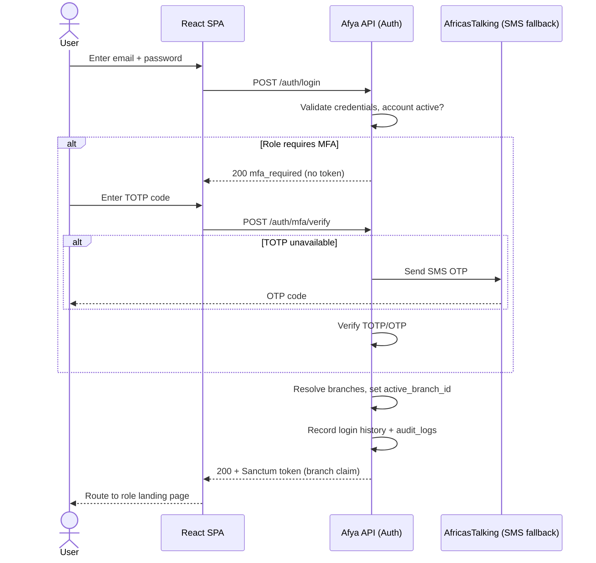
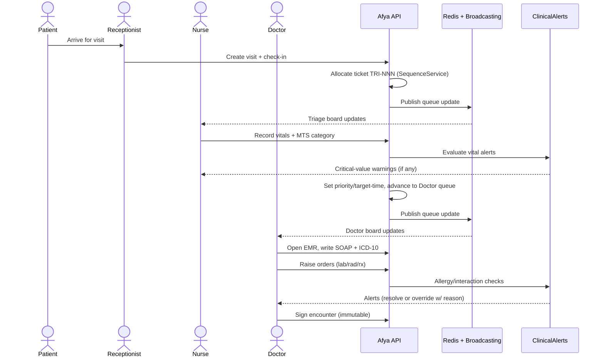
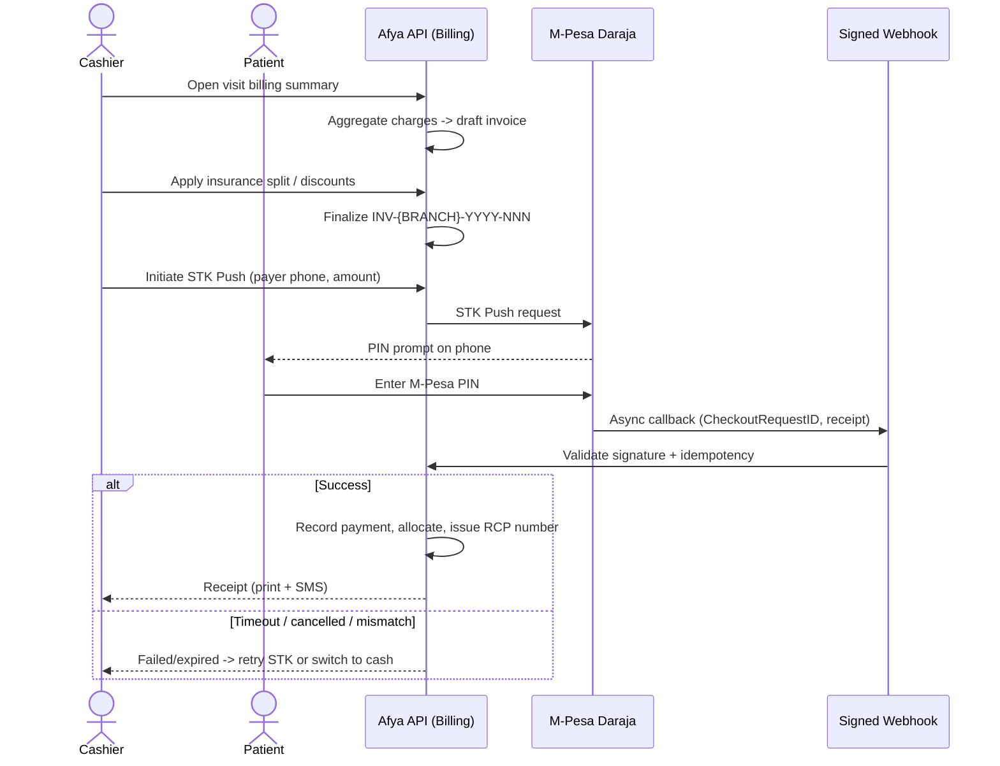
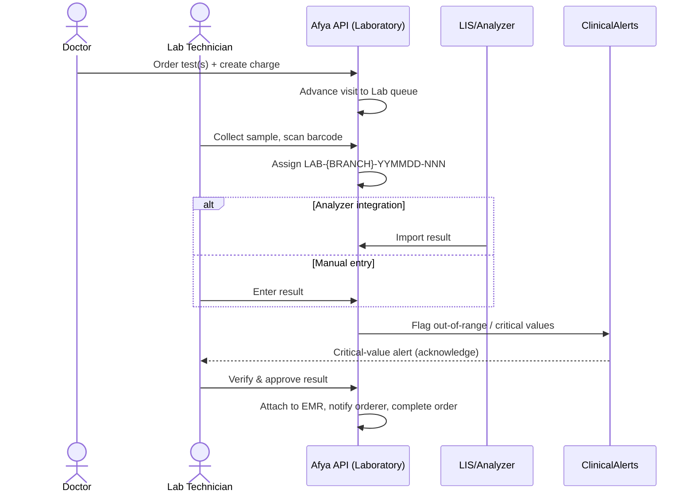

# 07 — Use Cases

> **Authority:** This document derives from `00-foundation.md`. All identifiers, roles, modules,
> triage rules, queue pipeline, payment/insurance gateways, and tenancy rules are inherited from
> the foundation. If anything here contradicts `00-foundation.md`, the foundation wins.

**Product:** Afya HMS · **Context:** Private multi-branch hospital, Kenya · **Doc version:** 1.0
**Scope:** Detailed, fully-specified use cases for the major operational and clinical flows.

---

## 1. Conventions used in this document

- **UC ID** format: `UC-{MODULE}-{NN}` (e.g. `UC-PAT-01`). Module codes map to foundation modules.
- **Actors** reference canonical role slugs from `00-foundation.md §5` (`receptionist`, `doctor`,
  `nurse`, `pharmacist`, `lab-technician`, `radiologist`, `cashier`, `records-officer`,
  `hospital-admin`, `patient`) plus **System actors**: `System` (the Afya backend),
  `M-Pesa Daraja`, `SHA Gateway`, `AfricasTalking (SMS)`, `LIS/Analyzer`, `PACS/Modality`.
- **Preconditions** assume the actor is authenticated (`UC-AUTH-01`) and has an `active_branch_id`
  unless the use case is the login/branch flow itself.
- All operational writes occur within the actor's `active_branch_id` per the `BranchScope` rule
  (`00-foundation.md §4`). All money is `KES`, `DECIMAL(12,2)`. All IDs follow `00-foundation.md §3`.
- **MSS** = Main Success Scenario. **AF** = Alternate Flow. **EF** = Exception Flow. **BR** = Business Rule.

---

## 2. Use-case index

| UC ID | Name | Primary actor(s) | Module(s) | Trigger |
|---|---|---|---|---|
| UC-AUTH-01 | Login + MFA | Any user | Auth | User opens app / session expired |
| UC-AUTH-02 | Branch switch | Multi-branch user | Tenancy, Auth | User selects a different branch |
| UC-PAT-01 | Register patient (walk-in / appointment / emergency) | Receptionist, Records Officer, Nurse | Patients | New patient presents |
| UC-APT-01 | Book appointment | Receptionist, Patient | Appointments | Patient requests a slot |
| UC-QUE-01 | Check-in & issue queue ticket | Receptionist | Queue, Appointments | Patient arrives for visit |
| UC-TRI-01 | Triage assessment (MTS) | Nurse | Triage, Queue | Patient reaches triage station |
| UC-EMR-01 | Doctor consultation + SOAP note | Doctor | EMR, Queue, ClinicalAlerts | Patient reaches doctor |
| UC-LAB-01 | Order lab test → sample → result → approval | Doctor, Lab Technician | Laboratory, EMR | Doctor orders a test |
| UC-RAD-01 | Radiology order → study | Doctor, Radiologist | Radiology, EMR | Doctor orders imaging |
| UC-PHA-01 | Prescribe → dispense (with interaction check) | Doctor, Pharmacist | Pharmacy, ClinicalAlerts | Doctor prescribes drugs |
| UC-BIL-01 | Generate invoice → M-Pesa STK → receipt | Cashier, Patient | Billing | Charges accrued / checkout |
| UC-INS-01 | SHA claim submission | Cashier, Records Officer | Insurance | Insured visit completed |
| UC-IPD-01 | Admit → ward/bed → discharge | Doctor, Nurse | Inpatient | Admission ordered |
| UC-INV-01 | Inventory PO → GRN → stock | Pharmacist, Hospital Admin | Inventory | Stock at/below reorder level |
| UC-POR-01 | Patient portal — view results | Patient | PatientPortal | Patient checks results online |

---

## 3. Authentication & Tenancy

### UC-AUTH-01 — Login + MFA

| Field | Value |
|---|---|
| **ID** | UC-AUTH-01 |
| **Actors** | Any user (primary), `System`, `AfricasTalking (SMS)` (fallback OTP), TOTP app |
| **Module** | Auth |

**Preconditions**
- User account exists, is active, and is assigned ≥1 branch.
- For `hospital-admin`, `doctor`, `pharmacist`, MFA (TOTP) is **enrolled** (foundation §5).

**Postconditions (success)**
- A Sanctum token is issued with an `active_branch_id` claim.
- Login event recorded in `login history` with device + IP; `audit_logs` entry written.

**Main Success Scenario**
1. User submits email + password to `POST /auth/login`.
2. System validates credentials (FormRequest) and that the account is active and not locked.
3. System checks the role requires MFA. If yes, System returns an `mfa_required` challenge (no token yet).
4. User submits the 6-digit TOTP code to `POST /auth/mfa/verify`.
5. System verifies the TOTP against the stored secret (±1 time-step window).
6. System resolves the user's branches; if exactly one, sets it as `active_branch_id`. If multiple, sets the **home branch** as default.
7. System issues the Sanctum token, records login history (device, IP, timestamp), writes an `audit_logs` entry.
8. SPA stores the token and routes the user to their role landing page.

**Alternate Flows**
- **AF-1 (no MFA required):** At step 3, role is not privileged → skip to step 6, issue token directly.
- **AF-2 (multiple branches):** At step 6, user is prompted to pick a branch (or accept home branch) → see UC-AUTH-02.
- **AF-3 (TOTP unavailable):** At step 4, user chooses "use SMS code"; System sends an OTP via AfricasTalking to the registered phone; user submits it; verification proceeds as step 5.

**Exception Flows**
- **EF-1 (bad credentials):** Step 2 fails → increment failed-attempt counter; generic error; no account-existence leak.
- **EF-2 (account locked):** After N failed attempts (policy), account is temporarily locked; System returns a lockout message and notifies the user.
- **EF-3 (invalid/expired TOTP):** Step 5 fails → re-prompt; after N failures, force re-auth from step 1.
- **EF-4 (password expired):** Step 2 detects expired password → force password-reset flow before token issuance.
- **EF-5 (idle session timeout):** Existing session idle beyond policy → token invalidated; user must repeat UC-AUTH-01.

**Business Rules**
- **BR-1:** MFA mandatory for `hospital-admin`, `doctor`, `pharmacist`.
- **BR-2:** Passwords subject to expiry policy; idle-session timeout enforced server-side.
- **BR-3:** All login attempts (success/fail) are auditable; PHI is never returned pre-auth.
- **BR-4:** Rate limiting applies to `login` and `mfa/verify` endpoints.

---

### UC-AUTH-02 — Branch switch

| Field | Value |
|---|---|
| **ID** | UC-AUTH-02 |
| **Actors** | Multi-branch user (primary), `System` |
| **Module** | Tenancy, Auth |

**Preconditions**
- User is authenticated and has access to ≥2 branches.

**Postconditions (success)**
- `active_branch_id` updated in session/token claim; all subsequent `BranchScope` queries filter to the new branch.

**Main Success Scenario**
1. User opens the branch switcher (UI control, foundation §4).
2. System lists branches the user may access (from user-branch grants).
3. User selects a target branch.
4. System validates the user still has access and the branch `is_active`.
5. System updates `active_branch_id` in the token/session claim and writes an `audit_logs` entry.
6. SPA invalidates branch-scoped TanStack Query caches and refetches the active workspace.

**Alternate Flows**
- **AF-1 (view-all role):** A user with `branch.view-all` (e.g. `hospital-admin`) may select "All branches" for reporting contexts only; operational writes still require a concrete branch.

**Exception Flows**
- **EF-1 (access revoked):** Step 4 fails → switch denied; user remains on previous branch; audit logged.
- **EF-2 (branch inactive):** Selected branch `is_active = false` → blocked with an explanatory message.
- **EF-3 (unsaved work):** Pending writes in current branch → SPA warns before switching to avoid cross-branch leakage.

**Business Rules**
- **BR-1:** A user has exactly one **home branch** and zero-or-more additional grants.
- **BR-2:** Global reference data (drug catalog, ICD-10, settings) is not branch-scoped and is unaffected by switching.
- **BR-3:** Branch switch never grants permissions; RBAC is evaluated independently per request.

---

## 4. Patient registration & appointments

### UC-PAT-01 — Register patient (walk-in / appointment / emergency)

| Field | Value |
|---|---|
| **ID** | UC-PAT-01 |
| **Actors** | Receptionist (primary, walk-in/appointment), Nurse/Records Officer (emergency), `System`, `SequenceService` |
| **Module** | Patients |

**Preconditions**
- Actor has `patients.create` and an active branch.

**Postconditions (success)**
- A patient record exists with a `PAT-YYYY-000001` number and a `public_id` UUID.
- The patient is associated with the registering `branch_id` (home/registered branch).

**Main Success Scenario (walk-in)**
1. Actor searches existing patients by name / phone / National ID / patient number to avoid duplicates.
2. System returns potential matches (fuzzy on name + DOB + phone).
3. Actor confirms "no match — new patient" and opens the registration form.
4. Actor enters demographics: legal name, DOB/age, sex, phone, National ID (optional), next of kin, residence, and insurance (SHA) details if any.
5. System validates input (FormRequest); National ID stored but **never** used as primary key (foundation §3).
6. Actor submits; `SequenceService` allocates the next `patient:YYYY` value inside a `SELECT … FOR UPDATE` transaction and forms `PAT-YYYY-000001`.
7. System persists the patient, generates `public_id` UUID, writes `audit_logs`.
8. System returns the patient record; actor proceeds to check-in (UC-QUE-01) or appointment (UC-APT-01).

**Alternate Flows**
- **AF-1 (appointment-based):** Patient pre-registered online or by phone; at step 3 the actor opens the existing draft/appointment record and only **verifies/completes** demographics, then check-in proceeds.
- **AF-2 (existing patient):** Step 2 returns a confident match → actor selects it; no new record created; proceed to check-in. Demographic deltas updated under audit.
- **AF-3 (emergency / unidentified):** A Nurse/Records Officer registers a provisional "John/Jane Doe Unknown" record with minimum data and **emergency** visit type so triage and care begin immediately; identity is reconciled later (AF-4).
- **AF-4 (identity reconciliation):** Once a Doe patient is identified, Records Officer merges/updates the provisional record into a full one, preserving the clinical timeline under audit.

**Exception Flows**
- **EF-1 (validation error):** Step 5 fails → field-level errors returned; nothing persisted.
- **EF-2 (suspected duplicate):** High-confidence match found after submit → System blocks and forces explicit "create anyway" with reason, or merge.
- **EF-3 (sequence contention):** Concurrent registration → `FOR UPDATE` serializes allocation; gaps tolerated; uniqueness guaranteed.

**Business Rules**
- **BR-1:** Patient number is per-year, zero-padded 6, never reused, never the National ID.
- **BR-2:** Emergency registration must **never** be blocked by missing demographics or billing.
- **BR-3:** Minimum viable identity for non-emergency: legal name + (DOB or age) + sex + one contact.
- **BR-4:** Clinical records are retained ≥10 years and are never hard-deleted (foundation §11).

---

### UC-APT-01 — Book appointment

| Field | Value |
|---|---|
| **ID** | UC-APT-01 |
| **Actors** | Receptionist (primary) or Patient (portal), `System`, `AfricasTalking (SMS)` |
| **Module** | Appointments |

**Preconditions**
- Patient record exists (UC-PAT-01) or is created inline.
- Target provider/department has a published schedule with open slots.

**Postconditions (success)**
- An appointment is booked for a specific provider, date, time, and branch.
- Confirmation + reminder notifications are scheduled.

**Main Success Scenario**
1. Actor selects branch, department/specialty, and provider (or "any available").
2. System shows available slots from the provider schedule (FullCalendar).
3. Actor selects a slot and links the patient (existing or newly created).
4. Actor enters reason for visit and appointment type (new / follow-up / review).
5. System validates the slot is still free and within working hours (FormRequest).
6. System persists the appointment, marks the slot reserved, writes `audit_logs`.
7. System schedules an SMS/email confirmation and a reminder (e.g. T-24h) via the notification abstraction.

**Alternate Flows**
- **AF-1 (patient self-booking):** Patient books via portal; only slots permitted for self-service are shown; same persistence path.
- **AF-2 (reschedule):** Actor opens an existing appointment, picks a new slot; old slot released, new reserved; reschedule notification sent.
- **AF-3 (cancel):** Actor cancels; slot released; cancellation notification sent; reason captured.
- **AF-4 (waitlist):** No slots available → patient added to a waitlist; notified if a slot frees up.

**Exception Flows**
- **EF-1 (slot taken — race):** Step 5 detects the slot was just taken → System offers nearest alternatives.
- **EF-2 (provider unavailable):** Schedule change/leave → affected appointments flagged for rescheduling; patients notified.
- **EF-3 (notification failure):** SMS provider error → appointment still booked; notification retried via queue; failure logged.

**Business Rules**
- **BR-1:** No double-booking of a provider slot (enforced at persistence with a uniqueness/locking guard).
- **BR-2:** Appointments are branch-scoped; cross-branch booking requires the user to switch branch first.
- **BR-3:** Reminder cadence is configurable per branch/department.

---

## 5. Queue & triage

### UC-QUE-01 — Check-in & issue queue ticket

| Field | Value |
|---|---|
| **ID** | UC-QUE-01 |
| **Actors** | Receptionist (primary), `System` (Redis + Broadcasting) |
| **Module** | Queue, Appointments |

**Preconditions**
- Patient is registered (UC-PAT-01). For scheduled visits, an appointment exists (UC-APT-01).

**Postconditions (success)**
- A visit is created and a queue ticket `{DEPT}-{NNN}` (daily reset) is issued at the entry station.
- The queue board updates in real time at the relevant station.

**Main Success Scenario**
1. Actor locates the patient (search or scan appointment).
2. Actor confirms identity and visit type (general OPD, specialty, emergency, review).
3. System creates a **visit** and determines the first queue station per the pipeline `Reception → Triage → Doctor → Lab → Pharmacy → Billing` (foundation §13).
4. System allocates the next daily ticket number for that department via `SequenceService` (e.g. `TRI-014`).
5. System places the visit in the target queue with default priority and publishes the update to Redis; the station board re-renders via Broadcasting.
6. Actor prints/SMS-sends the ticket to the patient.

**Alternate Flows**
- **AF-1 (appointment check-in):** Scheduled patient checked in within the grace window → marked "arrived"; queued with appointment priority.
- **AF-2 (emergency bypass):** Visit type = emergency → routed straight to Triage with elevated priority; may bypass reception queue (foundation §12–13).
- **AF-3 (direct-to-billing visit):** Visit needing only payment (e.g. report collection) skips clinical stations and enters Billing queue.

**Exception Flows**
- **EF-1 (late arrival):** Beyond appointment grace window → treated as walk-in or offered reschedule per policy.
- **EF-2 (duplicate active visit):** Patient already has an open visit today → System warns and links to the existing visit instead of creating a new one.
- **EF-3 (Redis/broadcast outage):** Real-time board degraded → ticket still issued and persisted in MySQL; board falls back to polling; incident logged.

**Business Rules**
- **BR-1:** Ticket numbers reset daily, per department, per branch.
- **BR-2:** Priority and emergency bypass are honored at **every** station (foundation §13).
- **BR-3:** A queue entry always belongs to exactly one visit and one branch.

---

### UC-TRI-01 — Triage assessment (Manchester Triage System)

| Field | Value |
|---|---|
| **ID** | UC-TRI-01 |
| **Actors** | Nurse (primary), `System`, `ClinicalAlerts` |
| **Module** | Triage, Queue, ClinicalAlerts |

**Preconditions**
- Visit exists and is in the Triage queue (UC-QUE-01).

**Postconditions (success)**
- Vitals and an MTS category (Red/Orange/Yellow/Green/Blue) are recorded.
- The visit's queue priority and target-time are set from the MTS category; visit advances toward Doctor.

**Main Success Scenario**
1. Nurse calls the next ticket from the Triage board (priority-ordered).
2. Nurse records vitals: BP, HR, RR, SpO₂, temperature, pain score, weight/height (BMI), blood glucose as applicable.
3. Nurse selects the presenting complaint and works the MTS discriminators.
4. System suggests/confirms an MTS category and its target time: Red = immediate, Orange ≤10 min, Yellow ≤60 min, Green ≤120 min, Blue ≤240 min (foundation §12).
5. System evaluates `ClinicalAlerts` on vitals (e.g. critical SpO₂, hypotension) and surfaces warnings.
6. Nurse confirms; System persists the triage record, sets queue priority/target-time, advances the visit to the Doctor queue, and broadcasts the board update.

**Alternate Flows**
- **AF-1 (Red — immediate):** MTS = Red → visit jumps the Doctor/resus queue immediately; on-call team notified.
- **AF-2 (re-triage):** Condition changes while waiting → Nurse re-triages; category and priority updated; timeline preserved.
- **AF-3 (direct discharge from triage):** Minor case routed to a defined fast-track per policy.

**Exception Flows**
- **EF-1 (incomplete vitals):** Equipment issue → Nurse may record a partial set with a documented reason; category still assignable.
- **EF-2 (alert override):** Nurse acknowledges a critical alert with a clinical note; acknowledgment audited.
- **EF-3 (deterioration in queue):** SLA target breached → board flags overdue patients for escalation.

**Business Rules**
- **BR-1:** MTS category drives queue priority and emergency bypass system-wide.
- **BR-2:** Every triage assessment is timestamped and attributable to the assessing nurse.
- **BR-3:** Critical-value alerts must be acknowledged, not silently dismissed.

---

## 6. Clinical encounter

### UC-EMR-01 — Doctor consultation + SOAP note

| Field | Value |
|---|---|
| **ID** | UC-EMR-01 |
| **Actors** | Doctor (primary), `System`, `ClinicalAlerts` |
| **Module** | EMR, Queue, ClinicalAlerts |

**Preconditions**
- Visit exists and is in the Doctor queue, triaged (UC-TRI-01).
- Doctor has `emr.create` / consultation permissions.

**Postconditions (success)**
- A SOAP-structured encounter note is saved against the visit.
- Diagnoses (ICD-10) and any orders (lab/radiology/prescription) are linked to the encounter.

**Main Success Scenario**
1. Doctor calls the next ticket from the Doctor board (priority-ordered).
2. System opens the patient EMR: history, allergies, problems, meds, triage vitals, prior encounters.
3. Doctor documents **S**ubjective (complaint/history).
4. Doctor documents **O**bjective (exam findings; triage vitals pre-populated).
5. Doctor records **A**ssessment with one or more **ICD-10** diagnoses.
6. Doctor records **P**lan: investigations, prescriptions, referrals, follow-up.
7. From the Plan, Doctor raises orders: lab (UC-LAB-01), radiology (UC-RAD-01), prescription (UC-PHA-01).
8. System runs allergy/interaction `ClinicalAlerts` against recorded allergies and active meds.
9. Doctor signs the encounter; System persists the SOAP note, links orders/diagnoses, advances the visit to the next pipeline station, and writes `audit_logs`.

**Alternate Flows**
- **AF-1 (follow-up/review):** Prior encounter carried forward; Doctor amends Plan and closes.
- **AF-2 (referral out):** Doctor records an external referral; referral letter generated as a PDF document.
- **AF-3 (admit):** Plan = admission → triggers UC-IPD-01.
- **AF-4 (results-pending recall):** Patient sent to Lab/Radiology and re-queued to Doctor for result review after results return.

**Exception Flows**
- **EF-1 (allergy/interaction alert):** Step 8 raises an alert → Doctor must resolve (change order) or override with a documented reason (audited).
- **EF-2 (incomplete SOAP):** Attempt to sign without minimum required fields → blocked with validation errors.
- **EF-3 (amend after sign):** Post-signature change creates an **addendum** (append-only); original note immutable.

**Business Rules**
- **BR-1:** A signed encounter is immutable; corrections are addenda, never overwrites (retention/audit).
- **BR-2:** Diagnoses use ICD-10 (global reference, not branch-scoped).
- **BR-3:** Orders inherit the encounter's `branch_id` and patient context.
- **BR-4:** Critical interaction/allergy alerts require explicit acknowledgment or override-with-reason.

---

## 7. Diagnostics

### UC-LAB-01 — Order lab test → sample → result → approval

| Field | Value |
|---|---|
| **ID** | UC-LAB-01 |
| **Actors** | Doctor (orders), Lab Technician (collect/result), `System`, `LIS/Analyzer` (optional), `Cashier` (billing) |
| **Module** | Laboratory, EMR, Billing |

**Preconditions**
- An encounter exists (UC-EMR-01) with a lab order, or a standalone lab order is authorized.

**Postconditions (success)**
- Result is recorded, **approved/verified**, attached to the EMR, and the orderer notified.
- Charges posted to billing; visit advances per pipeline.

**Main Success Scenario**
1. Doctor selects test(s) from the lab catalog; System creates a lab order and a billing charge.
2. Visit advances to Lab queue; patient settles/insurance-covers the charge per billing policy.
3. Lab Technician collects the sample, scans/prints a barcode, and the System assigns a sample ID `LAB-{BRANCH}-YYMMDD-0001` (foundation §3).
4. Technician marks the sample collected and (optionally) received by the analyzer.
5. Result is captured — entered manually or imported from `LIS/Analyzer`.
6. System flags out-of-range values against reference ranges and raises critical-value `ClinicalAlerts`.
7. A senior/authorized technician (or pathologist) **verifies and approves** the result.
8. System attaches the approved result to the EMR, notifies the ordering doctor, marks the order complete, writes `audit_logs`.

**Alternate Flows**
- **AF-1 (urgent/STAT):** Order flagged STAT → prioritized in the lab queue; orderer alerted on approval immediately.
- **AF-2 (add-on test):** Additional test on an existing sample → new order, reuses sample if viable.
- **AF-3 (external reference lab):** Test sent out → status "sent"; result entered on return and approved.

**Exception Flows**
- **EF-1 (sample rejection):** Hemolyzed/insufficient/mislabeled → sample rejected with reason; recollection requested; patient/orderer notified.
- **EF-2 (critical result):** Step 6 critical value → mandatory critical-value notification to the orderer; acknowledgment recorded.
- **EF-3 (analyzer mismatch):** Imported result fails QC/validation → held for manual review, not auto-approved.
- **EF-4 (unpaid blocking test):** If branch policy requires payment first and charge unpaid → sample collection blocked until cleared (except emergency).

**Business Rules**
- **BR-1:** A result is not visible in EMR/portal until **approved** by an authorized verifier.
- **BR-2:** Sample IDs are barcoded, branch- and date-scoped, unique.
- **BR-3:** Critical values require explicit acknowledgment.
- **BR-4:** Emergency orders are never blocked by unpaid charges.

---

### UC-RAD-01 — Radiology order → study

| Field | Value |
|---|---|
| **ID** | UC-RAD-01 |
| **Actors** | Doctor (orders), Radiologist + Radiographer (acquire/report), `System`, `PACS/Modality` |
| **Module** | Radiology, EMR, Billing |

**Preconditions**
- Encounter exists with a radiology order (UC-EMR-01) or an authorized standalone order.

**Postconditions (success)**
- Imaging study acquired, a verified radiology report attached to EMR, orderer notified; charges posted.

**Main Success Scenario**
1. Doctor selects modality/exam (X-ray, US, CT, etc.); System creates a radiology order + billing charge.
2. System assigns a study ID `RAD-{BRANCH}-YYMMDD-0001` (foundation §3); visit advances to Radiology.
3. Radiographer performs safety checks (pregnancy/contrast/allergy) and acquires images.
4. Images are stored to the document store / `PACS`; signed-URL access only (foundation §7).
5. Radiologist reviews images and dictates/writes a structured report.
6. Radiologist **verifies and signs** the report.
7. System attaches the signed report to the EMR, notifies the orderer, marks the study complete, writes `audit_logs`.

**Alternate Flows**
- **AF-1 (contrast study):** Pre-screening + consent captured; contrast administration recorded.
- **AF-2 (STAT imaging):** Prioritized; preliminary "wet read" issued, then finalized.
- **AF-3 (repeat/additional views):** Extra images appended to the same study.

**Exception Flows**
- **EF-1 (safety contraindication):** Pregnancy/contrast risk at step 3 → study held; orderer consulted; alternative arranged.
- **EF-2 (image QC fail):** Poor image quality → re-acquisition before reporting.
- **EF-3 (critical finding):** Urgent finding → immediate notification to orderer with acknowledgment.

**Business Rules**
- **BR-1:** Images and reports are served only via time-limited signed URLs; no public access (foundation §7, §11).
- **BR-2:** Report visible in EMR/portal only after radiologist sign-off.
- **BR-3:** Safety screening is mandatory before acquisition.

---

## 8. Pharmacy

### UC-PHA-01 — Prescribe → dispense (with drug interaction check)

| Field | Value |
|---|---|
| **ID** | UC-PHA-01 |
| **Actors** | Doctor (prescribe), Pharmacist (dispense), `System`, `ClinicalAlerts`, `Cashier` |
| **Module** | Pharmacy, ClinicalAlerts, Billing, Inventory |

**Preconditions**
- Encounter exists (UC-EMR-01). Pharmacist has `prescriptions.dispense`. MFA applies to doctor and pharmacist (foundation §5).

**Postconditions (success)**
- A prescription `RX-{BRANCH}-YYYY-000001` (QR-coded) is created, dispensed, billed, and stock decremented.

**Main Success Scenario**
1. Doctor selects drugs from the catalog, sets dose/route/frequency/duration/quantity.
2. System runs `ClinicalAlerts`: drug–drug interactions, drug–allergy, duplicate therapy, dose range, contraindications.
3. Doctor resolves any alerts (adjust) or overrides with a documented reason; System creates the prescription with a QR code and posts a provisional billing charge.
4. Visit advances to Pharmacy queue.
5. Pharmacist retrieves the prescription (scan QR / search) and reviews clinical appropriateness and stock.
6. Pharmacist confirms payment status with Billing (or insurance coverage) per policy.
7. Pharmacist dispenses; System decrements inventory (batch/expiry, FEFO), records the dispensing event.
8. System finalizes the billing charge, marks the prescription dispensed, writes `audit_logs`, and counsels/labels are printed.

**Alternate Flows**
- **AF-1 (partial dispense):** Insufficient stock → dispense available quantity; balance back-ordered or substituted (AF-2); patient informed.
- **AF-2 (generic/therapeutic substitution):** With doctor or protocol approval, an equivalent is dispensed and recorded.
- **AF-3 (inpatient dispensing):** Ward-based administration via MAR; charges to the admission, not OPD checkout.

**Exception Flows**
- **EF-1 (interaction/allergy alert):** Step 2 critical alert → prescription blocked until resolved or override-with-reason (audited).
- **EF-2 (out of stock):** No stock and no substitute → prescription flagged unfilled; orderer notified; triggers reorder (UC-INV-01).
- **EF-3 (expired/recalled batch):** Selected batch expired/recalled → blocked; FEFO forces the correct batch.
- **EF-4 (unpaid):** Payment required and unsettled → dispensing held (except emergency/inpatient policy).

**Business Rules**
- **BR-1:** Dispensing requires explicit resolution/override of critical interaction & allergy alerts.
- **BR-2:** Stock decrements by **FEFO** (first-expiry-first-out) with batch/expiry tracking.
- **BR-3:** Controlled substances require additional authorization and are fully audited.
- **BR-4:** Prescription carries a QR code; `RX` numbering is per-branch, per-year.

---

## 9. Billing & insurance

### UC-BIL-01 — Generate invoice → M-Pesa STK payment → receipt

| Field | Value |
|---|---|
| **ID** | UC-BIL-01 |
| **Actors** | Cashier (primary), Patient, `System`, `M-Pesa Daraja`, `AfricasTalking (SMS)` |
| **Module** | Billing |

**Preconditions**
- The visit has accrued chargeable items (consultation, lab, radiology, pharmacy, procedures).

**Postconditions (success)**
- An invoice `INV-{BRANCH}-YYYY-000001` is generated; a verified M-Pesa payment posts a receipt `RCP-{BRANCH}-YYYY-000001`.
- Visit advances/closes; receipt issued to patient.

**Main Success Scenario**
1. Cashier opens the visit's billing summary; System aggregates all charges into a draft invoice.
2. Cashier applies any insurance split (SHA portion vs. patient co-pay) and discounts per policy.
3. System finalizes the invoice number via `SequenceService` and shows the patient-payable balance.
4. Cashier (or patient) selects **M-Pesa STK Push**; enters/confirms the payer phone number and amount.
5. System calls `M-Pesa Daraja` STK Push; the patient receives a prompt on their phone and enters their PIN.
6. M-Pesa sends an asynchronous callback to a **signed webhook**; System validates and processes it **idempotently** by `CheckoutRequestID` / `mpesa_receipt` (foundation §9).
7. On success, System records the payment, allocates it to the invoice, generates the receipt number, and updates the balance.
8. System issues the receipt (print + SMS/email), advances/closes the visit, writes `audit_logs`.

**Alternate Flows**
- **AF-1 (cash payment):** `CashGateway` used → cashier records cash tendered/change; receipt issued immediately.
- **AF-2 (Paybill/Till manual reconcile):** Patient pays via Paybill/Till → System matches the incoming confirmation to the invoice by reference.
- **AF-3 (partial payment):** Patient pays part → invoice balance remains; further payments allocated until cleared.
- **AF-4 (insurance-covered):** Patient-payable = 0 → invoice closed against the SHA claim (UC-INS-01); no STK needed.

**Exception Flows**
- **EF-1 (STK timeout / cancelled):** No callback or user cancels → payment marked failed/expired; cashier may retry STK or switch to cash.
- **EF-2 (duplicate callback):** Repeated callback for the same `CheckoutRequestID` → ignored idempotently (no double credit).
- **EF-3 (amount mismatch):** Callback amount ≠ requested → flagged for manual reconciliation; no auto-receipt.
- **EF-4 (callback unreachable):** Webhook delivery delayed → System reconciles via Daraja transaction-status query (queued retry).

**Business Rules**
- **BR-1:** All M-Pesa callbacks are idempotent and signature-verified.
- **BR-2:** Money is `KES`, `DECIMAL(12,2)`; never floats; invoice/receipt numbers are per-branch, per-year.
- **BR-3:** A receipt is issued only against a **verified** payment.
- **BR-4:** Emergency care is delivered first; billing follows (no payment gate on emergency clinical steps).

---

### UC-INS-01 — SHA claim submission

| Field | Value |
|---|---|
| **ID** | UC-INS-01 |
| **Actors** | Cashier/Accountant (primary), Records Officer, `System`, `SHA Gateway` |
| **Module** | Insurance (SHA), Billing |

**Preconditions**
- Patient has valid SHA membership; the visit produced claimable services.
- Required documentation (diagnosis ICD-10, itemized charges, supporting docs) is available.

**Postconditions (success)**
- A claim `CLM-{BRANCH}-YYYY-00001` is submitted to SHA and tracked to adjudication.

**Main Success Scenario**
1. Actor verifies SHA eligibility/benefit for the patient (pre-auth where required).
2. System assembles the claim: patient + membership, ICD-10 diagnoses, itemized services from the invoice, attachments.
3. System validates completeness against SHA rules and allocates the claim number.
4. Actor submits the claim via the `ShaGateway` (foundation §9).
5. SHA acknowledges receipt; System stores the acknowledgment and sets status "submitted".
6. System tracks adjudication updates (approved / partially approved / queried / rejected).
7. On approval, System reconciles the SHA-paid amount against the invoice; any patient co-pay follows UC-BIL-01.

**Alternate Flows**
- **AF-1 (pre-authorization):** Service requires pre-auth → request and obtain authorization before/at submission; auth code attached.
- **AF-2 (batch submission):** Multiple claims batched for a period and submitted together.
- **AF-3 (resubmission):** Queried claim corrected and resubmitted with the same lineage.

**Exception Flows**
- **EF-1 (ineligible member):** Step 1 fails → service billed to patient (UC-BIL-01); patient informed.
- **EF-2 (validation failure):** Step 3 fails → claim held with a checklist of missing items.
- **EF-3 (rejection):** SHA rejects → reason recorded; appeal or rebill to patient per policy.
- **EF-4 (gateway downtime):** `SHA Gateway` unavailable → claim queued and retried; not lost.

**Business Rules**
- **BR-1:** `InsurerGateway` abstraction isolates SHA specifics; future insurers pluggable (foundation §9).
- **BR-2:** Claims are branch-scoped; numbering per-branch, per-year.
- **BR-3:** Every claim status transition is auditable.

---

## 10. Inpatient

### UC-IPD-01 — Admit → ward/bed → discharge

| Field | Value |
|---|---|
| **ID** | UC-IPD-01 |
| **Actors** | Doctor (admit/discharge), Nurse (ward care), `System`, Cashier (final bill) |
| **Module** | Inpatient, EMR, Billing |

**Preconditions**
- A doctor's admission order exists (UC-EMR-01 AF-3). A bed is available in the target ward.

**Postconditions (success)**
- An admission `ADM-{BRANCH}-YYYY-00001` is created, a bed allocated, inpatient care recorded, and on discharge the bed is released and the stay billed.

**Main Success Scenario**
1. Doctor places an admission order specifying ward type and provisional diagnosis.
2. System creates the admission, allocates number `ADM-{BRANCH}-YYYY-00001`, and shows the ward/bed board.
3. Nurse assigns an available bed; System marks the bed occupied and links it to the admission.
4. Care team records ongoing care: vitals rounds, nursing notes, MAR (medication administration), ward orders, daily progress (SOAP).
5. Bed-day, drug, procedure, and investigation charges accrue to the admission.
6. Doctor writes a discharge summary, discharge meds, and follow-up plan.
7. System releases the bed, triggers final billing (UC-BIL-01) and any SHA claim (UC-INS-01), and closes the admission with `audit_logs`.

**Alternate Flows**
- **AF-1 (transfer):** Patient moved between beds/wards/branches → previous bed released, new allocated; continuity preserved.
- **AF-2 (ICU/escalation):** Level-of-care change updates ward, staffing, and charge profile.
- **AF-3 (DAMA):** Discharge Against Medical Advice → consent/disclaimer captured; admission closed with that status.
- **AF-4 (deceased):** Death recorded; mortuary/handover workflow; admission closed appropriately.

**Exception Flows**
- **EF-1 (no bed available):** Step 3 → patient held in a holding area / waitlisted; bed-manager notified.
- **EF-2 (billing hold at discharge):** Outstanding balance → discharge clearance workflow before release (except emergency/medico-legal).
- **EF-3 (readmission):** New admission within a defined window flagged for review/linkage.

**Business Rules**
- **BR-1:** A bed maps to exactly one active admission at a time.
- **BR-2:** Bed-days accrue per occupancy; transfers re-allocate cleanly without double-charging.
- **BR-3:** Admission, beds, and charges are branch-scoped; numbering per-branch, per-year.
- **BR-4:** Discharge summary is required to close an admission.

---

## 11. Inventory

### UC-INV-01 — Inventory PO → GRN → stock

| Field | Value |
|---|---|
| **ID** | UC-INV-01 |
| **Actors** | Pharmacist / Storekeeper (primary), Hospital Admin (approval), `System`, Supplier (external) |
| **Module** | Inventory, Pharmacy |

**Preconditions**
- Items exist in the catalog with reorder levels; supplier records exist.

**Postconditions (success)**
- A PO `PO-{BRANCH}-YYYY-0001` is raised, goods received via GRN, and stock updated with batch/expiry.

**Main Success Scenario**
1. System flags items at/below reorder level (or actor initiates a manual requisition).
2. Actor creates a purchase order: supplier, items, quantities, prices; System allocates `PO-{BRANCH}-YYYY-0001`.
3. Hospital Admin (or authorized approver) approves the PO per the approval threshold.
4. PO is sent to the supplier; status "ordered".
5. On delivery, actor records a **GRN**: matches delivered items/quantities to the PO, captures batch numbers and expiry dates.
6. System increments stock per batch (with expiry), updates valuation, and links the GRN to the PO.
7. System reconciles the supplier invoice against the PO/GRN (three-way match) and writes `audit_logs`.

**Alternate Flows**
- **AF-1 (partial delivery):** GRN records a partial receipt; PO stays open for the balance.
- **AF-2 (over/short/damaged):** Discrepancy recorded; only accepted quantity stocked; supplier notified.
- **AF-3 (inter-branch transfer):** Stock moved between branches via a transfer note; both branch balances updated.

**Exception Flows**
- **EF-1 (PO rejected):** Approver rejects → PO returned to draft with comments.
- **EF-2 (GRN mismatch):** Delivered ≠ ordered → blocked from full posting until reconciled.
- **EF-3 (expired/near-expiry receipt):** Goods at/near expiry → flagged; acceptance requires override with reason.
- **EF-4 (duplicate GRN):** Re-scan of the same delivery → prevented to avoid double-stocking.

**Business Rules**
- **BR-1:** Stock is tracked per **batch and expiry**; issuance is FEFO (consistent with UC-PHA-01).
- **BR-2:** POs require approval above the configured threshold.
- **BR-3:** Inventory, POs, and GRNs are branch-scoped; PO numbering per-branch, per-year.
- **BR-4:** Reorder alerts are configurable per item per branch.

---

## 12. Patient portal

### UC-POR-01 — Patient portal: view results

| Field | Value |
|---|---|
| **ID** | UC-POR-01 |
| **Actors** | Patient (primary), `System` |
| **Module** | PatientPortal, Documents |

**Preconditions**
- Patient has a portal account linked to their `public_id`; authenticated (UC-AUTH-01).

**Postconditions (success)**
- Patient views **approved** lab/radiology results and downloads documents via signed URLs; access is audited as PHI access.

**Main Success Scenario**
1. Patient logs in to the portal and opens "My Results".
2. System lists results/reports whose status is **approved/verified** and released for patient viewing.
3. Patient selects a result; System renders it and offers a download.
4. Document downloads use **time-limited signed URLs** (foundation §7).
5. System writes a PHI-access entry to `audit_logs` for every view/download.

**Alternate Flows**
- **AF-1 (sensitive results hold):** Certain results (per policy) are withheld from portal until reviewed/released by a clinician.
- **AF-2 (download invoice/receipt):** Patient downloads billing documents from the same portal.
- **AF-3 (dependant/proxy):** A linked guardian views a minor's results under a recorded proxy relationship.

**Exception Flows**
- **EF-1 (result not yet approved):** Pending result is not shown; portal indicates "in progress".
- **EF-2 (expired signed URL):** Stale link → System re-issues a fresh signed URL on demand.
- **EF-3 (unauthorized access attempt):** Access to another patient's record blocked and logged as a security event.

**Business Rules**
- **BR-1:** Only **approved** results are portal-visible (consistent with UC-LAB-01 BR-1, UC-RAD-01 BR-2).
- **BR-2:** All portal PHI access is audited (foundation §11).
- **BR-3:** No public document URLs; signed URLs only, time-limited.

---

## 13. Sequence / use-case diagrams (key flows)

### 13.1 Login + MFA (UC-AUTH-01)

### 13.2 Check-in → Triage → Doctor (UC-QUE-01 → UC-TRI-01 → UC-EMR-01)

### 13.3 Invoice → M-Pesa STK → Receipt (UC-BIL-01)

### 13.4 Lab order → sample → result → approval (UC-LAB-01)

---

## 14. Traceability notes

- Every use case writes to `audit_logs` for security/PHI-relevant events (foundation §11).
- Every operational use case is constrained by `BranchScope` and the active branch (foundation §4).
- Clinical artefacts (encounters, results, reports) are append-only/immutable after sign-off and retained
  ≥10 years; corrections are addenda (foundation §11).
- Queue movement across all clinical use cases follows the canonical pipeline and honors priority +
  emergency bypass (foundation §12–13).
- Detailed permission mappings for each use-case actor live in `08-rbac-matrix.md`.
