# 09 — System Architecture

> **Authority:** Subordinate to `00-foundation.md`. Where this document and the foundation
> disagree, the foundation wins. This document expands the foundation's architectural
> decisions into an exhaustive, buildable blueprint for Afya HMS.

**Product:** Afya HMS · **Context:** Private multi-branch hospital, Kenya · 100–300 patients/day · 1,000 users now, architected for 10,000+.
**Stack:** Laravel 11 / PHP 8.3+ · React 18 + TypeScript + Vite (SPA/PWA) · MySQL 8+ · Redis · Docker.
**Architecture style:** Modular Monolith (one deployable, internally bounded modules; no microservices).
**Document version:** 1.0 · **Status:** Architecture baseline

---

## Table of contents

1. [Architectural principles](#1-architectural-principles)
2. [C4 — Level 1: System Context](#2-c4--level-1-system-context)
3. [C4 — Level 2: Container view](#3-c4--level-2-container-view)
4. [High-level architecture diagram](#4-high-level-architecture-diagram)
5. [Modular monolith — module boundaries & dependencies](#5-modular-monolith--module-boundaries--dependencies)
6. [Request lifecycle (the canonical layered flow)](#6-request-lifecycle-the-canonical-layered-flow)
7. [Synchronous vs asynchronous processing](#7-synchronous-vs-asynchronous-processing)
8. [Real-time architecture (queue boards, alerts)](#8-real-time-architecture-queue-boards-alerts)
9. [Caching strategy (Redis layers)](#9-caching-strategy-redis-layers)
10. [Storage driver abstraction](#10-storage-driver-abstraction)
11. [External integrations](#11-external-integrations)
12. [Data flow diagrams (critical flows)](#12-data-flow-diagrams-critical-flows)
13. [Scaling strategy: 1k → 10k users](#13-scaling-strategy-1k--10k-users)
14. [Deployment topology](#14-deployment-topology)
15. [Technology decisions & rationale](#15-technology-decisions--rationale)
16. [Cross-cutting concerns](#16-cross-cutting-concerns)
17. [Failure modes & resilience](#17-failure-modes--resilience)

---

## 1. Architectural principles

These principles govern every decision below.

| # | Principle | Consequence |
|---|---|---|
| P1 | **Modular monolith, not microservices** | One deployable artifact; modules communicate in-process via service interfaces and the event bus, never over HTTP. Avoids distributed-systems tax while a single team scales the product. |
| P2 | **Stateless application tier** | No request state in app memory. Sessions, cache, queues, broadcasting, and locks live in Redis; files in object storage. Any app container can serve any request → trivial horizontal scale. |
| P3 | **Strict layering** | `Route → Controller → FormRequest → Service → Repository → Model`. Controllers thin; business rules only in services; persistence only in repositories. |
| P4 | **Explicit module boundaries** | A module exposes a public service contract + events + DTOs. Other modules depend on the contract, never on internal repositories/models. |
| P5 | **Async by default for side-effects** | The synchronous path commits the core domain transaction; everything else (notifications, claims, PDFs, alerts, audit fan-out) is queued. |
| P6 | **Provider abstraction at every external edge** | Payments, insurers, SMS/email, and storage all sit behind interfaces. Swapping a provider is a config + binding change. |
| P7 | **Row-level multi-tenancy** | Shared DB; `branch_id` on every operational table; `BranchScope` enforced globally. |
| P8 | **Security & auditability are not optional** | Sanctum auth, RBAC on every write, signed URLs for clinical files, immutable audit trail for PHI access. |

---

## 2. C4 — Level 1: System Context

Afya HMS as a single system, its users, and the external systems it depends on.

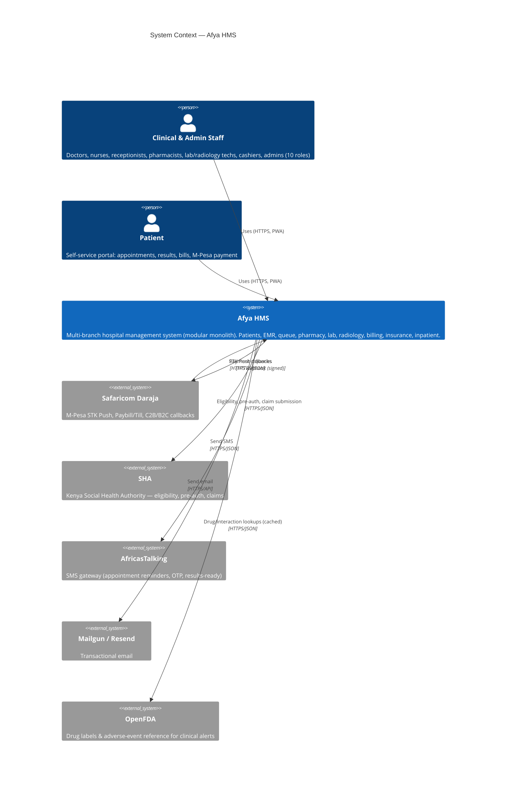

**Context narrative.** Staff and patients are the only human actors. Afya HMS owns all clinical and operational data. Five external systems are integrated, each behind an abstraction (foundation §7–9): payments (Daraja), insurance (SHA), SMS (AfricasTalking), email (Mailgun/Resend), and a clinical reference feed (OpenFDA). All inbound external traffic (Daraja callbacks) arrives on signed, idempotent webhook routes.

---

## 3. C4 — Level 2: Container view

The internal containers (deployable/runtime units) inside Afya HMS.

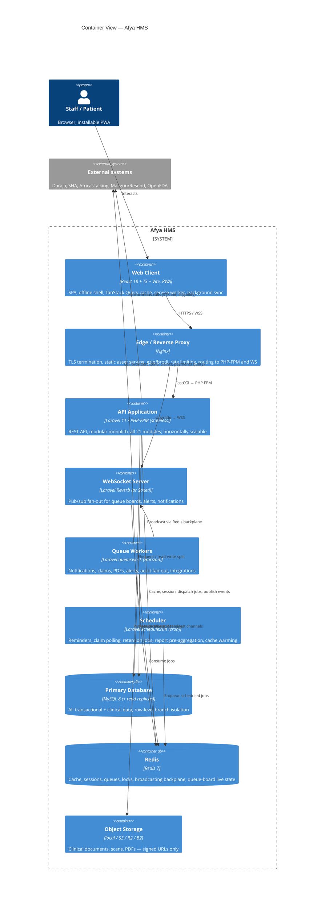

**Container responsibilities.**

- **Web Client (PWA)** — the only UI. Talks REST + WSS. Caches read data, queues writes offline, syncs on reconnect.
- **Nginx edge** — TLS, static assets, compression, coarse rate limiting, and routing (`/api/*` → PHP-FPM, `/app/*` → WebSocket upgrade, everything else → SPA shell/CDN).
- **API application** — the modular monolith. Identical image runs N times behind the proxy; fully stateless.
- **WebSocket server** — Laravel Reverb (first-party, Laravel 11 native) preferred; Soketi as drop-in alternative. Subscribes to the Redis backplane and fans messages to clients.
- **Queue workers** — same codebase, run as `queue:work`; supervised by **Horizon**. Tiered queues (see §7).
- **Scheduler** — single cron entrypoint (`schedule:run` every minute) that dispatches time-based jobs onto queues.
- **MySQL** — single writer + read replica(s). Read replicas added at scale (§13).
- **Redis** — multi-purpose backbone (cache, session, queue, lock, broadcast). Logically separated by DB index/prefix; physically separable at scale.
- **Object storage** — driver-abstracted; `local` for dev, S3/R2/B2 in cloud.

---

## 4. High-level architecture diagram

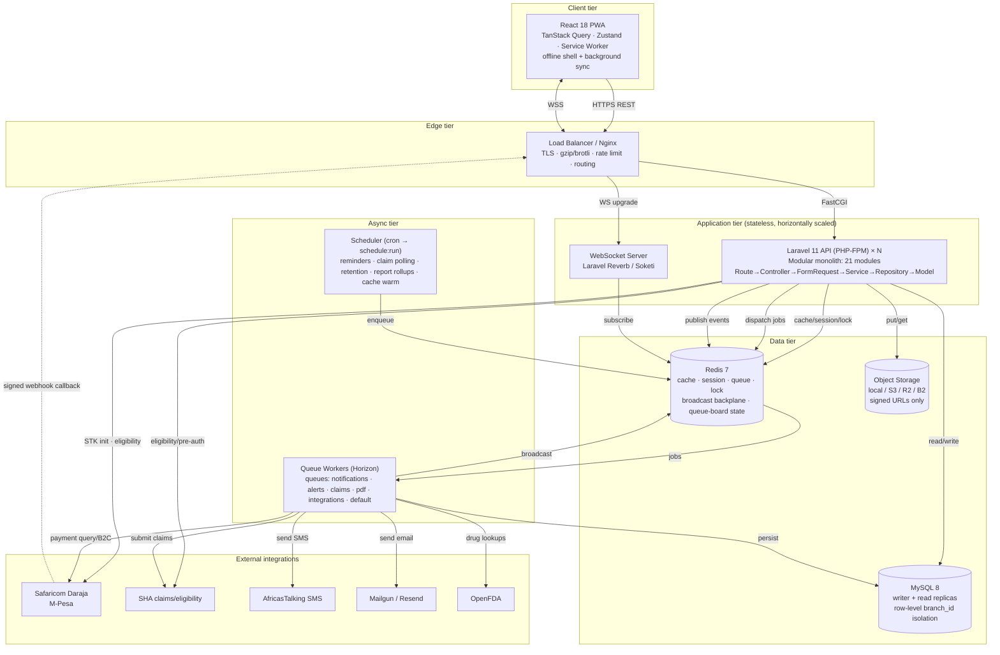

---

## 5. Modular monolith — module boundaries & dependencies

### 5.1 Module catalogue

The 21 bounded contexts from foundation §1, grouped by concern:

| Group | Modules |
|---|---|
| **Platform** | `Auth`, `Tenancy`, `Admin`, `Audit`, `Documents`, `Communication`, `Reporting` |
| **Front office** | `Patients`, `Appointments`, `Queue`, `Triage` |
| **Clinical** | `EMR`, `ClinicalAlerts`, `Inpatient` |
| **Diagnostics** | `Laboratory`, `Radiology` |
| **Pharmacy & supply** | `Pharmacy`, `Inventory` |
| **Revenue** | `Billing`, `Insurance` (SHA) |
| **Patient-facing** | `PatientPortal` |

### 5.2 Internal structure of a module

Every module is a self-contained namespace (`app/Modules/{Module}`) with a fixed internal shape:

```
app/Modules/Pharmacy/
  Http/
    Controllers/        # thin; one action group per resource
    Requests/           # FormRequests (validation = contract)
    Resources/          # API Resources (JSON shaping)
  Services/             # business logic, transactions, orchestration
  Repositories/
    Contracts/          # interfaces (the only thing other code may bind)
    Eloquent/           # implementations
  Models/               # Eloquent (module-private)
  Data/                 # DTOs (spatie/laravel-data)
  Events/               # domain events this module emits
  Listeners/            # reactions to other modules' events
  Jobs/                 # queued work owned by this module
  Policies/             # authorization
  Providers/            # ModuleServiceProvider: bindings, routes, events
  routes.php
```

### 5.3 The boundary contract

> A module is a black box. The **only** legal coupling points between modules are:
> 1. **Public service interfaces** (e.g. `BillingServiceContract`) resolved from the container.
> 2. **Domain events** published to the in-process event bus and consumed by listeners.
> 3. **DTOs** passed across those boundaries.
>
> Reaching into another module's `Models/` or `Repositories/Eloquent/` is forbidden and caught in code review / architecture tests (e.g. `pestphp/pest-plugin-arch`).

### 5.4 Module dependency graph

Arrows = "depends on the public contract / listens to events of". The graph is intentionally acyclic for compile-time dependencies; runtime feedback happens only through events.

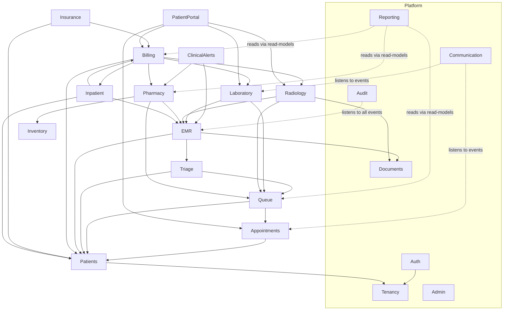

**Key boundary rules.**

- **Every module depends on `Tenancy`** (branch scoping) and `Auth` (identity/permissions) — these are platform substrate.
- **`Audit` and `Communication` are pure listeners** — they subscribe to events emitted across the system and never expose write contracts that other modules call. This keeps the side-effect (notify, log) decoupled from the core transaction.
- **`Reporting` reads, never writes** — it consumes denormalized read-models / materialized rollups (refreshed by the scheduler) rather than querying live transactional tables, protecting OLTP performance.
- **`Billing` is a hub** — it aggregates billable events from Pharmacy, Lab, Radiology, Inpatient. Those modules emit `*.charge.raised` events; Billing listens and assembles invoices, so upstream modules do not depend on Billing internals.
- **`Insurance` (SHA) sits behind `InsurerGateway`** and depends on Billing for claimable line items.

### 5.5 Cross-module communication patterns

| Pattern | When | Mechanism |
|---|---|---|
| **Query / command** | One module needs data or an action from another *now*, in the same request | Resolve the target's `*ServiceContract` from the container, pass/receive DTOs |
| **Notification of fact** | Something happened; others may react | Emit a domain event; listeners (often queued) react. Emitter doesn't know its consumers |
| **Read for reporting** | Analytics, dashboards | Read-models populated asynchronously; never live JOINs across module tables in hot paths |

---

## 6. Request lifecycle (the canonical layered flow)

The foundation (§2) mandates `Route → Controller → FormRequest → Service → Repository → Model` with DTOs, Resources, and Events. Here is the full traversal for a **write** request.

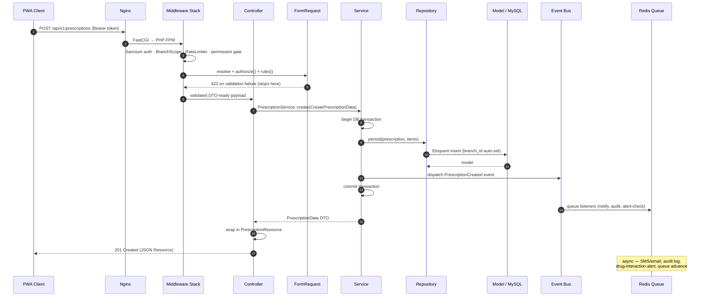

### 6.1 Responsibilities per layer

| Layer | Owns | Must NOT |
|---|---|---|
| **Route** | URL → controller mapping, route-level middleware/throttle | Contain logic |
| **Middleware** | Auth (Sanctum), branch resolution, RBAC gate, rate limiting, request ID, locale | Touch the DB for business reads |
| **Controller** | Translate HTTP ↔ DTO, call one service method, return Resource | Contain business rules, transactions, or queries |
| **FormRequest** | Authorization (`authorize()`) + validation rules (the write contract) | Mutate data |
| **DTO** (`spatie/laravel-data`) | Typed, immutable data across boundaries | Hold behavior |
| **Service** | Business rules, orchestration, **transaction boundary**, event dispatch | Build HTTP responses, format JSON |
| **Repository** | Persistence behind an interface; query encapsulation | Contain business rules |
| **Model** | Eloquent mapping, casts, relations, scopes (incl. `BranchScope`) | Orchestrate cross-aggregate logic |
| **Resource** | JSON output shaping, conditional fields by permission | Query or mutate |
| **Event/Listener/Job** | Side-effects, decoupled and (mostly) async | Block the synchronous response |

### 6.2 Read request (cache-aware) lifecycle

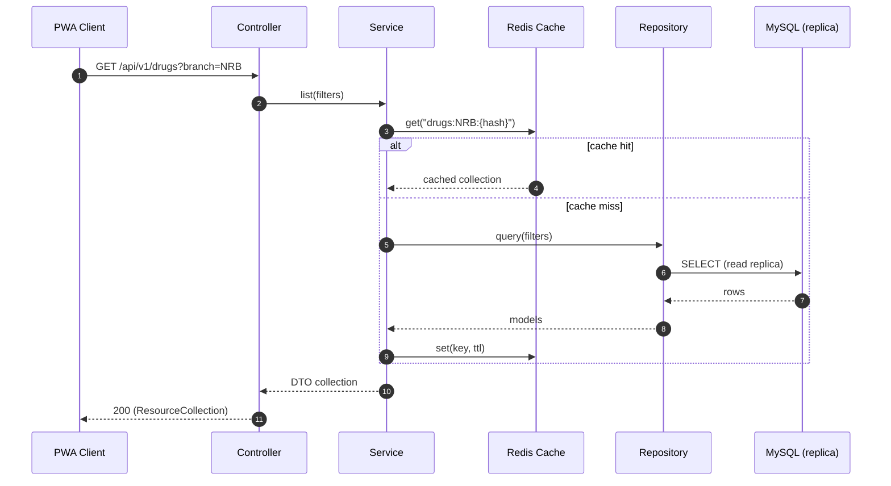

---

## 7. Synchronous vs asynchronous processing

### 7.1 Decision rule

> **Synchronous** = anything the caller must see reflected in the response (the core domain write + its invariants).
> **Asynchronous** = anything that can complete slightly later without breaking the user's mental model, or that calls a slow/unreliable external system.

### 7.2 Classification

| Workload | Mode | Queue | Rationale |
|---|---|---|---|
| Create patient / appointment / prescription / invoice | **Sync** | — | Domain transaction; user needs the result + ID immediately |
| Sequence number allocation | **Sync** | — | Must be atomic with the write (`SELECT … FOR UPDATE`) |
| Drug-interaction / allergy alert evaluation | **Async** | `alerts` (high) | Runs against EMR + OpenFDA cache; surfaced via broadcast within seconds |
| SMS / email notifications | **Async** | `notifications` | External, latency-variable, retryable |
| SHA claim submission & status polling | **Async** | `claims` | External, slow, must retry with backoff |
| PDF generation (invoices, reports, discharge summaries) | **Async** | `pdf` | CPU-heavy; user downloads when ready |
| Audit fan-out (activity log + immutable PHI-access record) | **Async** | `default` (or `audit`) | Must not slow the request; durability via queue retry |
| Queue-board state advance + broadcast | **Async** | `alerts`/`realtime` | Near-real-time fan-out, decoupled from the triggering write |
| M-Pesa STK Push initiation | **Sync** | — | User waits for the "check your phone" acknowledgement |
| M-Pesa callback processing | **Async** | `payments` | Inbound webhook → enqueue → reconcile idempotently |
| Report pre-aggregation / rollups | **Async (scheduled)** | `reporting` | Heavy aggregation off the OLTP hot path |
| Retention/archival sweeps | **Async (scheduled)** | `maintenance` | Long-running, off-peak |

### 7.3 Queue topology (Horizon)

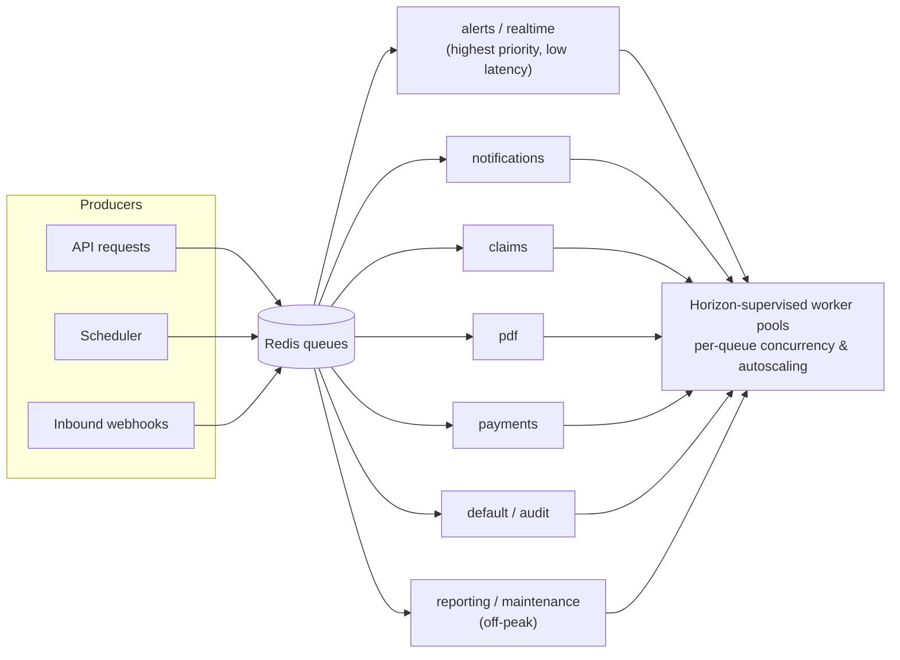

- **Connection:** Redis. **Supervisor:** Laravel Horizon (metrics, throughput, failed-job retry UI).
- **Priority:** `alerts`/`realtime` drained first; `reporting`/`maintenance` last and rate-limited.
- **Reliability:** all jobs are idempotent, use exponential backoff, `tries`/`backoff` set per job, and land in `failed_jobs` after exhaustion with alerting.
- **Isolation at scale:** separate worker pools (containers) per queue class so a flood of PDFs cannot starve clinical alerts.

---

## 8. Real-time architecture (queue boards, alerts)

Foundation §13 mandates Redis + Laravel Broadcasting (WebSockets) for the queue pipeline. This section details it.

### 8.1 Components

- **Live state in Redis** — authoritative queue-board state (ticket order, "now serving", station status) lives in Redis structures (sorted sets keyed by `branch:dept:date`), so it survives app restarts and is shared across all app instances.
- **Laravel Broadcasting** — events implement `ShouldBroadcast`; published to the Redis pub/sub backplane.
- **WebSocket server** — **Laravel Reverb** (first-party, Laravel 11) subscribes to the backplane and pushes to clients over WSS. Soketi is a compatible fallback. The PWA uses **Laravel Echo**.
- **Channels** — `private-branch.{id}.queue` (staff boards), `private-station.{id}` (per-station), `private-user.{id}` (personal alerts), `private-patient.{id}` (portal: "your turn", "results ready"). Authorization via Sanctum + channel auth callbacks honoring RBAC + branch scope.

### 8.2 Flow: ticket advances through the pipeline

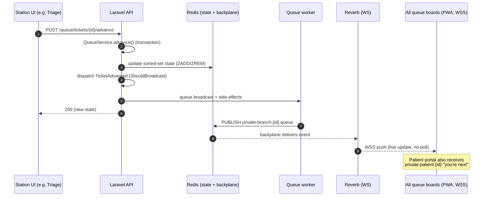

### 8.3 Resilience & offline

- **WS is an enhancement, not a dependency.** If the socket drops, the PWA falls back to short-interval polling of the REST state endpoint, then resubscribes on reconnect.
- **State of record is Redis + MySQL.** The socket only carries deltas; a reconnecting client refetches the snapshot, guaranteeing eventual consistency on the board.
- **Display screens** (waiting-room TVs) are read-only subscribers on the public-safe projection of the board (ticket numbers only, no PHI).

---

## 9. Caching strategy (Redis layers)

Redis is one logical service, partitioned by purpose (DB index / key prefix), physically splittable at scale.

| Layer | Key shape | TTL / invalidation | Purpose |
|---|---|---|---|
| **Reference-data cache** | `ref:icd10`, `ref:drugs:catalog`, `settings:{key}` | Long TTL (hours/days); busted on admin edit via event | Hot, rarely-changing global lookups (ICD-10, drug catalog, settings) |
| **Query/result cache** | `q:{module}:{branch}:{filtersHash}` | Short TTL (30–300s); tag-busted on relevant writes | Expensive list/aggregate reads (dashboards, catalog filters) |
| **Permission/RBAC cache** | `perms:user:{id}` | Busted on role/permission change | Avoid re-resolving Spatie permissions per request |
| **Session store** | `laravel_session:{id}` / Sanctum token state | Idle-timeout TTL | Stateless app tier (foundation §11) |
| **Queue-board live state** | `qb:{branch}:{dept}:{date}` (sorted set) | Daily reset; explicit ops | Real-time queue ordering shared across instances |
| **Rate limiting** | `throttle:{key}` | Window TTL | Login, OTP, API throttles |
| **Locks / atomic sequences** | `lock:sequence:{scope}` | Short, auto-release | Coordinate sequence generation, prevent double-dispatch |
| **OpenFDA response cache** | `fda:drug:{rxnorm}` | Long TTL (days) | Avoid hammering external API; alerts read from here |
| **Broadcasting backplane** | pub/sub channels | n/a (transient) | Cross-instance event fan-out to Reverb |

**Caching principles.**

- **Cache-aside** (lazy) for query results; **write-through/bust-on-write** for reference data via domain events.
- **Cache tags** group invalidation (e.g. tag `branch:NRB:billing` busts all billing list caches for that branch on any invoice write).
- **Never cache PHI in a way that bypasses authorization** — cached results are keyed by branch and, where role-sensitive, by permission scope.
- **Scheduler warms** the heaviest dashboard caches just before clinic open to avoid cold-start stampedes; cache locks (`Cache::lock`) prevent thundering-herd recompute.

---

## 10. Storage driver abstraction

Per foundation §7: a `StorageManager` over drivers `local` (MVP), `s3`, `r2`, `b2`.

```mermaid
flowchart LR
    subgraph App
        DS["DocumentService"]
        SM["StorageManager<br/>(reads config/storage.php)"]
    end
    DS --> SM
    SM -->|config('storage.default')| LOCAL["local disk"]
    SM --> S3["AWS S3"]
    SM --> R2["Cloudflare R2"]
    SM --> B2["Backblaze B2"]
    DS -->|always| SIGNED["time-limited signed URL"]
    note["App code never names a concrete provider.<br/>All clinical files: signed URLs, no public buckets."]
```

- **Single entry point:** all file writes/reads go through `DocumentService`, which calls `Storage::disk(config('storage.default'))`. No module references a concrete provider SDK.
- **Signed URLs only** for clinical files (lab images, radiology DICOM/derived JPEGs, scanned consent, generated PDFs). No public buckets; URLs expire.
- **Metadata in MySQL** (`documents` table: owner, branch_id, type, mime, size, disk, path, checksum, `public_id` UUID); **bytes in object storage**.
- **Driver parity:** local for dev/CI; S3/R2/B2 in cloud chosen purely by env. Large diagnostic images stored object-side; the DB holds only references.

---

## 11. External integrations

All integrations live behind interfaces (foundation §6–9) and run their network I/O on queue workers (except user-blocking initiations).

| Integration | Abstraction | Direction | Sync/Async | Reliability pattern |
|---|---|---|---|---|
| **Safaricom Daraja (M-Pesa)** | `PaymentGateway` → `MpesaDarajaGateway` (+ `CashGateway`) | Outbound STK init/query; inbound callbacks | STK init sync; callback async | Signed webhook routes, **idempotent by `CheckoutRequestID`/`mpesa_receipt`**, timeout + status reconciliation |
| **SHA (insurance)** | `InsurerGateway` → `ShaGateway` | Outbound eligibility/pre-auth/claim; status polling | Async (claims/eligibility) | Retry with backoff, claim state machine, scheduler polls status, dead-letter on exhaustion |
| **AfricasTalking (SMS)** | `NotificationChannelManager` (SMS provider) | Outbound | Async (`notifications`) | Retryable Laravel Notification channel, delivery-report handling |
| **Mailgun / Resend (email)** | `NotificationChannelManager` (email provider) | Outbound | Async (`notifications`) | Provider chosen by config; retry + bounce handling |
| **OpenFDA** | `DrugReferenceService` | Outbound | Async + cached | Long-TTL Redis cache (`fda:*`), graceful degradation if API down (alerts still fire on local interaction tables) |

**Inbound webhook hardening (Daraja):** dedicated signed route, IP/allowlist where available, signature/shared-secret verification, immediate enqueue (thin controller), idempotent processing keyed on the M-Pesa receipt so retries/duplicates are safe.

---

## 12. Data flow diagrams (critical flows)

### 12.1 Flow A — Patient visit: reception → triage → doctor (queue pipeline)

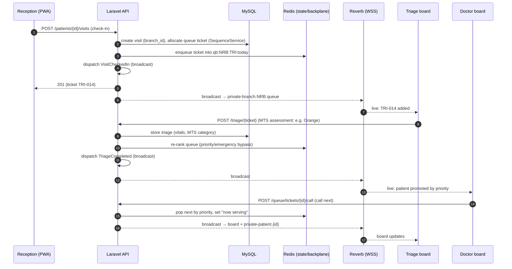

### 12.2 Flow B — Billing + M-Pesa STK Push payment

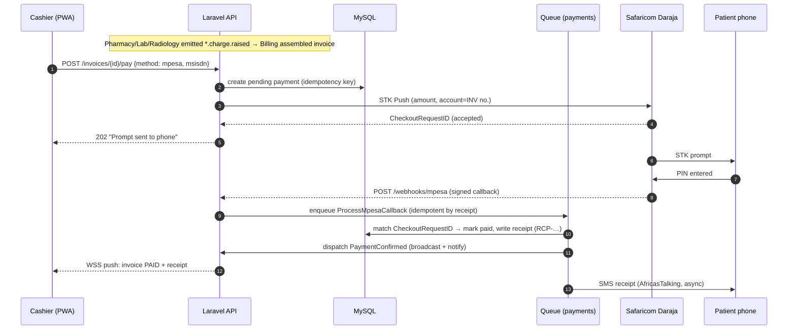

### 12.3 Flow C — Prescription with drug-interaction clinical alert

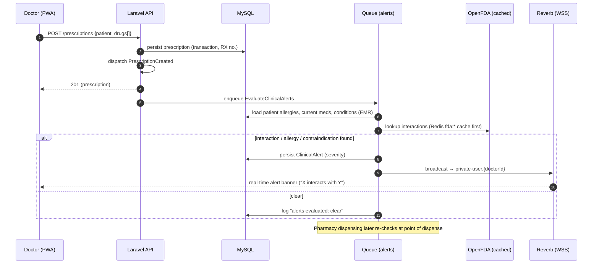

---

## 13. Scaling strategy: 1k → 10k users

Scaling is purely additive because of P2 (stateless tier) — no re-architecture between the two endpoints.

### 13.1 Capacity stages

| Stage | Users | App tier | MySQL | Redis | Workers | WS |
|---|---|---|---|---|---|---|
| **S0 — MVP / single branch** | ≤1k | 1–2 PHP-FPM containers | Single instance | Single instance (all roles) | 1 Horizon pool (mixed queues) | 1 Reverb |
| **S1 — Multi-branch growth** | 1k–4k | 3–6 stateless containers behind LB | Writer + 1 read replica | Single, monitored; consider DB-index split | Dedicated pools: alerts vs notifications/pdf | 1–2 Reverb behind LB (sticky/least-conn) |
| **S2 — Scale-out** | 4k–10k+ | Autoscaling group (N containers) | Writer + 2+ read replicas; reporting on dedicated replica | Redis split by role: cache / queue / broadcast; consider Redis Cluster or managed (e.g. ElastiCache) | Per-queue worker pools, autoscaled by queue depth (Horizon metrics) | Reverb cluster behind LB, Redis backplane shared |

### 13.2 Horizontal scaling levers

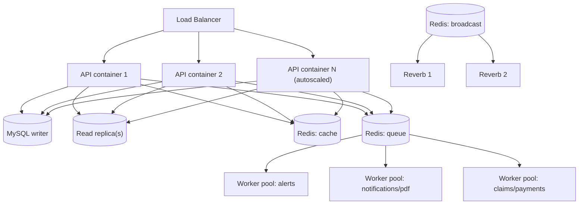

- **Stateless API** → add containers freely; LB health-checks `/up`.
- **Read/write split** → Eloquent read connection points at replica(s); writes to the primary. Reporting reads from a dedicated replica so analytics never contend with OLTP.
- **Redis** → start unified, split by role (cache/queue/broadcast) as load grows; move to managed/clustered Redis at S2.
- **Queue worker pools** → scale per queue independently by depth; clinical `alerts` pool is protected from `pdf`/`reporting` floods.
- **WebSocket** → Reverb instances scale horizontally sharing the Redis backplane; LB uses least-connections.
- **MySQL writer** → vertical scale first; partition/archive cold clinical data (10-year retention) to keep hot tables lean; consider read-mostly caching to defer write-tier pressure.

### 13.3 Bottleneck watch-list

| Risk | Symptom | Mitigation |
|---|---|---|
| Single MySQL writer | Write latency under multi-branch load | Read replicas offload reads; archive cold data; optimize indexes; per-branch partitioning if needed |
| Sequence contention (`FOR UPDATE`) | Lock waits on patient/invoice numbers | Short transactions; per-scope locks; pre-allocation batching if extreme |
| Queue-board hot keys in Redis | Latency spikes on busy branch | Per-branch key sharding; broadcast deltas not snapshots |
| Report queries on OLTP | Slow dashboards block clinical reads | Dedicated reporting replica + pre-aggregated rollups |
| Heavy PDF jobs | Worker starvation | Isolated `pdf` pool, rate-limited |

---

## 14. Deployment topology

### 14.1 Local development (Docker Compose)

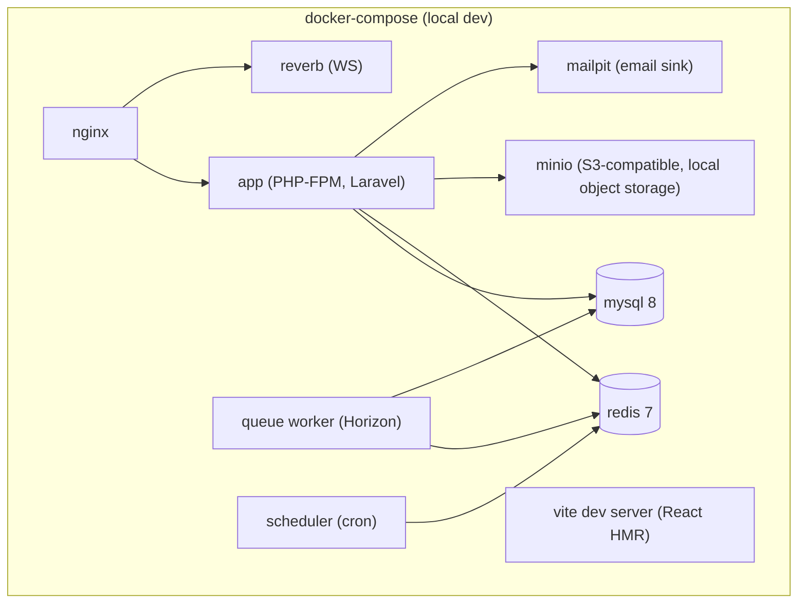

- **Single command up** (`docker compose up`). `local` storage driver or MinIO for S3 parity; Mailpit for email; real provider sandboxes (Daraja sandbox, SHA test) via env.
- **Dev ergonomics:** Vite HMR for the SPA, Xdebug-ready PHP image, seeded demo branches/users.

### 14.2 Cloud / production

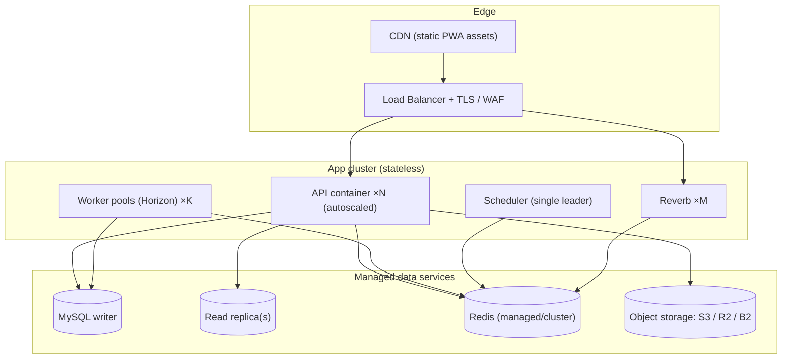

- **Image:** one application image runs as API, worker, scheduler, or Reverb selected by entrypoint/command — guarantees code parity across roles.
- **Scheduler leadership:** exactly one scheduler process (leader-elected / single replica) to avoid duplicate cron firing; jobs themselves idempotent as defense-in-depth.
- **Config:** 12-factor; all provider keys, DB, Redis, storage via environment/secrets manager. No provider hardcoded (P6).
- **Zero-downtime deploys:** rolling replace of stateless containers; migrations run as a gated pre-deploy step (backward-compatible, expand/contract).
- **Observability:** centralized logs, Horizon dashboard, health endpoints (`/up`), metrics on queue depth, DB replica lag, WS connections.
- **Backups & retention:** automated MySQL backups + PITR; object-storage versioning; clinical data never hard-deleted (soft-delete + archival, ≥10-year retention per foundation §11).

---

## 15. Technology decisions & rationale

| Concern | Decision | Alternatives considered | Rationale |
|---|---|---|---|
| Architecture style | **Modular monolith** | Microservices | Single team, single domain; avoids distributed complexity, network failure modes, and ops cost while preserving module boundaries for a future split if ever needed |
| Backend framework | **Laravel 11 / PHP 8.3+** | Symfony, NestJS | Mature ecosystem for exactly these needs (queues, broadcasting, Sanctum, Horizon, Notifications, Eloquent); team velocity |
| API style | **REST (versioned `/api/v1`)** | GraphQL | Simpler caching, tooling, and RBAC per-endpoint; predictable for a PWA + offline cache |
| Frontend | **React 18 + TS strict + Vite (PWA)** | Vue, Angular, Blade | Offline-first PWA, strong typing mirrors backend DTOs, large talent pool; foundation §10 |
| DB | **MySQL 8** | PostgreSQL | Operational familiarity in target market, strong replication story; sufficient for OLTP HMS workload |
| Cache/queue/broadcast/lock | **Redis 7** | Memcached, RabbitMQ, SQS | One battle-tested system covers cache, sessions, queues, locks, and the broadcast backplane; simplifies ops |
| Queue supervisor | **Laravel Horizon** | Bare `queue:work`, Supervisor only | Per-queue metrics, autoscaling, failed-job retry UI, throughput visibility |
| WebSockets | **Laravel Reverb** | Soketi, Pusher (SaaS) | First-party Laravel 11, self-hosted (data sovereignty / Kenya DPA), no per-message SaaS cost; Soketi as fallback |
| Auth | **Laravel Sanctum + TOTP MFA** | Passport (OAuth2), Auth0 | SPA token auth is lighter than full OAuth2; MFA for privileged roles per foundation §11 |
| RBAC | **Spatie Laravel Permission** | Hand-rolled gates | Proven, `{module}.{action}` permission model, role-aware caching |
| DTOs | **spatie/laravel-data** | Plain arrays, manual DTOs | Typed, validated, castable boundary objects; integrates with Resources |
| Audit | **Spatie Activity Log + immutable `audit_logs`** | Activity log only | Model change history *plus* a separate immutable PHI-access trail for compliance |
| Payments | **Daraja behind `PaymentGateway`** | Direct SDK calls | Abstraction allows Cash + future gateways; idempotent webhooks |
| Insurance | **SHA behind `InsurerGateway`** | Direct integration | Future insurers pluggable; isolates SHA volatility |
| SMS / Email | **AfricasTalking / Mailgun|Resend behind `NotificationChannelManager`** | Direct SDKs | Config-swappable providers; code never calls SDK directly |
| Storage | **`StorageManager` over local/S3/R2/B2** | Single provider | Local dev parity, cloud portability, no vendor lock-in; signed URLs |
| Containerization | **Docker + Compose (dev) → orchestrated cluster (prod)** | Bare metal/VM | Reproducible envs, identical image across roles, easy horizontal scale |
| Clinical reference | **OpenFDA (cached)** | Paid drug DB | Free, sufficient for interaction/label reference; cached + degrades gracefully |

---

## 16. Cross-cutting concerns

| Concern | Mechanism | Reference |
|---|---|---|
| **Multi-tenancy** | `branch_id` on every operational table; global `BranchScope`; `branch.view-all` bypass for admins; active branch in token/session claim | Foundation §4 |
| **AuthN** | Sanctum SPA tokens; password expiry; idle timeout; device/IP tracking; OTP; TOTP MFA for `hospital-admin`, `doctor`, `pharmacist` | Foundation §5, §11 |
| **AuthZ** | Spatie permissions `{module}.{action}`; FormRequest `authorize()`; Policies; Resource field gating; channel auth for WS | Foundation §5 |
| **Validation** | FormRequest on every write; Zod mirrors on the client | Foundation §2, §10 |
| **Identifiers/money/time** | `SequenceService` (atomic), DECIMAL(12,2) KES, UTC stored / Africa/Nairobi rendered | Foundation §3, §6 |
| **Audit & compliance** | Activity Log + immutable `audit_logs`; Kenya DPA 2019, MOH, ≥10-yr retention, soft-delete only for clinical data | Foundation §11 |
| **Security in transit/at rest** | TLS everywhere; encrypted casts for sensitive columns; volume/DB encryption in prod; signed URLs; secure headers; rate limiting | Foundation §11 |
| **i18n** | `en` + `sw`; locale from request; no hardcoded strings | Foundation §10 |
| **Observability** | Structured logs w/ request IDs, Horizon metrics, health checks, replica-lag & queue-depth alerts | §14 |
| **Testing** | Pest/PHPUnit (unit/feature/integration) incl. architecture tests for module boundaries; Vitest/RTL/Playwright; ≥80% coverage | Foundation §14 |

---

## 17. Failure modes & resilience

| Failure | Effect | Design response |
|---|---|---|
| External provider down (Daraja/SHA/SMS/email/OpenFDA) | Outbound action fails | Async + retry/backoff; idempotent processing; graceful degradation (e.g. alerts fall back to local interaction tables; cash payment always available) |
| Duplicate/replayed M-Pesa callback | Risk of double-credit | Idempotency keyed on `mpesa_receipt`/`CheckoutRequestID` |
| WebSocket outage | No live board updates | PWA polls REST snapshot; Redis+MySQL remain source of truth; resubscribe on reconnect |
| Redis outage | Cache/queue/broadcast impaired | Cache misses fall through to DB; managed Redis with failover at S2; queues durable on recovery; app still serves core reads/writes |
| Read replica lag | Stale reads | Read-after-write routed to primary for the affected request; bounded staleness acceptable for lists/dashboards |
| Worker crash mid-job | Partial side-effect | Jobs idempotent + retried; failures land in `failed_jobs` with alerting |
| App container loss | One node gone | Stateless tier; LB removes via health check; capacity from remaining/new containers |
| Network partition to object storage | File ops fail | Retries; metadata persists in DB; user retries download; uploads queued where possible |

---

*End of 09 — System Architecture. Consistent with `00-foundation.md` v1.0.*
