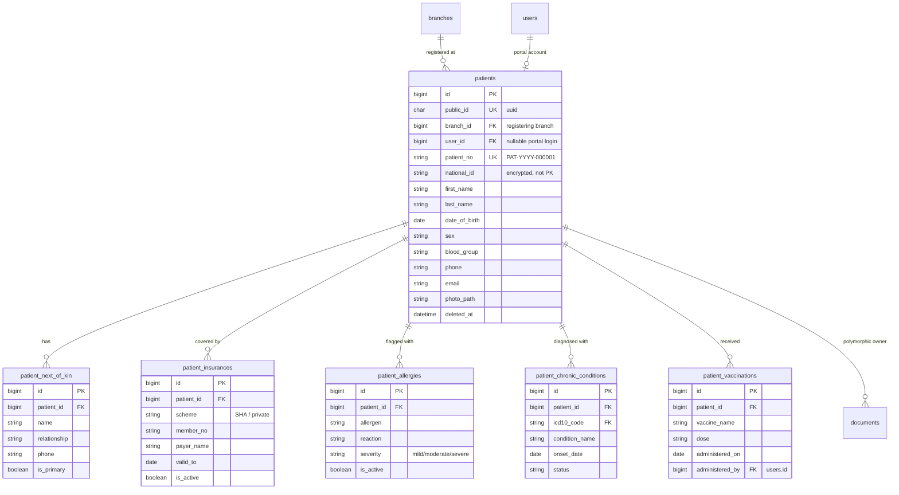
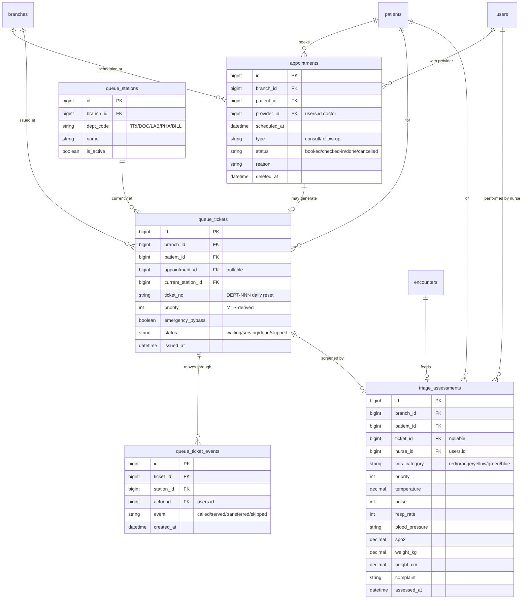
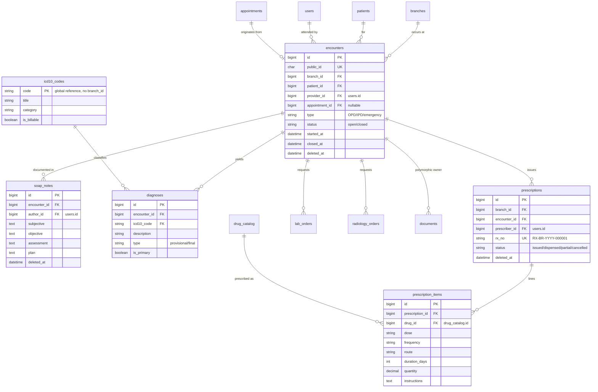
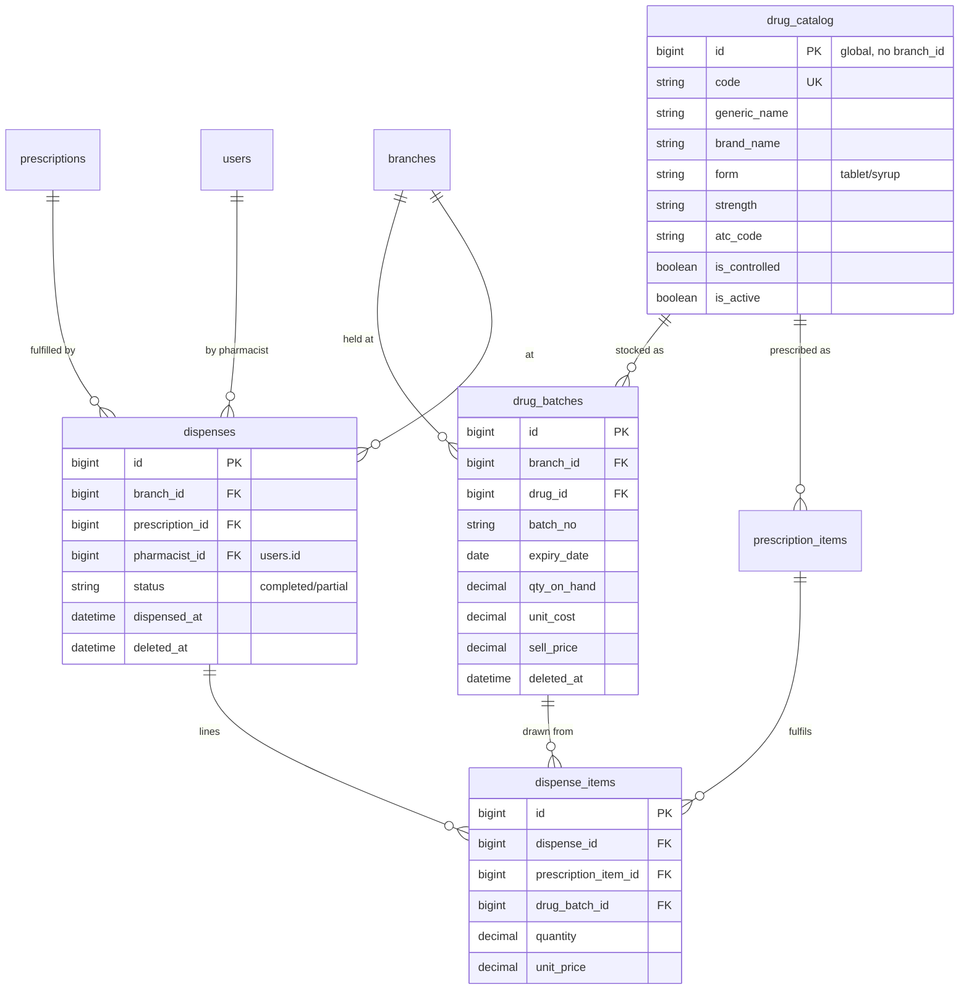
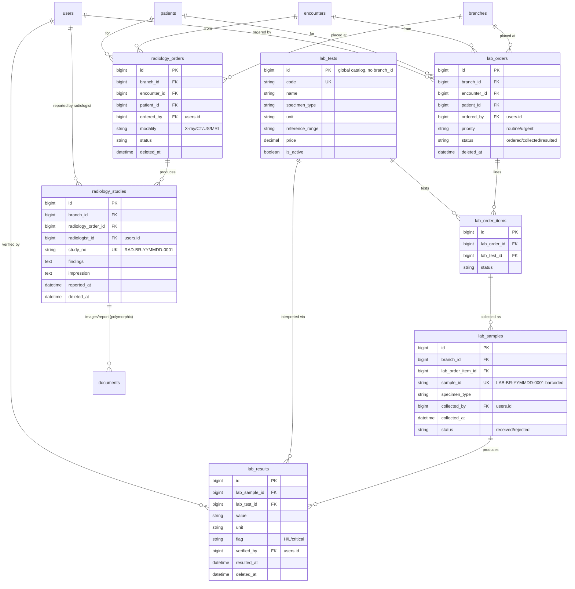
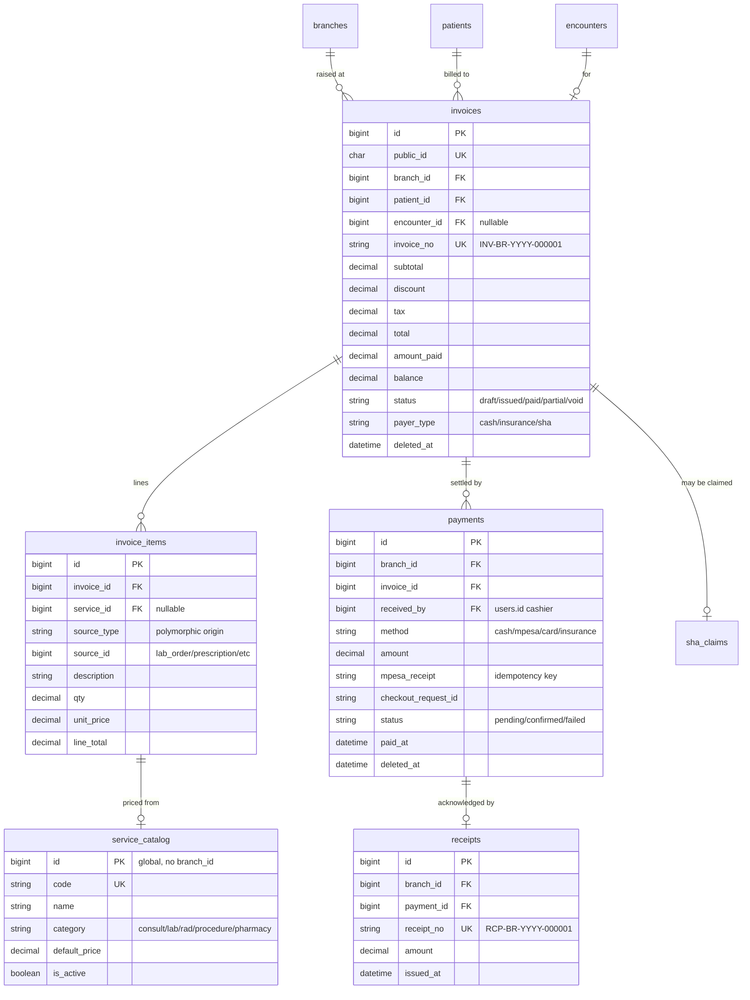
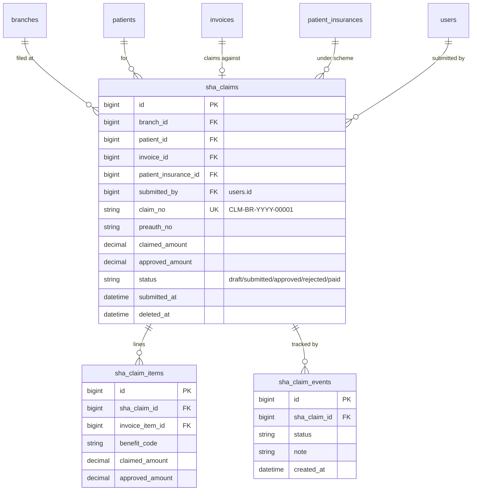
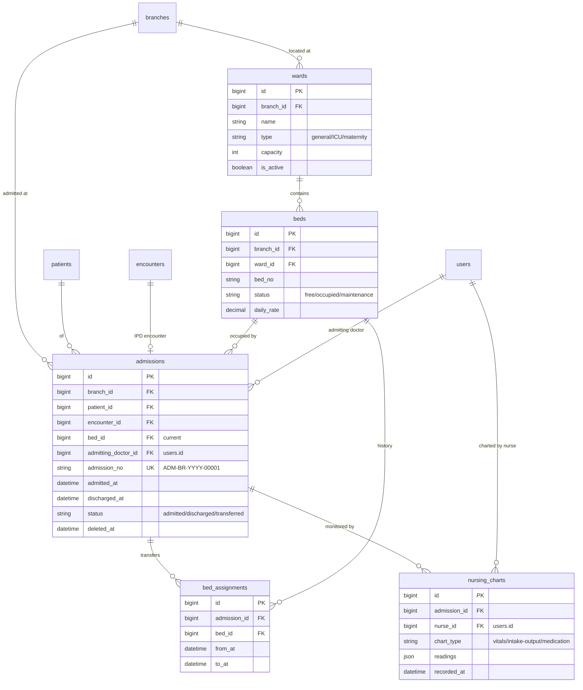
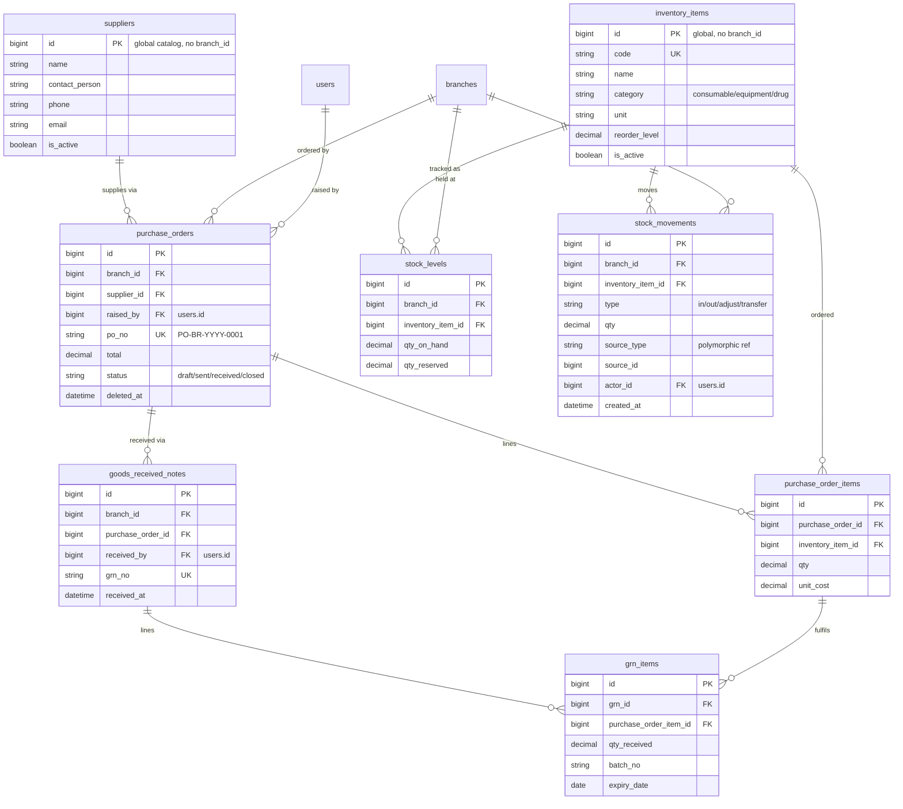
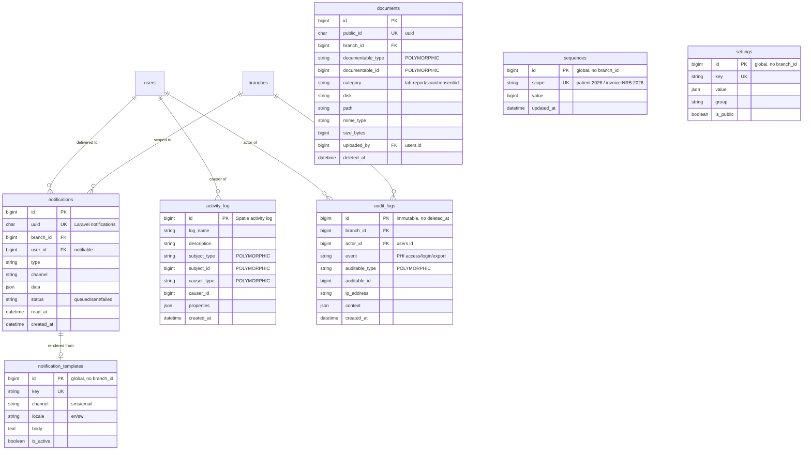

# 10 — Database ERD & Entity Catalog

> **Scope:** Conceptual / logical data model for Afya HMS. This document defines every major
> entity, its purpose, its relationships, and its cardinality. The **physical DDL** (exact column
> types, indexes, constraints, partitions) lives in `11-database-ddl.md` and MUST stay consistent
> with the model here.
> **Authority:** Subordinate to `00-foundation.md`. All identifiers, the `branch_id` rule, the 10
> roles, sequence generation, and money/timestamp conventions are inherited from Foundation §3–§6.

**Document version:** 1.0 · **Status:** MVP architecture baseline
**Conventions inherited from Foundation:**
- PKs are `BIGINT UNSIGNED AUTO_INCREMENT` internally; externally-exposed resources also carry a `public_id` `CHAR(36)` UUID (patients, documents, etc.).
- Money = `DECIMAL(12,2)`, currency `KES`. Timestamps stored UTC.
- `created_at`, `updated_at`, `deleted_at` (soft delete) on all domain tables unless noted.
- Every **operational** table carries `branch_id` FK → `branches.id`. **Global reference data does not** (drug catalog master, ICD-10, roles/permissions, settings, suppliers shared catalog).

---

## 1. Reading the diagrams

- `PK` = primary key, `FK` = foreign key, `UK` = unique key.
- Cardinality (crow's foot): `||--o{` = one-to-many (optional many), `||--|{` = one-to-many (mandatory many), `}o--o{` = many-to-many (resolved via a join entity), `||--||` = one-to-one.
- Columns shown are **identifying / relational** columns plus a few business-critical attributes — not the full physical column list (see doc 11).
- Polymorphic relations (e.g. `documents`, `attachments`, `notifications`) are drawn with their `*_type` / `*_id` pair and explained in §4.

---

## 2. Domain ERDs (Mermaid)

### 2.1 Tenancy & Auth

```mermaid
erDiagram
    branches ||--o{ users : "home branch"
    branches ||--o{ branch_user : "grants"
    users ||--o{ branch_user : "multi-branch access"
    users }o--o{ roles : "model_has_roles"
    roles }o--o{ permissions : "role_has_permissions"
    users }o--o{ permissions : "model_has_permissions (direct)"
    users ||--o{ user_sessions : "logs in via"
    users ||--o{ login_histories : "tracked by"
    users ||--o| mfa_secrets : "secured by"
    users ||--o{ password_histories : "rotates"

    branches {
        bigint id PK
        string code UK "e.g. NRB"
        string name
        string address
        string phone
        string timezone "Africa/Nairobi"
        boolean is_active
        datetime deleted_at
    }
    users {
        bigint id PK
        char public_id UK "uuid"
        bigint home_branch_id FK
        string staff_no UK "null for patients"
        string name
        string email UK
        string phone
        string password
        boolean mfa_enabled
        boolean is_active
        datetime password_changed_at
        datetime last_login_at
        datetime deleted_at
    }
    branch_user {
        bigint id PK
        bigint branch_id FK
        bigint user_id FK
        boolean is_default
    }
    roles {
        bigint id PK
        string name UK "slug e.g. doctor"
        string guard_name
    }
    permissions {
        bigint id PK
        string name UK "module.action"
        string guard_name
    }
    user_sessions {
        bigint id PK
        bigint user_id FK
        string token_id
        string ip_address
        string device
        datetime last_activity_at
        datetime expires_at
    }
    login_histories {
        bigint id PK
        bigint user_id FK
        string ip_address
        string user_agent
        boolean success
        string failure_reason
        datetime created_at
    }
    mfa_secrets {
        bigint id PK
        bigint user_id FK UK
        text secret_encrypted
        json recovery_codes
        datetime confirmed_at
    }
    password_histories {
        bigint id PK
        bigint user_id FK
        string password_hash
        datetime created_at
    }
```

### 2.2 Patients & Clinical Profile



### 2.3 Appointments, Queue & Triage



### 2.4 EMR — Encounters, SOAP, Diagnoses, Prescriptions



### 2.5 Pharmacy



### 2.6 Laboratory & Radiology



### 2.7 Billing, Payments, Receipts



### 2.8 SHA Insurance Claims



### 2.9 Inpatient — Wards, Beds, Admissions, Nursing



### 2.10 Inventory & Procurement



### 2.11 Communication, Documents, Audit & System



---

## 3. Entity Catalog

Each entity below states **why it exists** (its reason for being in the model, not just its columns)
and its **key relationships**.

### Tenancy & Auth

| Entity | Purpose (why it exists) | Key relationships |
|---|---|---|
| `branches` | The tenancy anchor. Row-level isolation in a single shared DB requires a concrete branch record every operational row points at; also holds per-site code/timezone used in document numbering (`INV-NRB-…`). | 1→M `users` (home), M↔M `users` via `branch_user`, parent of nearly every operational table. |
| `users` | Single account table for all 10 roles including `patient` portal logins. Patients optionally link here so a person can both be a clinical record and authenticate. | M↔M `roles`, M↔M `branches` (branch_user), 1→0..1 `patients`, 1→M sessions/logins. |
| `branch_user` | Resolves the many-to-many "a user may work at several branches" requirement and stores which branch is default for the branch-switcher. | join of `users` × `branches`. |
| `roles` / `permissions` | RBAC backbone (Spatie). Global reference data — no `branch_id`. The 10 canonical role slugs live here; permissions are `module.action`. | M↔M with `users` and each other (pivot tables `model_has_roles`, `role_has_permissions`, `model_has_permissions`). |
| `user_sessions` | Supports idle-timeout, device + IP tracking, and remote session revocation required by the security baseline. | M→1 `users`. |
| `login_histories` | Immutable login audit (success/failure, IP, agent) for intrusion detection and DPA compliance. | M→1 `users`. |
| `mfa_secrets` | Stores the encrypted TOTP secret + recovery codes for the MFA-required privileged roles. | 1↔1 `users`. |
| `password_histories` | Enforces password-reuse prevention and rotation policy. | M→1 `users`. |

### Patients

| Entity | Purpose | Key relationships |
|---|---|---|
| `patients` | Master clinical identity. Carries the `PAT-YYYY-000001` number and a UUID `public_id`; National ID is stored encrypted and is never a key. The hub of the entire clinical graph. | M→1 `branches`, 0..1→1 `users`, 1→M kin/insurance/allergies/chronic/vaccinations, 1→M encounters/orders/invoices, polymorphic owner of `documents`. |
| `patient_next_of_kin` | Emergency contacts and consent-giver records, separated so a patient can have several with one primary. | M→1 `patients`. |
| `patient_insurances` | Holds payer/scheme membership (SHA or private) so billing can route claims and verify coverage validity. | M→1 `patients`, 1→M `sha_claims`. |
| `patient_allergies` | Drives clinical safety alerts at prescribing/dispensing time; kept as discrete rows so each allergen has severity/status. | M→1 `patients`. |
| `patient_chronic_conditions` | Longitudinal problem list (e.g. diabetes, HTN) linked to ICD-10 for continuity of care across encounters. | M→1 `patients`, M→1 `icd10_codes`. |
| `patient_vaccinations` | Immunization history for recall scheduling and MOH reporting. | M→1 `patients`, M→1 `users` (administrator). |

### Appointments, Queue, Triage

| Entity | Purpose | Key relationships |
|---|---|---|
| `appointments` | Scheduled future visits with a provider; the planned counterpart to walk-in queue flow. | M→1 `branches`/`patients`/`users`, 1→0..1 `queue_tickets`, 1→0..1 `encounters`. |
| `queue_stations` | Named service points per branch (TRI/DOC/LAB/PHA/BILL) the queue pipeline routes tickets through. | M→1 `branches`, 1→M `queue_tickets`. |
| `queue_tickets` | The real-time token a patient holds while moving through the canonical pipeline; carries MTS-derived priority and emergency-bypass flag. Ticket number resets daily per department. | M→1 `branches`/`patients`/`stations`, 0..1 `appointments`, 1→M `queue_ticket_events`. |
| `queue_ticket_events` | Append-only movement log (called/served/transferred/skipped) for queue analytics and wait-time SLAs. | M→1 `queue_tickets`, `queue_stations`, `users`. |
| `triage_assessments` | Manchester Triage screening + vitals captured by a nurse; sets queue priority and feeds the doctor's encounter. | M→1 `branches`/`patients`/`users`, 0..1 `queue_tickets`, feeds `encounters`. |

### EMR

| Entity | Purpose | Key relationships |
|---|---|---|
| `encounters` | The clinical visit unit (OPD/IPD/emergency) that groups all documentation, orders, and billing for one episode of care. | M→1 `branches`/`patients`/`users`, 0..1 `appointments`, 1→M soap_notes/diagnoses/prescriptions/lab_orders/radiology_orders, 0..1 `invoices`, 0..1 `admissions`. |
| `soap_notes` | Structured Subjective/Objective/Assessment/Plan clinical narrative, separated from the encounter so multiple authored notes can exist. | M→1 `encounters`, M→1 `users`. |
| `diagnoses` | ICD-10-coded assessment results (provisional/final, primary flag) needed for billing, claims, and statistics. | M→1 `encounters`, M→1 `icd10_codes`. |
| `icd10_codes` | Global reference dictionary of diagnosis codes (no `branch_id`); shared by chronic conditions and diagnoses. | 1→M `diagnoses`, `patient_chronic_conditions`. |
| `prescriptions` | The `RX-…` order header a prescriber issues; QR-coded and dispensed by pharmacy. | M→1 `branches`/`encounters`/`users`, 1→M `prescription_items`, 1→M `dispenses`. |
| `prescription_items` | Per-drug order lines (dose/frequency/route/duration) referencing the global drug catalog. | M→1 `prescriptions`, M→1 `drug_catalog`, 1→M `dispense_items`. |

### Pharmacy

| Entity | Purpose | Key relationships |
|---|---|---|
| `drug_catalog` | Global formulary master (generic/brand/form/strength, controlled flag) shared across all branches; no `branch_id`. | 1→M `drug_batches`, `prescription_items`. |
| `drug_batches` | Per-branch physical stock with batch/expiry/cost/price — the unit FEFO dispensing draws from and expiry alerts watch. | M→1 `branches`/`drug_catalog`, 1→M `dispense_items`. |
| `dispenses` | Pharmacist fulfilment event against a prescription (full/partial), the record reconciling clinical order with stock movement. | M→1 `branches`/`prescriptions`/`users`, 1→M `dispense_items`. |
| `dispense_items` | Lines linking a dispensed quantity to the specific batch and the prescription line it fulfils (for traceability and recall). | M→1 `dispenses`, `prescription_items`, `drug_batches`. |

### Laboratory & Radiology

| Entity | Purpose | Key relationships |
|---|---|---|
| `lab_tests` | Global test catalog (specimen type, unit, reference range, price); no `branch_id`. | 1→M `lab_order_items`, `lab_results`. |
| `lab_orders` | Provider request header for one or more tests during an encounter. | M→1 `branches`/`encounters`/`patients`/`users`, 1→M `lab_order_items`. |
| `lab_order_items` | Individual ordered tests with per-test status. | M→1 `lab_orders`, `lab_tests`, 1→M `lab_samples`. |
| `lab_samples` | Barcoded specimen (`LAB-…`) tying collection to an ordered test, enabling chain-of-custody and rejection tracking. | M→1 `lab_order_items`, `branches`, `users` (collector), 1→M `lab_results`. |
| `lab_results` | Result values with H/L/critical flags and verifier; the clinically actionable output, soft-deletable but retained ≥10 yrs. | M→1 `lab_samples`, `lab_tests`, `users` (verifier). |
| `radiology_orders` | Imaging request (modality) raised in an encounter. | M→1 `branches`/`encounters`/`patients`/`users`, 1→M `radiology_studies`. |
| `radiology_studies` | The performed study (`RAD-…`) with findings/impression; DICOM/report files attach polymorphically via `documents`. | M→1 `radiology_orders`, `branches`, `users` (radiologist), 1→M `documents`. |

### Billing, Payments, SHA

| Entity | Purpose | Key relationships |
|---|---|---|
| `service_catalog` | Global price list of billable services (consult/lab/rad/procedure/pharmacy) so invoice lines reference a canonical price. | 1→M `invoice_items`. |
| `invoices` | The `INV-…` financial document per encounter/patient, tracking totals, payments, balance and payer type. | M→1 `branches`/`patients`, 0..1 `encounters`, 1→M `invoice_items`/`payments`, 0..1 `sha_claims`. |
| `invoice_items` | Billed lines; `source_type`/`source_id` polymorphically reference the clinical origin (lab order, prescription, bed-day, etc.). | M→1 `invoices`, 0..1 `service_catalog`, polymorphic source. |
| `payments` | Money received against an invoice (cash/M-Pesa/card/insurance); `mpesa_receipt`/`checkout_request_id` provide webhook idempotency. | M→1 `branches`/`invoices`/`users`, 1→0..1 `receipts`. |
| `receipts` | The `RCP-…` acknowledgement issued for a confirmed payment. | M→1 `branches`, 1→1 `payments`. |
| `sha_claims` | SHA insurance claim header (`CLM-…`) against an invoice, tracking pre-auth, claimed vs approved amounts and lifecycle. | M→1 `branches`/`patients`/`invoices`/`patient_insurances`/`users`, 1→M `sha_claim_items`/`sha_claim_events`. |
| `sha_claim_items` | Per-benefit claim lines mapping invoice items to SHA benefit codes with claimed/approved amounts. | M→1 `sha_claims`, `invoice_items`. |
| `sha_claim_events` | Append-only status trail for claim adjudication tracking. | M→1 `sha_claims`. |

### Inpatient

| Entity | Purpose | Key relationships |
|---|---|---|
| `wards` | Physical nursing units per branch (general/ICU/maternity) with capacity. | M→1 `branches`, 1→M `beds`. |
| `beds` | Individual chargeable beds with status and daily rate; the resource admissions occupy. | M→1 `branches`/`wards`, 1→M `admissions`, `bed_assignments`. |
| `admissions` | The IPD stay (`ADM-…`) linking a patient + encounter to a bed and admitting doctor across admit→discharge. | M→1 `branches`/`patients`/`encounters`/`beds`/`users`, 1→M `bed_assignments`/`nursing_charts`. |
| `bed_assignments` | History of bed occupancy within an admission so transfers and billing per bed are auditable. | M→1 `admissions`, `beds`. |
| `nursing_charts` | Time-series nursing observations (vitals, intake/output, med administration) recorded against an admission. | M→1 `admissions`, `users` (nurse). |

### Inventory & Procurement

| Entity | Purpose | Key relationships |
|---|---|---|
| `suppliers` | Vendor master for procurement; global catalog, no `branch_id`. | 1→M `purchase_orders`. |
| `inventory_items` | Global catalog of stockable non-formulary goods (consumables/equipment); no `branch_id`. | 1→M PO items, `stock_levels`, `stock_movements`. |
| `purchase_orders` | The `PO-…` procurement header to a supplier raised by a branch. | M→1 `branches`/`suppliers`/`users`, 1→M `purchase_order_items`/`goods_received_notes`. |
| `purchase_order_items` | Ordered lines (qty, unit cost) per inventory item. | M→1 `purchase_orders`, `inventory_items`, 1→M `grn_items`. |
| `goods_received_notes` | The GRN recording physical receipt against a PO, the trigger for stock increase. | M→1 `branches`/`purchase_orders`/`users`, 1→M `grn_items`. |
| `grn_items` | Received lines with batch/expiry, reconciling delivered vs ordered quantities. | M→1 `goods_received_notes`, `purchase_order_items`. |
| `stock_levels` | Current on-hand/reserved quantity per item per branch for reorder alerts. | M→1 `branches`, `inventory_items`. |
| `stock_movements` | Append-only ledger of every stock in/out/adjust/transfer; `source_type`/`source_id` polymorphically links the cause (GRN, dispense, adjustment). | M→1 `branches`, `inventory_items`, `users`, polymorphic source. |

### Communication, Documents, Audit, System

| Entity | Purpose | Key relationships |
|---|---|---|
| `documents` | Centralized polymorphic file store (lab reports, scans, consents, ID photos). `documentable_type`/`documentable_id` let any entity own files; served via signed URLs. | M→1 `branches`, `users` (uploader); polymorphic owner = patients/encounters/radiology_studies/etc. |
| `notification_templates` | Versioned SMS/email message bodies per locale (en/sw); global reference, no `branch_id`. | 1→M `notifications`. |
| `notifications` | Outbound message records (queued/sent/failed) per recipient, supporting the abstracted notification channel manager. | M→1 `branches`, `users`, 0..1 `notification_templates`. |
| `activity_log` | Spatie model-change audit (subject/causer polymorphic) for general change history. | polymorphic subject + causer (`users`). |
| `audit_logs` | Dedicated **immutable** security/PHI-access log (login, export, record view). No `deleted_at` — never deleted. | M→1 `branches`, `users` (actor), polymorphic `auditable`. |
| `sequences` | The single source for gap-tolerant numbered identifiers (`patient:2026`, `invoice:NRB:2026`); written only by `SequenceService` under `SELECT … FOR UPDATE`. Global, no `branch_id`. | standalone. |
| `settings` | Key/value (JSON) system & feature configuration, grouped, optionally public. Global, no `branch_id`. | standalone. |

---

## 4. Cross-cutting modelling notes

### 4.1 `branch_id` presence

- **Present** on every operational table (it appears in the diagrams): patients, appointments, queue_tickets, triage, encounters, prescriptions, dispenses, drug_batches, lab/radiology orders+results+studies, invoices, payments, receipts, sha_claims, wards, beds, admissions, purchase_orders, GRNs, stock_levels, stock_movements, documents, notifications, audit_logs, branch_user.
- **Absent** on global reference / master data (per Foundation §4): `roles`, `permissions`, `icd10_codes`, `drug_catalog`, `lab_tests`, `service_catalog`, `suppliers`, `inventory_items`, `notification_templates`, `sequences`, `settings`. Child line tables (`invoice_items`, `lab_order_items`, `prescription_items`, etc.) inherit branch context through their parent and omit a redundant `branch_id` unless a query path needs it.
- Enforcement is the Eloquent `BranchScope` global scope; bypass only for roles holding `branch.view-all` (Hospital Admin, executive reporting). Models therefore carry the scope, and `branch_id` is set automatically on create from the user's `active_branch_id`.

### 4.2 Soft deletes

- `deleted_at` is present on all **domain** tables (shown in the diagrams) to satisfy the ≥10-year medical-record retention rule — clinical data is **never hard-deleted**.
- **Exceptions (no soft delete):** append-only / immutable logs — `audit_logs`, `login_histories`, `queue_ticket_events`, `sha_claim_events`, `stock_movements`, `activity_log` — and infrastructure tables `sequences`, pivot tables (`branch_user`, Spatie `model_has_*`). These are either write-once ledgers or pure join rows.

### 4.3 Polymorphic relations

- `documents` — `documentable_type` + `documentable_id`: any entity (patient, encounter, radiology_study, admission, sha_claim) can own files without per-owner FK columns. Indexed on the pair.
- `invoice_items.source_type` + `source_id` — links a billed line back to its clinical origin (lab order, prescription item, bed-day, procedure) so billing is derivable and auditable.
- `stock_movements.source_type` + `source_id` — records what caused each movement (GRN, dispense, manual adjustment, transfer).
- `audit_logs.auditable_type` + `auditable_id` and `activity_log.subject_*` / `causer_*` — generic auditing across all models.
- `notifications` (Laravel) uses a `notifiable` morph in the framework default; here normalized to `user_id` since all recipients are users.

### 4.4 Indexing intent (logical — physical in doc 11)

- **Tenancy:** composite index leading with `branch_id` on every operational table (`(branch_id, …)`) so the global scope filter is index-served.
- **Lookups by business number:** unique indexes on `patient_no`, `invoice_no`, `receipt_no`, `rx_no`, `sample_id`, `study_no`, `admission_no`, `po_no`, `claim_no`, and `public_id` UUIDs.
- **Foreign keys:** every FK column indexed (MySQL InnoDB requirement) — `patient_id`, `encounter_id`, `branch_id`, `user_id` derivatives.
- **Hot query paths:** `queue_tickets (branch_id, current_station_id, status, priority)` for the live board; `appointments (branch_id, provider_id, scheduled_at)` for calendars; `drug_batches (branch_id, drug_id, expiry_date)` for FEFO/expiry alerts; `invoices (branch_id, status, patient_id)` for AR; `audit_logs (branch_id, auditable_type, auditable_id, created_at)` for record-access review.
- **Polymorphic pairs:** composite index on each `(*_type, *_id)`.
- **Time-series:** `nursing_charts (admission_id, recorded_at)`, `stock_movements (branch_id, inventory_item_id, created_at)`.
- **Sequence integrity:** unique index on `sequences.scope`; row-locked, never indexed for range scans.

### 4.5 Consistency with doc 11 (DDL)

This is the **logical** model: it fixes entities, relationships, cardinality, and intent. Doc 11
must realize it physically with: exact `BIGINT UNSIGNED` / `CHAR(36)` / `DECIMAL(12,2)` types, the
inherited timestamp/soft-delete columns, FK constraints with `ON DELETE RESTRICT` for clinical data,
the indexes named above, and Spatie's standard permission/activity-log table shapes. No entity here
may be dropped or renamed in doc 11 without updating this document first (Foundation precedence rule).
