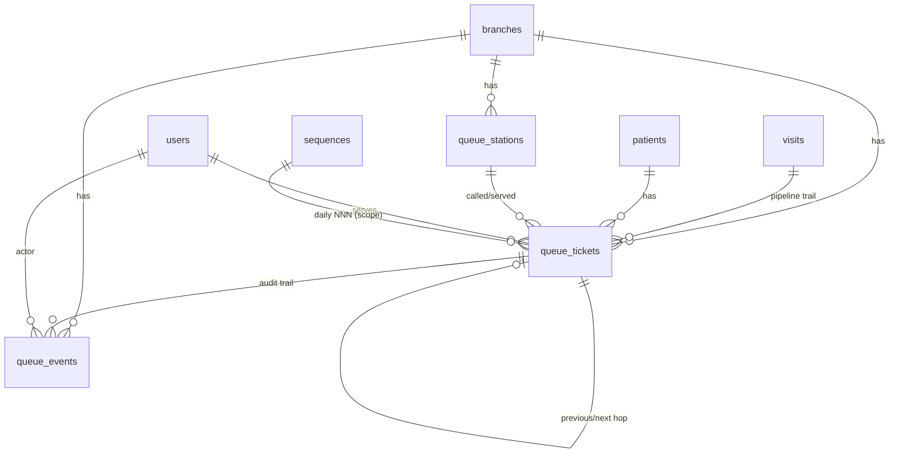
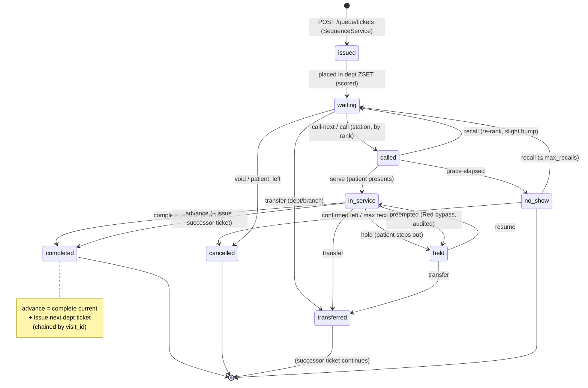

# 17 — Queue Management System Design

> **Authority:** Subordinate to `00-foundation.md`. Where this document and the
> foundation disagree, the foundation wins. This document expands the canonical
> queue pipeline (foundation §13), MTS triage (§12), ticket format (§3), sequence
> generation (§6), branch scoping (§4), and the real-time architecture (`09 §8`)
> into an exhaustive, buildable design for the **Queue** module.

**Product:** Afya HMS · **Context:** Private multi-branch hospital, Kenya · 100–300 patients/day · 1,000 users now, architected for 10,000+.
**Stack:** Laravel 11 / PHP 8.3+ · React 18 + TS + Vite (SPA/PWA) · MySQL 8+ · Redis 7 · Laravel Reverb (WebSockets).
**Module:** `Queue` (front-office bounded context; depends on `Patients`, `Appointments`, `Tenancy`, `Auth`).
**Document version:** 1.0 · **Status:** Design baseline

---

## Table of contents

1. [Concept & goals](#1-concept--goals)
2. [Station model & workflow state machine](#2-station-model--workflow-state-machine)
3. [Ticket generation](#3-ticket-generation)
4. [Priority queue & emergency bypass](#4-priority-queue--emergency-bypass)
5. [Waiting-time estimation algorithm](#5-waiting-time-estimation-algorithm)
6. [Data model](#6-data-model)
7. [Real-time architecture](#7-real-time-architecture)
8. [Display screens & dashboards](#8-display-screens--dashboards)
9. [API endpoints](#9-api-endpoints)
10. [Edge cases](#10-edge-cases)
11. [Metrics & SLAs](#11-metrics--slas)
12. [Diagrams (state + sequence)](#12-diagrams-state--sequence)

---

## 1. Concept & goals

### 1.1 What the Queue module is

The **Queue** module is the operational backbone that moves a patient through the
canonical clinical pipeline of a branch:

```
Reception → Triage → Doctor → Lab → Pharmacy → Billing
```

The pipeline is **directed but skippable per visit type**: a returning patient
collecting a refill may go `Reception → Pharmacy → Billing`; a walk-in with chest
pain may be fast-tracked `Reception → Triage(Red) → Doctor` with Lab inserted
mid-stream. Each hop is a **queue ticket** at a **station**, and the module owns:

- **Ticket lifecycle** — issue, call, serve, advance, recall, hold, transfer, complete, no-show.
- **Ordering** — fairness (FIFO within priority band) blended with clinical urgency (MTS) and emergency bypass.
- **Real-time fan-out** — live boards, station dashboards, and patient-portal "you're next" pushes.
- **Estimation** — position-based ETA per station from rolling service-time averages.
- **Observability** — wait time, throughput, SLA-breach metrics per station / department / branch.

### 1.2 Goals

| # | Goal | Measure |
|---|---|---|
| G1 | **Order patients fairly and safely** | FIFO within band; Red/Orange never wait behind lower acuity |
| G2 | **Real-time everywhere** | Board/dashboard update < 1 s after a state change (WSS), no manual refresh |
| G3 | **Accurate waiting estimates** | Displayed ETA within ±25% of actual for ≥80% of tickets |
| G4 | **Zero PHI on public displays** | TV boards show ticket numbers only; never names/MRN |
| G5 | **Branch-isolated** | Every ticket/station/event carries `branch_id`; boards scoped per branch |
| G6 | **Resilient** | WS is enhancement-only; Redis+MySQL are source of record; polling fallback |
| G7 | **Auditable** | Every transition is an immutable `queue_events` row + activity log |
| G8 | **Daily-deterministic numbering** | `{DEPT}-{NNN}` resets per department, per branch, per day via `SequenceService` |

### 1.3 Non-goals

- **Appointment scheduling** — owned by `Appointments`; Queue consumes a checked-in appointment but does not book.
- **Clinical content** — triage *assessment* (vitals, MTS category) is owned by `Triage`; Queue only consumes the resulting `mts_category` to (re)rank. Consultation/EMR content is owned by `EMR`.
- **Billing math** — Queue routes a ticket *to* the Billing station; invoice assembly is `Billing`.

### 1.4 Departments ↔ stations

A **department** is a pipeline stage (`RECEPTION`, `TRIAGE`, `DOCTOR`, `LAB`,
`PHARMACY`, `BILLING`). A **station** is a physical/logical service point inside a
department (e.g. `DOCTOR` has *Consult Room 1*, *Consult Room 2*). Tickets are
issued against a **department queue**; a ticket is *called* by a specific
**station** within that department.

| Department | Code (`DEPT`) | Ticket prefix | Typical stations | Staffed by |
|---|---|---|---|---|
| Reception | `REC` | `REC-NNN` | Front desks | `receptionist` |
| Triage | `TRI` | `TRI-NNN` | Triage bays | `nurse` |
| Doctor | `DOC` | `DOC-NNN` | Consult rooms | `doctor` |
| Laboratory | `LAB` | `LAB-NNN` | Sample/collection points | `lab-technician` |
| Pharmacy | `PHA` | `PHA-NNN` | Dispensing windows | `pharmacist` |
| Billing | `BIL` | `BIL-NNN` | Cashier desks | `cashier` |

> Ticket prefix uses the 3-letter department code (`TRI-014`, `DOC-007`) per
> foundation §3. The reception prefix is `REC`; foundation examples (`TRI-014`,
> `DOC-007`) are illustrative of the `{DEPT}-{NNN}` shape.

---

## 2. Station model & workflow state machine

### 2.1 Station model

A **station** is the unit that *serves* tickets. State of a station:

| Station state | Meaning | Can call next? |
|---|---|---|
| `open` | Staffed, accepting | Yes |
| `serving` | Currently with a patient (has an active ticket) | No (must complete/hold first) |
| `paused` | Temporarily not calling (break, restock) | No |
| `closed` | Not staffed today / end of shift | No |

Each station belongs to exactly one department and one branch. A user
(staff member) **occupies** a station for a shift session; a station may have at
most one ticket in `in_service` at a time.

### 2.2 Ticket state machine

A ticket is the patient's position at **one department**. Its lifecycle within a
department:

| State | Meaning | Counts toward wait? |
|---|---|---|
| `issued` | Created, not yet placed in a department queue (transient, < 1s) | — |
| `waiting` | In the department queue, ranked, awaiting a call | **Yes** (waiting clock runs) |
| `called` | A station has called this ticket; patient summoned to the room/window | Yes (grace window for arrival) |
| `in_service` | Patient is being served at the station | No (service clock runs) |
| `held` | Parked by the station (patient stepped out, awaiting a result) — keeps position metadata | Paused |
| `completed` | Service at this department finished; routed onward or to pipeline end | No |
| `no_show` | Called but did not present within the grace window | No |
| `transferred` | Moved to another department/branch queue (a successor ticket is created) | No |
| `cancelled` | Voided (duplicate, patient left, error) — soft-stop, audited | No |

> The **pipeline** is modeled as a chain of department tickets sharing one
> `visit_id`. Advancing from Doctor → Lab **completes** the `DOC` ticket and
> **issues** a new `LAB` ticket linked by `visit_id` and `previous_ticket_id`.
> Thus "advance" = `complete current` + `issue next`. A single visit therefore
> has a *trail* of tickets, one per department it touches.

### 2.3 Transitions, triggers, and who advances

| From → To | Trigger / action | Performed by | Side-effects |
|---|---|---|---|
| `issued → waiting` | Place in department queue (`ZADD`) | System (on issue) | `queue_events: issued`; broadcast board add; compute initial score |
| `waiting → called` | **Call next** (or recall) | Station occupant (dept role) | Set "now serving"; broadcast board + `private-patient`; start grace timer |
| `called → in_service` | Patient presents; staff marks "start" | Station occupant | Service clock starts; `queue_events: served_start` |
| `called → no_show` | Grace window elapsed without presentation | System (scheduler/manual) | `queue_events: no_show`; eligible for one recall (see §10.1) |
| `called → waiting` | **Recall** / re-queue (patient late but present) | Station occupant | Re-rank (slight priority bump, see §10.2) |
| `in_service → held` | **Hold** (patient stepped out / awaiting prerequisite) | Station occupant | Position parked; station freed to call next |
| `held → in_service` | **Resume** | Station occupant | Service clock resumes |
| `in_service → completed` | **Complete** (no next dept) OR final pipeline step | Station occupant | `queue_events: completed`; pipeline may end |
| `in_service → completed` (+ issue next) | **Advance** to next department | Station occupant | Completes current; **issues successor ticket** at next dept; broadcasts both boards |
| `* → transferred` | **Transfer** to another department or branch | Station occupant / supervisor | New ticket at target queue; old marked `transferred`; cross-branch handling §10.5 |
| `* → cancelled` | **Cancel/void** | Supervisor / receptionist (permissioned) | Soft-stop; reason recorded; board removal |

**Who advances — authority rules:**

- A ticket can only be **called/served/advanced** by a user occupying a **station in that ticket's current department and branch** (RBAC: `queue.call`, `queue.advance` + department-role gate).
- **Recall, hold, transfer** require `queue.manage` (station occupant or supervisor).
- **Cancel/void** requires `queue.void` (receptionist supervisor / `hospital-admin`).
- **Emergency bypass / manual re-rank** requires `queue.prioritize` (triage nurse, charge nurse, doctor).
- All transitions honor `BranchScope` — a user cannot act on another branch's ticket unless they hold `branch.view-all` and have switched active branch.

---

## 3. Ticket generation

### 3.1 Format

Per foundation §3: **`{DEPT}-{NNN}`**, daily reset, **per department, per branch**.

- `DEPT` — 3-letter department code (`REC`, `TRI`, `DOC`, `LAB`, `PHA`, `BIL`).
- `NNN` — zero-padded running number, **resets to 1 each calendar day** (Africa/Nairobi) for each `(branch, department)` pair.
- Examples: `TRI-014`, `DOC-007`, `PHA-031`.

> The short human ticket `{DEPT}-{NNN}` is the **display** number. The database
> row also carries an internal `BIGINT` PK and a `public_id` UUID for
> externally-exposed references (portal, QR payload) so the daily sequence is not
> leaked across branches and is safe to encode.

### 3.2 Sequence allocation via `SequenceService`

Numbering uses the canonical `sequences` table and the single-writer
`SequenceService` (foundation §6), with a **daily, per-branch, per-department
scope**:

```
scope = "queue:{BRANCH}:{DEPT}:{YYYY-MM-DD}"
e.g.    "queue:NRB:TRI:2026-06-22"
```

Allocation (inside the ticket-issue DB transaction):

```php
// SequenceService::next() — atomic, gap-tolerant
DB::transaction(function () use ($branch, $dept, $date) {
    $scope = "queue:{$branch->code}:{$dept}:{$date}"; // Africa/Nairobi date
    $row = Sequence::where('scope', $scope)
                   ->lockForUpdate()           // SELECT ... FOR UPDATE
                   ->first();
    $value = $row ? $row->value + 1 : 1;       // resets because scope is per-day
    Sequence::updateOrCreate(['scope' => $scope], ['value' => $value]);
    return $value;                              // → NNN
});
```

- **Daily reset is implicit**: a new date string ⇒ a new scope ⇒ counter starts at 1. No nightly job needed (an optional scheduler job prunes stale scope rows).
- **Concurrency-safe**: `lockForUpdate()` serializes concurrent issues for the same `(branch, dept, day)`; foundation §6 guarantee.
- **Branch isolation**: the branch code is embedded in the scope, so two branches issue `TRI-014` independently the same day without collision (rows differ by `branch_id`).

The final display number: `sprintf('%s-%03d', $deptCode, $nnn)` ⇒ `TRI-014`.
`NNN` widens gracefully (`%03d` minimum) if a department exceeds 999/day.

### 3.3 QR code on the ticket

Every issued ticket carries a **QR code** so patients can self-track and staff can
scan to pull a ticket up.

- **Payload:** a signed, time-limited URL to the public-safe portal tracker, keyed by the ticket `public_id` (UUID) — **never** the patient MRN or name.
  ```
  https://portal.afyahms.co.ke/q/{ticket_public_id}?sig=...&exp=...
  ```
- Scanning opens the patient tracker: current department, position, live ETA (via `private-patient.{id}` / public projection) — no PHI beyond the patient's own ticket once authenticated, or ticket-number-only if anonymous.
- **Generation:** server-side (`simple-qrcode`/`bacon-qr-code`) embedded in the printed thermal ticket and in the PWA ticket view.
- **Printed ticket layout** (thermal, 80mm): branch name, department, big `{DEPT}-{NNN}`, issue time, QR, and an estimated-wait line ("Approx wait: ~18 min").

---

## 4. Priority queue & emergency bypass

### 4.1 Priority bands (from MTS)

The Manchester Triage System (foundation §12) drives ordering once a patient is
triaged. Before triage (e.g. at Reception), tickets carry a **default band**
(`Green`/standard) unless flagged.

| MTS category | Band weight `W` | Target time-to-be-seen | Behavior |
|---|---|---|---|
| **Red** (immediate) | 0 | 0 min | **Emergency bypass** — jumps to front, can pre-empt service |
| **Orange** (very urgent) | 1 | ≤ 10 min | Jumps ahead of Yellow/Green/Blue |
| **Yellow** (urgent) | 2 | ≤ 60 min | Standard urgent |
| **Green** (standard) | 3 | ≤ 120 min | Default for walk-ins |
| **Blue** (non-urgent) | 4 | ≤ 240 min | Lowest |

### 4.2 Ordering algorithm (priority-aware FIFO with anti-starvation)

Tickets in a department queue are held in a **Redis sorted set** ordered by a
composite **score** (lower = served sooner). The score blends band, arrival time,
and a small **anti-starvation aging** term so that within reason lower bands still
progress and are not starved indefinitely.

**Score formula** for a waiting ticket:

```
score = (W * BAND_STRIDE)
        + arrival_offset_seconds
        - aging_bonus

where:
  W                 = band weight (0..4 from MTS table)
  BAND_STRIDE       = 86_400   (one day in seconds — guarantees a strict band
                                 separation: any Orange outranks any Green that
                                 arrived the same day, before aging)
  arrival_offset    = (issued_at − branch_day_start) in seconds  → FIFO within band
  aging_bonus       = min(AGING_CAP, floor(wait_seconds / AGING_STEP) * AGING_UNIT)
                      AGING_STEP = 600  (every 10 min waited…)
                      AGING_UNIT = 3_600 (…earn 1h of score credit)
                      AGING_CAP  = 0.5 * BAND_STRIDE  (never lets a low band fully
                                                       leapfrog a whole higher band —
                                                       caps the climb at half a stride)
```

**Properties:**

- **Band dominates**: `BAND_STRIDE` (86,400) ≫ any same-day `arrival_offset` (< 86,400) before aging, so an Orange (W=1 ⇒ base 86,400) is always ahead of a Green (W=3 ⇒ base 259,200). Red (W=0) sits at/near the front by construction.
- **FIFO within a band**: among equal `W`, the earlier `arrival_offset` wins.
- **Anti-starvation**: `aging_bonus` shaves score the longer a ticket waits, capped at half a stride — a long-waiting Green climbs toward, but cannot fully overtake, an entire higher band. This protects throughput fairness without violating clinical priority.
- **Recomputation**: scores are recomputed on (a) issue, (b) triage MTS assignment / change, (c) recall, and (d) a periodic *aging tick* (lightweight scheduled job every 60s that re-applies `aging_bonus` for long-waiters on busy queues).

### 4.3 Emergency bypass (Red / critical)

Red (and operationally flagged emergencies) follow a **bypass path**:

1. **Front-of-queue insert** — score forced to a reserved negative band so the Red ticket is `peek`-ed next regardless of others.
2. **Service pre-emption (optional, policy-gated)** — if all stations are busy and the case is life-threatening, a supervisor with `queue.prioritize` may **interrupt**: the current `in_service` ticket is moved to `held` (its service clock pauses, position preserved) and the Red is called. This is heavily audited (`queue_events: preempted`, reason mandatory).
3. **Cross-station broadcast** — a Red event broadcasts on `private-branch.{id}.queue` with an elevated `alert` flag so *every* relevant station/board flashes the emergency, and on `private-user.{doctorId}` to summon clinicians.
4. **Resuscitation fast-track** — Red patients may be routed straight to a designated `DOCTOR`/resus station, **skipping** normal Reception/Triage waiting (Triage still records the MTS assessment retrospectively).

> Pre-emption is the *only* path that touches an already-`in_service` ticket; it
> requires `queue.prioritize` + a recorded reason and surfaces in the audit trail
> and SLA metrics.

---

## 5. Waiting-time estimation algorithm

Each department/station shows a **position-based ETA**. The estimate combines a
**rolling average service time** per station with the ticket's **position in its
band-adjusted queue** and the **number of active servers**.

### 5.1 Rolling average service time

For each station, maintain an exponentially-weighted moving average (EWMA) of
actual service durations (`served_start → completed`):

```
AST_new = α * service_duration_last  +  (1 − α) * AST_prev
α = 0.3   (responsive but smooth; configurable per department)
```

- Stored per station in Redis (`qstat:{branch}:{dept}:{station}:ast`) and periodically snapshotted to MySQL (`queue_stations.avg_service_seconds`) for cold-start and reporting.
- **Cold start** (no history today): seed from yesterday's stored average, else a per-department default (`config('queue.default_service_seconds')`, e.g. Triage 300s, Doctor 720s, Pharmacy 240s, Billing 180s, Lab 360s, Reception 150s).
- **Department-level AST** = mean of its open stations' AST, used for the board's per-department ETA.

### 5.2 Position-based ETA formula

For a given waiting ticket `t` in department `d` at branch `b`:

```
servers          = number of stations in d currently open/serving      (≥ 1)
position         = count of waiting tickets ranked ahead of t           (by score, §4.2)
                   + (tickets currently in_service that will free a server)
AST_d            = department rolling average service seconds (§5.1)
remaining_curr   = mean remaining service time of in-progress tickets   (≈ AST_d / 2)

ETA_seconds(t) = ceil(position / servers) * AST_d  +  (remaining_curr / servers)
```

**Reading it:**

- `ceil(position / servers)` = how many "service rounds" must clear before `t` is reached, given parallel servers.
- `* AST_d` = each round costs one average service time.
- `+ remaining_curr / servers` = credit for the work already in progress (current patients are partway done).

**Displayed value:** `ETA = now + ETA_seconds`, rendered as a coarse band to avoid false precision and "ticking-down anxiety":

| Raw ETA | Displayed |
|---|---|
| < 5 min | "Next / ~5 min" |
| 5–15 min | "~10–15 min" |
| 15–30 min | "~20–30 min" |
| 30–60 min | "~45 min" |
| > 60 min | "Over an hour" |

### 5.3 Adjustments & guards

- **Priority shifts recompute**: when a higher-band ticket jumps ahead, the affected lower tickets' `position` (and thus ETA) increases on the next board push — handled automatically because ETA is derived from live `position`.
- **Held/no-show**: held tickets don't count toward `position`; a no-show ahead of `t` reduces `t`'s position immediately.
- **Server changes**: opening/closing a station changes `servers` and re-broadcasts ETAs.
- **Smoothing**: ETA shown to a patient is clamped to be **monotonic-ish** — it won't jump *up* by more than one band on a single update unless a Red bypass occurred (avoids confusing "your wait got longer" flicker for normal jitter).
- **Accuracy target (G3)**: ±25% for ≥80% of tickets; tracked as a metric (`eta_error = |actual_wait − first_displayed_eta|`).

---

## 6. Data model

Three core tables, all carrying `branch_id` (foundation §4), `created_at` /
`updated_at` / `deleted_at` (foundation §3), and `BIGINT UNSIGNED` PKs with a
`public_id` UUID where externally exposed. Consistent with the data-model and
DB-schema conventions (docs 10/11) and reusing the shared `sequences`,
`branches`, `users`, `patients`, and `visits` tables.

### 6.1 `queue_stations`

A physical/logical service point inside a department.

| Column | Type | Notes |
|---|---|---|
| `id` | BIGINT UNSIGNED PK | |
| `branch_id` | BIGINT UNSIGNED FK → `branches.id` | tenancy scope |
| `department` | ENUM(`REC`,`TRI`,`DOC`,`LAB`,`PHA`,`BIL`) | pipeline stage |
| `code` | VARCHAR(16) | e.g. `DOC-RM1`, unique per (branch, department) |
| `name` | VARCHAR(64) | "Consult Room 1" |
| `status` | ENUM(`open`,`serving`,`paused`,`closed`) | current station state (§2.1) |
| `current_user_id` | BIGINT UNSIGNED NULL FK → `users.id` | occupant this shift |
| `current_ticket_id` | BIGINT UNSIGNED NULL FK → `queue_tickets.id` | the `in_service` ticket (≤1) |
| `avg_service_seconds` | INT UNSIGNED NULL | snapshot of EWMA AST (§5.1) |
| `is_emergency_capable` | BOOLEAN default false | can receive Red bypass (resus rooms) |
| `sort_order` | SMALLINT | display ordering |
| `created_at/updated_at/deleted_at` | TIMESTAMP | soft-delete |

**Indexes:** `(branch_id, department, status)`, unique `(branch_id, code)`.
**Relationships:** `belongsTo branch`, `belongsTo currentUser`, `belongsTo currentTicket`, `hasMany queue_tickets` (called by), `hasMany queue_events`.

### 6.2 `queue_tickets`

The patient's position at one department (one row per department hop; chained by `visit_id`).

| Column | Type | Notes |
|---|---|---|
| `id` | BIGINT UNSIGNED PK | |
| `public_id` | CHAR(36) UUID unique | external/QR reference (no sequence leak) |
| `branch_id` | BIGINT UNSIGNED FK → `branches.id` | tenancy scope |
| `visit_id` | BIGINT UNSIGNED FK → `visits.id` | links the whole pipeline trail |
| `patient_id` | BIGINT UNSIGNED FK → `patients.id` | |
| `appointment_id` | BIGINT UNSIGNED NULL FK → `appointments.id` | if scheduled |
| `department` | ENUM(`REC`,`TRI`,`DOC`,`LAB`,`PHA`,`BIL`) | current stage |
| `ticket_number` | VARCHAR(12) | display `{DEPT}-{NNN}` (e.g. `TRI-014`) |
| `sequence_value` | SMALLINT UNSIGNED | the raw `NNN` (for the day/branch/dept) |
| `service_date` | DATE | Africa/Nairobi date used for the daily-reset scope |
| `state` | ENUM(`issued`,`waiting`,`called`,`in_service`,`held`,`completed`,`no_show`,`transferred`,`cancelled`) | §2.2 |
| `mts_category` | ENUM(`red`,`orange`,`yellow`,`green`,`blue`) NULL | from Triage; drives band (§4.1) |
| `priority_score` | BIGINT | last computed score (§4.2); also lives in Redis ZSET |
| `is_emergency` | BOOLEAN default false | Red / flagged bypass |
| `station_id` | BIGINT UNSIGNED NULL FK → `queue_stations.id` | station that called/served it |
| `assigned_user_id` | BIGINT UNSIGNED NULL FK → `users.id` | serving clinician |
| `previous_ticket_id` | BIGINT UNSIGNED NULL FK → `queue_tickets.id` | the prior dept hop |
| `next_ticket_id` | BIGINT UNSIGNED NULL FK → `queue_tickets.id` | the successor (on advance) |
| `recall_count` | TINYINT default 0 | times recalled after no-show (§10) |
| `issued_at` | TIMESTAMP | enters `waiting` |
| `called_at` | TIMESTAMP NULL | first `called` |
| `served_at` | TIMESTAMP NULL | `served_start` |
| `completed_at` | TIMESTAMP NULL | left department |
| `wait_seconds` | INT UNSIGNED NULL | computed: `served_at − issued_at` (excl. holds) |
| `service_seconds` | INT UNSIGNED NULL | computed: `completed_at − served_at` (excl. holds) |
| `first_eta_seconds` | INT UNSIGNED NULL | ETA at issue (for accuracy metric §5.3) |
| `created_at/updated_at/deleted_at` | TIMESTAMP | clinical-adjacent ⇒ soft-delete, never hard-delete |

**Indexes:** `(branch_id, department, service_date, state)` (board queries),
`(visit_id)`, `(patient_id)`, unique `(branch_id, department, service_date, sequence_value)`,
`(public_id)`.
**Relationships:** `belongsTo branch, visit, patient, appointment, station, assignedUser`; self-ref `previous`/`next`; `hasMany queue_events`.

### 6.3 `queue_events`

Immutable, append-only audit of every transition (the source of truth for metrics
and the clinical/operational trail).

| Column | Type | Notes |
|---|---|---|
| `id` | BIGINT UNSIGNED PK | |
| `branch_id` | BIGINT UNSIGNED FK → `branches.id` | |
| `queue_ticket_id` | BIGINT UNSIGNED FK → `queue_tickets.id` | |
| `station_id` | BIGINT UNSIGNED NULL FK → `queue_stations.id` | where it happened |
| `actor_user_id` | BIGINT UNSIGNED NULL FK → `users.id` | who performed it (null = system) |
| `event_type` | ENUM(`issued`,`called`,`recalled`,`served_start`,`held`,`resumed`,`advanced`,`completed`,`no_show`,`transferred`,`cancelled`,`preempted`,`reranked`) | |
| `from_state` | VARCHAR(16) NULL | transition source |
| `to_state` | VARCHAR(16) NULL | transition target |
| `mts_category` | ENUM(...) NULL | acuity at time of event |
| `reason` | VARCHAR(255) NULL | mandatory for `preempted`, `cancelled`, `transferred` |
| `meta` | JSON NULL | e.g. `{from_branch, to_branch, prev_ticket, position, eta}` |
| `occurred_at` | TIMESTAMP | event time (UTC) |
| `created_at` | TIMESTAMP | (no `updated_at`/`deleted_at` — append-only) |

**Indexes:** `(branch_id, occurred_at)`, `(queue_ticket_id, occurred_at)`,
`(branch_id, event_type, occurred_at)` (metrics rollups).
**Relationships:** `belongsTo branch, ticket, station, actor`.

> `queue_events` is **append-only and immutable** (no update/delete) — it mirrors
> the `audit_logs` philosophy of `09 §16`. Every `QueueService` mutation writes
> exactly one event inside the same transaction as the state change, so the event
> log and ticket state can never diverge.

### 6.4 Relationship diagram



---

## 7. Real-time architecture

Implements `09 §8` (Redis + Laravel Broadcasting + Reverb) for the queue
specifically. **Redis is the live state of record for ordering; MySQL is the
durable record; the WebSocket only carries deltas.**

### 7.1 Redis structures for live queue state

| Key | Type | Purpose | Lifecycle |
|---|---|---|---|
| `qb:{branch}:{dept}:{date}` | **Sorted set** (ZSET) | Waiting tickets ranked by `priority_score`; member = `ticket_id`, score = `priority_score` | Daily key (date in name); pruned nightly |
| `qb:{branch}:{dept}:{date}:serving` | **Hash** | `station_id → ticket_id` currently `in_service` ("now serving") | Daily |
| `qb:{branch}:{dept}:{date}:held` | **Set** | Ticket ids parked (held) | Daily |
| `qstat:{branch}:{dept}:{station}:ast` | **String (float)** | EWMA service seconds (§5.1) | Rolling; snapshot to DB |
| `qcount:{branch}:{dept}:{date}` | **String (int)** | Cheap waiting count for boards | Daily; mirrors ZCARD |
| `lock:queue:{branch}:{dept}` | **Lock** | Serialize call-next / re-rank for a queue | Short, auto-release |
| `lock:sequence:queue:{branch}:{dept}:{date}` | **Lock** | Coordinate `SequenceService` allocation | Short |

**Core operations:**

- **Issue** → `SequenceService.next()` (locked) → DB insert → `ZADD qb:... score ticket_id` → `INCR qcount`.
- **Call next** → `Cache::lock('lock:queue:...')` → `ZPOPMIN`-style **peek** of lowest score (actually `ZRANGE ... 0 0`, then conditional `ZREM` after DB state moves to `called`) → set `serving` hash → broadcast.
- **Re-rank** (triage/aging) → `ZADD` with new score (ZADD updates score in place).
- **Snapshot/reconcile** → on reconnect or worker restart, a board client **refetches the REST snapshot** (built from Redis, validated against MySQL `state`) — guaranteeing eventual consistency (`09 §8.3`).

> **Authoritative ordering lives in Redis; authoritative *facts* live in MySQL.**
> Redis ZSET is rebuildable at any time from `queue_tickets WHERE state='waiting'`
> (a `queue:rehydrate` artisan command runs on deploy / Redis recovery).

### 7.2 Broadcasting channels (per branch / department / station / patient)

All channels are **private** with Sanctum + RBAC + branch-scope channel
authorization (`routes/channels.php`):

| Channel | Audience | Authorization | Payload class |
|---|---|---|---|
| `private-branch.{branchId}.queue` | Branch staff boards (all departments) | member of branch (or `branch.view-all`) | dept-level deltas |
| `private-branch.{branchId}.dept.{dept}` | A department's station dashboards | role gate for that department + branch | ticket-level deltas (incl. PHI-light) |
| `private-station.{stationId}` | A single station's UI | occupant / supervisor | "your called ticket presented", holds |
| `private-patient.{patientId}` | Patient portal | the patient (Sanctum) | "you're next", "called to TRI", ETA |
| `presence-branch.{branchId}.stations` | Supervisor live station map | `queue.manage` | who's open/serving/paused |
| **`board.{branchId}.{dept}`** (public-safe) | **Waiting-room TV** (read-only) | no PHI; signed display token | ticket numbers + now-serving only |

> **PHI rule (G4):** the TV-board channel (`board.{branch}.{dept}`) carries
> **ticket numbers and station labels only** — never patient names or MRNs. Staff
> channels (`dept.{dept}`) may carry name initials/age for the worklist, gated by
> role.

### 7.3 WebSocket events (broadcast)

Laravel events implementing `ShouldBroadcast`, dispatched by `QueueService` and
fanned out via the Redis backplane → Reverb (queued on the `realtime`/`alerts`
queue per `09 §7`):

| Event | Channels | Carries |
|---|---|---|
| `TicketIssued` | `branch.queue`, `dept`, `board` | ticket #, dept, position, ETA |
| `TicketCalled` | `dept`, `station`, `board`, `patient` | ticket #, station, "now serving" |
| `TicketServingStarted` | `dept`, `station` | ticket #, station |
| `TicketHeld` / `TicketResumed` | `dept`, `station` | ticket # |
| `TicketAdvanced` | source `dept`+`board`, target `dept`+`board`, `patient` | old/new dept, new ticket # |
| `TicketCompleted` | `dept`, `board`, `patient` | ticket #, "done" |
| `TicketNoShow` | `dept`, `board` | ticket # removed |
| `TicketTransferred` | source + target (cross-branch aware) | from/to dept|branch |
| `QueueReranked` | `branch.queue`, `dept`, `board`, affected `patient` | new positions/ETAs |
| `EmergencyBypass` | `branch.queue` (alert flag), `dept`, `user.{doctor}` | Red ticket, station |
| `StationStatusChanged` | `presence-branch.stations`, `board` | station open/paused/closed |

Events broadcast **deltas**, not full snapshots (`09 §8.3`) — keeps the wire small
and the board incremental.

### 7.4 Frontend subscription (PWA)

- **Laravel Echo + Reverb** client. On entering a board/dashboard view, the feature subscribes to the relevant channel(s) via a `useQueueChannel(branchId, dept)` hook.
- **Initial load:** TanStack Query fetches the REST **board-state snapshot** (`GET /queue/boards/{dept}`); the WS then applies incremental deltas to that cache (`queryClient.setQueryData`).
- **Reducer:** a small client reducer applies each event (`add/move/serve/remove`) to the cached board list; ETAs recompute client-side from the pushed `position`/`AST` or are taken from the server payload.
- **Zustand** holds board UI state (active branch, department filter, sound on/off) per foundation §10.

### 7.5 Fallback polling

WebSocket is an **enhancement, not a dependency** (`09 §8.3`, G6):

- The `useQueueChannel` hook tracks socket health. On disconnect, it transparently switches to **short-interval polling** of `GET /queue/boards/{dept}` (e.g. every 5 s for staff dashboards, 10–15 s for TV boards) using TanStack Query's `refetchInterval`.
- On reconnect, it **resubscribes** and **refetches one snapshot** to reconcile any deltas missed during the gap, then resumes delta mode.
- TV boards (often on flaky displays) default to a **belt-and-braces** mode: subscribe to WS *and* keep a slow `refetchInterval` (e.g. 30 s) as a safety net.

---

## 8. Display screens & dashboards

### 8.1 Department TV boards (waiting-room displays)

Read-only, full-screen, public-safe (no PHI). One board per department (or a
combined multi-department board for small branches).

**Shows:**
- **Now serving** — large: `TRI-014 → Bay 2`, `DOC-007 → Room 1` (ticket # + station label).
- **Up next** — the next 3–5 waiting ticket numbers in rank order.
- **Recently completed / forwarded** — fading list ("`DOC-005` → Pharmacy").
- **Emergency banner** — flashes on `EmergencyBypass` (no patient detail).
- **Per-department approximate wait** — from department ETA (§5.2), coarse band.
- Branch clock (Africa/Nairobi), branch name/logo, audio chime on new "now serving".

**Refresh:** WSS push (delta) + 30 s polling safety net (§7.5). No interaction.
**Channel:** `board.{branch}.{dept}` (public-safe projection). **i18n:** `en`/`sw` toggled per branch config.

### 8.2 Reception dashboard

For `receptionist`. The pipeline's entry point and overall watchtower.

**Shows:**
- **Check-in panel** — search/select patient (or scan appointment QR) → **issue ticket** to `Reception`/first department; choose visit type (which sets the skip-path).
- **Live pipeline overview** — counts per department (waiting / in-service / held) across the branch.
- **Issued tickets today** — searchable list with state, current department, wait time.
- **Actions** — reprint ticket, **cancel/void** (permissioned), **transfer**, mark patient-left.
- **No-show queue** — tickets that elapsed grace, with one-tap **recall**.

**Refresh:** WSS (`branch.queue` + `dept` deltas) with 5 s polling fallback.

### 8.3 Clinician / station dashboards (worklist)

For `nurse` (Triage), `doctor`, `lab-technician`, `pharmacist`, `cashier` — the
**station console** they drive the queue from.

**Shows:**
- **My station** — open/pause/close toggle; "now serving" card with **Start / Hold / Resume / Complete / Advance** buttons.
- **Department worklist** — ranked waiting tickets for *their* department with band color (Red/Orange/…), wait time, and **Call next** (auto-picks top of rank) plus manual pick.
- **PHI-light identity** — first name + initial + age + MTS category (role-gated; full record opens via EMR link).
- **Advance routing** — "Complete & send to…" picker (Lab / Pharmacy / Billing / Doctor / Done) — drives the skippable pipeline.
- **Triage extras (nurse):** MTS category selector → on save, re-ranks the Doctor queue (`QueueReranked`).
- **Emergency controls (permissioned):** flag emergency / request pre-emption.

**Refresh:** WSS (`dept.{dept}` + `station.{id}`) with 5 s polling fallback.
Sound cue when a called patient presents or a Red bypass fires.

### 8.4 Supervisor / charge view

For `hospital-admin` / charge nurse (`queue.manage`).

**Shows:** live **station map** (presence channel) — every station's status &
occupant across the branch; live **SLA dashboard** (breaches by band, §11);
**bottleneck heat** (which department's avg wait is rising); manual **re-rank /
transfer / reopen station** controls; cross-branch view if `branch.view-all`.

**Refresh:** WSS (`presence-branch.stations` + `branch.queue`) + metrics polling (15–30 s).

---

## 9. API endpoints

REST, versioned under `/api/v1`, all behind Sanctum + `BranchScope` + RBAC
(`queue.*` permissions). Writes use FormRequests; responses are API Resources;
mutations run in a transaction inside `QueueService` and emit a `queue_events`
row + broadcast event. `{ticket}` accepts the `public_id` UUID.

| # | Method & path | Action | Permission | Body / params | Result |
|---|---|---|---|---|---|
| 1 | `POST /queue/tickets` | **Issue** a ticket (check-in / next-hop) | `queue.issue` | `{patient_id, visit_id?, department, appointment_id?, visit_type?}` | 201 ticket (`{DEPT}-{NNN}`, public_id, QR url, first_eta) |
| 2 | `POST /queue/stations/{station}/call-next` | **Call next** by rank | `queue.call` | — | 200 called ticket; sets "now serving" |
| 3 | `POST /queue/tickets/{ticket}/call` | **Call a specific** ticket (manual pick) | `queue.call` | `{station_id}` | 200 called ticket |
| 4 | `POST /queue/tickets/{ticket}/serve` | Mark **service start** (`called → in_service`) | `queue.call` | — | 200 ticket |
| 5 | `POST /queue/tickets/{ticket}/advance` | **Complete & route** to next department | `queue.advance` | `{to_department}` | 200 `{completed, next_ticket}` |
| 6 | `POST /queue/tickets/{ticket}/complete` | **Complete** (end of pipeline) | `queue.advance` | — | 200 ticket `completed` |
| 7 | `POST /queue/tickets/{ticket}/recall` | **Recall** a no-show / late patient | `queue.manage` | — | 200 re-queued ticket |
| 8 | `POST /queue/tickets/{ticket}/hold` | **Hold** (park) | `queue.manage` | `{reason?}` | 200 ticket `held` |
| 9 | `POST /queue/tickets/{ticket}/resume` | **Resume** a held ticket | `queue.manage` | — | 200 ticket `in_service` |
| 10 | `POST /queue/tickets/{ticket}/transfer` | **Transfer** to another dept/branch | `queue.manage` | `{to_department, to_branch_id?, reason}` | 200 `{transferred, new_ticket}` |
| 11 | `POST /queue/tickets/{ticket}/no-show` | Mark **no-show** | `queue.manage` | `{reason?}` | 200 ticket `no_show` |
| 12 | `POST /queue/tickets/{ticket}/cancel` | **Void/cancel** | `queue.void` | `{reason}` | 200 ticket `cancelled` |
| 13 | `POST /queue/tickets/{ticket}/prioritize` | **Re-rank / emergency** flag | `queue.prioritize` | `{mts_category?, emergency?, reason}` | 200 reranked; may broadcast `EmergencyBypass` |
| 14 | `GET /queue/boards/{department}` | **Board state** snapshot (staff) | `queue.view` | `?branch_id` | 200 ranked waiting + serving + ETAs |
| 15 | `GET /queue/boards/{department}/public` | **TV board** snapshot (no PHI) | display token | `?branch_id` | 200 ticket numbers + now-serving only |
| 16 | `GET /queue/tickets/{ticket}` | Ticket detail + live position/ETA | `queue.view` / owner (portal) | — | 200 ticket + position + eta band |
| 17 | `GET /queue/stations` | List stations + status | `queue.view` | `?branch_id&department` | 200 stations |
| 18 | `PATCH /queue/stations/{station}/status` | Open / pause / close station | `queue.manage` | `{status}` | 200 station; broadcasts `StationStatusChanged` |
| 19 | `POST /queue/stations/{station}/occupy` | Occupy station for shift | `queue.call` | — | 200 station (occupant set) |
| 20 | `GET /queue/metrics` | Live metrics (wait, throughput, SLA) | `reporting.queue` | `?branch_id&department&range` | 200 metrics |

**Concurrency:** `call-next` / `advance` take the `lock:queue:{branch}:{dept}`
Redis lock to prevent two stations grabbing the same head-of-queue ticket; the
transaction re-reads ticket state under lock and rejects (`409 Conflict`) if it
already moved (idempotent retry-safe).

---

## 10. Edge cases

### 10.1 No-show

- A `called` ticket whose **grace window** (e.g. 90 s for Triage/Doctor, configurable) elapses without `serve` is marked `no_show` by a **scheduled sweep** (every 30–60 s) or manually by the station.
- The station is freed (`serving` hash cleared) and may **call next** immediately.
- A no-show is **recallable once** (`recall_count` increments) — see §10.2. After the max recalls, it stays `no_show` and falls out of the active board (still visible in the no-show panel for reception follow-up / SMS).

### 10.2 Recall

- **Recall** (`POST .../recall`) returns a `no_show` or late ticket to `waiting` with a **modest priority adjustment**: it re-enters near (not at) the front of its band — score set to *current band base + a small negative offset proportional to time already waited*, so it isn't sent to the very back (which would be unfair) nor allowed to jump bands.
- `recall_count` is capped (`config('queue.max_recalls')`, e.g. 2). Each recall writes a `queue_events: recalled`.

### 10.3 Patient leaves (abandonment)

- If a waiting patient leaves (told to reception, or detected via portal "cancel my queue"), the ticket is **cancelled** (`queue.void`) with reason `patient_left`, removed from the ZSET and board.
- If discovered only at call time (called, never presents, and reception confirms departure), it's a `no_show` → `cancelled`. Either way the event trail records it for throughput/abandonment metrics (§11).

### 10.4 Station closed mid-queue

- Closing a station (`PATCH .../status closed`): if it has an `in_service` ticket, that ticket is auto-**held** (or reassigned) and the closure is blocked until resolved (UI forces "complete / hold / reassign first").
- Waiting tickets are **never lost** — they live in the *department* ZSET, not on a station, so they're simply served by the remaining open stations. `servers` drops ⇒ ETAs recompute upward and re-broadcast.
- If **all** stations in a department close, the queue **pauses**: tickets remain `waiting`, the board shows "Department temporarily closed", and ETAs are suppressed until a station reopens.

### 10.5 Cross-branch transfer

- Patients are sometimes referred to another branch (e.g. a service only at `NRB`). `transfer` with `to_branch_id`:
  1. The current ticket is marked `transferred` (event records `from_branch`/`to_branch`).
  2. A **new ticket** is issued at the **target branch + department**, drawing a fresh `{DEPT}-{NNN}` from *that branch's* daily sequence (foundation §4 isolation) and inserted into the target branch's ZSET.
  3. `visit_id` continuity: cross-branch transfer either continues the same visit (if the visit is multi-branch) or spawns a linked visit per `Patients`/`Appointments` policy; the ticket chain records `previous_ticket_id` across branches.
  4. Broadcasts fire on **both** branches' channels. The acting user must have rights on the target branch (or the transfer is queued for the target branch's reception to accept).

### 10.6 Other edge cases

- **Duplicate issue** (double check-in): de-duplicated by an idempotency guard on `(visit_id, department, service_date, active state)`; a second issue returns the existing active ticket (409/200 idempotent).
- **Redis loss / restart:** `queue:rehydrate` rebuilds every ZSET from `queue_tickets WHERE state IN ('waiting','called') AND service_date = today` (MySQL is source of truth); boards refetch snapshot on reconnect.
- **Clock/day rollover:** `service_date` is pinned at issue (Africa/Nairobi); tickets issued before midnight keep yesterday's scope and age out; new day starts fresh sequences.
- **Pre-emption (Red):** see §4.3 — only path that interrupts `in_service`; mandatory reason + `preempted` event.
- **Skipped stage:** advancing directly (e.g. Reception → Pharmacy) is just an `advance` with a `to_department` that isn't the linear next — fully supported by the skippable-pipeline model.

---

## 11. Metrics & SLAs

All metrics derive from the immutable `queue_events` + `queue_tickets` timing
columns, pre-aggregated by the scheduler into reporting rollups (`09 §5.4`,
`Reporting` reads read-models, never live OLTP).

### 11.1 Core metrics

| Metric | Definition | Grain |
|---|---|---|
| **Avg wait time** | mean(`wait_seconds`) = `served_at − issued_at` (excl. holds) | per dept / station / branch / band / day |
| **Median & p90 wait** | percentile of `wait_seconds` | per dept / branch |
| **Avg service time** | mean(`service_seconds`) (EWMA also live in Redis, §5.1) | per station / dept |
| **Throughput** | count of `completed` tickets per hour | per dept / branch |
| **Time-in-pipeline** | last `completed_at` − first `issued_at` for a `visit_id` | per visit |
| **Now-waiting / now-serving** | live `ZCARD` / `serving` hash size | per dept (live) |
| **No-show rate** | `no_show` ÷ `called` | per dept / branch |
| **Abandonment rate** | `cancelled(patient_left)` ÷ `issued` | per dept / branch |
| **Recall rate** | `recalled` events ÷ `no_show` | per dept |
| **ETA accuracy** | share of tickets where \|`wait_seconds` − `first_eta_seconds`\| ≤ 25% | per dept (tracks G3) |

### 11.2 SLA targets & breach detection

SLAs are anchored to the MTS time-to-be-seen targets (§4.1):

| Band | SLA (time to `served_at`) | Breach |
|---|---|---|
| Red | 0 min (immediate) | any measurable wait flags review |
| Orange | ≤ 10 min | `wait_seconds > 600` |
| Yellow | ≤ 60 min | `wait_seconds > 3600` |
| Green | ≤ 120 min | `wait_seconds > 7200` |
| Blue | ≤ 240 min | `wait_seconds > 14400` |

- **Live breach watch:** the aging tick (§4.2) flags any waiting ticket approaching its band SLA; the supervisor board highlights it amber → red, and an `EmergencyBypass`-style alert can be raised for Orange/Red about to breach.
- **SLA breach metric:** count and rate of breaches per band/dept/branch/day; feeds the supervisor SLA dashboard and `Reporting`.
- **Operational alerting:** a department whose live avg wait exceeds a configurable threshold (e.g. Doctor > 90 min) raises a bottleneck alert to the charge nurse (`private-user`) so a station can be opened.

---

## 12. Diagrams (state + sequence)

### 12.1 Ticket state diagram



### 12.2 Sequence diagram — issue → triage re-rank → call → advance (with live boards)

```mermaid
sequenceDiagram
    autonumber
    participant Rec as Reception (PWA)
    participant API as Laravel API (QueueService)
    participant Seq as SequenceService
    participant DB as MySQL
    participant Redis as Redis (ZSET + backplane)
    participant WS as Reverb (WSS)
    participant TV as TV board (public)
    participant Tri as Triage console
    participant Doc as Doctor console
    participant Pat as Patient portal

    Rec->>API: POST /queue/tickets {patient, dept:TRI}
    API->>Seq: next("queue:NRB:TRI:2026-06-22")  (lockForUpdate)
    Seq-->>API: 14
    API->>DB: insert queue_ticket TRI-014 (waiting) + event issued
    API->>Redis: ZADD qb:NRB:TRI:today score 14
    API->>API: dispatch TicketIssued (ShouldBroadcast)
    API-->>Rec: 201 {TRI-014, QR, eta ~18m}
    API-->>WS: backplane → board.NRB.TRI / branch.queue
    WS-->>TV: live: TRI-014 added, "up next"

    Note over Tri: Nurse triages → MTS Orange
    Tri->>API: POST /queue/tickets/{TRI-014}/prioritize {mts:orange}
    API->>DB: update mts_category, recompute score, event reranked
    API->>Redis: ZADD (re-score → jumps Greens)
    API->>API: dispatch QueueReranked
    API-->>WS: branch.queue / dept.TRI / board
    WS-->>TV: board re-orders (TRI-014 up)
    WS-->>Pat: private-patient: "you're moving up"

    Note over Doc: Patient advanced TRI→DOC earlier; Doctor calls next
    Doc->>API: POST /queue/stations/{DOC-RM1}/call-next
    API->>Redis: lock + ZRANGE top → DOC-007
    API->>DB: state called, set station, event called
    API->>Redis: serving hash {DOC-RM1: DOC-007}
    API->>API: dispatch TicketCalled
    API-->>WS: dept.DOC / board.NRB.DOC / private-patient
    WS-->>TV: "Now serving DOC-007 → Room 1"
    WS-->>Pat: "It's your turn — Room 1"

    Doc->>API: POST /queue/tickets/{DOC-007}/serve
    API->>DB: in_service, served_at=now, event served_start
    Doc->>API: POST /queue/tickets/{DOC-007}/advance {to:PHA}
    API->>DB: complete DOC-007 (service_seconds) + issue PHA-031 (waiting)
    API->>Redis: ZREM doctor set ; ZADD pharmacy set
    API->>API: dispatch TicketAdvanced
    API-->>WS: DOC board (done) + PHA board (new) + patient
    WS-->>TV: "DOC-007 → Pharmacy"; "PHA-031 up next"
    WS-->>Pat: "Proceed to Pharmacy (PHA-031)"
    Note over API,Redis: EWMA AST updated from DOC-007 service_seconds
```

---

*End of 17 — Queue Management System Design. Consistent with `00-foundation.md` v1.0 and `09-system-architecture.md` v1.0.*
