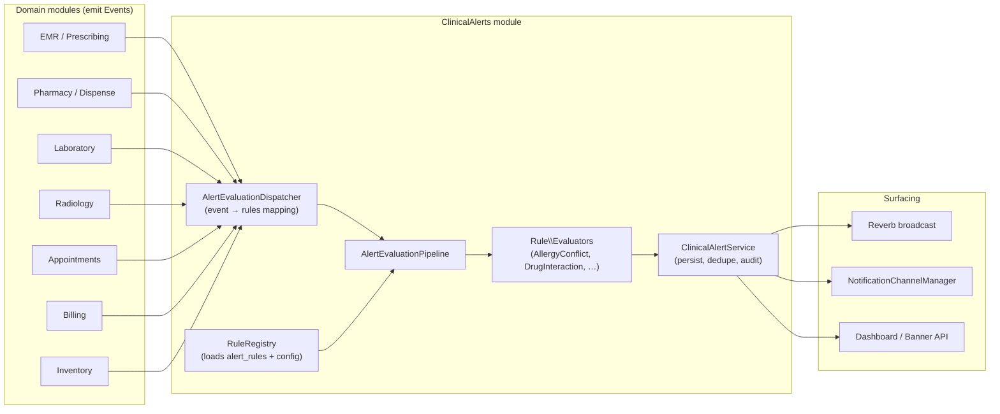
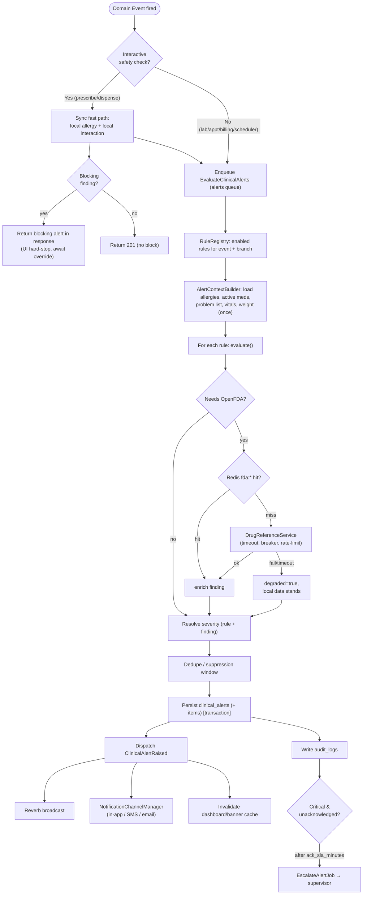

# 18 — Clinical Alerts Engine Design

> **Module:** `ClinicalAlerts` (bounded context, foundation §1).
> **Scope:** Centralized, configurable, event-driven patient-safety alerting across the EMR, Pharmacy, Laboratory, Radiology, Appointments and Billing modules.
> **Authority:** Subordinate to `00-foundation.md`. Implements SRS §4.8 (FR-ALERT-001..005), FRD FR-ALERT-001..012, and the architecture decisions in `09-system-architecture.md` (alerts queue, OpenFDA-cached, broadcast surfacing).
> **Document version:** 1.0 · **Status:** Design baseline

---

## 1. Goals & patient-safety rationale

### 1.1 Why a centralized engine

Clinical errors in a hospital are overwhelmingly **systemic, not individual**: a drug prescribed against a documented allergy, two interacting drugs ordered by different prescribers, a panic potassium value buried in a busy result queue, a duplicated therapy across two visits. These are exactly the failure modes that a computer is good at catching and a busy clinician is not. Afya HMS treats clinical safety alerting as a **first-class, centralized capability** rather than scattered `if` statements inside Pharmacy, Lab and EMR — so that:

- **One rule set, one evaluation pipeline, one audit trail.** No module re-implements interaction logic. The Pharmacy dispense check (FR-RX-003) and the EMR prescribe check (FR-EMR-011) call the **same** engine.
- **Rules are data, not code.** Thresholds, severities and toggles live in `alert_rules` + `config/alerts.php` and are editable by a Hospital Admin (FR-ALERT-010) — never hardcoded.
- **Every alert is acknowledged and audited.** Overrides capture actor, reason and timestamp (FR-ALERT-004, FR-ALERT-008), satisfying the Kenya Data Protection Act 2019 and MOH record-keeping expectations (foundation §11).
- **The system is safe when the internet is not.** Safety-critical interaction/allergy checks rely on an **authoritative local dataset**; OpenFDA is *enrichment only* (SRS AS-4, SW-FDA-3). If OpenFDA is down, alerts still fire.

### 1.2 Design tenets

| Tenet | Consequence in this design |
|---|---|
| **Fail safe, not silent** | If the engine cannot complete (e.g. external lookup times out), it degrades to local data and still raises what it can; it never swallows a potential conflict. |
| **Right alert, right person, right time** | Severity drives surfacing: `critical` is real-time + blocking; `info` is a passive badge. |
| **Fight alert fatigue** | De-duplication windows, per-rule suppression, and acknowledgement state prevent the same alert nagging repeatedly (FR-ALERT-010). |
| **Never the sole gate, but always the gate** | Blocking alerts require an explicit, reasoned override — the clinician stays in control, but the override is captured. |
| **Configurable by clinicians, not engineers** | Thresholds (panic values, balance limits, expiry windows) are admin-editable and versioned. |

### 1.3 Severity model (canonical)

Three machine severities map onto a clinical interpretation and a delivery behavior:

| Severity | Clinical meaning | Default behavior | Example |
|---|---|---|---|
| `info` | FYI; no action mandated | Passive badge / inbox entry, no interruption | Outstanding balance below soft threshold; immunization due |
| `warning` | Action advised; proceed allowed | Interruptive modal, **override-with-reason**, audited | Moderate drug–drug interaction; duplicate therapy; high (non-panic) lab value |
| `critical` | Potential patient harm | **Blocking** hard-stop until acknowledged/overridden; real-time broadcast + notification; escalates if unacknowledged | Allergy conflict; major interaction; panic lab value |

> Severity is a property of the **rule + the matched data**, resolved at evaluation time (see §2.3). A rule may map different findings to different severities (e.g. interaction severity from the dataset → `warning`/`critical`).

---

## 2. Centralized rules engine architecture

### 2.1 Position in the modular monolith



The engine follows the canonical layered architecture (foundation §2): domain **Services** dispatch **Events**; **Listeners** (sync) or **Jobs** (queued `alerts`) drive the **AlertEvaluationPipeline**; results are persisted through a **Repository** and surfaced via **Events/broadcast** and the **NotificationChannelManager** (foundation §8).

### 2.2 Rule definition

A **rule** is a configurable, named unit of safety logic. Each rule has:

- A **persistent definition** row in `alert_rules` (admin-editable: enabled, severity override, threshold params, dedupe window, scope by branch).
- A **code-side evaluator** implementing `AlertRuleEvaluator` — pure logic, no I/O of its own beyond injected repositories/services.
- A **trigger binding**: which domain Event(s) cause it to run, declared in `config/alerts.php`.

```php
// app/Modules/ClinicalAlerts/Contracts/AlertRuleEvaluator.php
interface AlertRuleEvaluator
{
    /** Stable machine key, matches alert_rules.rule_key (e.g. "allergy_conflict"). */
    public function key(): string;

    /** Domain event FQCNs this evaluator reacts to. */
    public function triggers(): array;

    /**
     * Evaluate the rule against an event payload + loaded clinical context.
     * MUST be side-effect free; returns zero or more findings.
     *
     * @return AlertFinding[]
     */
    public function evaluate(AlertContext $context, AlertRuleConfig $config): array;
}
```

```php
// A finding is the raw, un-persisted result of one matched rule.
final class AlertFinding
{
    public function __construct(
        public readonly string $ruleKey,
        public readonly AlertSeverity $severity,   // info|warning|critical (resolved)
        public readonly bool $blocking,
        public readonly string $title,             // human summary, i18n key + params
        public readonly string $message,
        public readonly array $context,            // structured: drugs, codes, values…
        public readonly ?string $sourceType = null,// e.g. Prescription, LabResult
        public readonly ?int $sourceId = null,
        public readonly string $dedupeHash,        // stable hash for suppression window
    ) {}
}
```

### 2.3 Evaluation pipeline

The pipeline is the single path every evaluation takes. It is deterministic and ordered:

1. **Resolve rules** — `RuleRegistry` returns enabled `alert_rules` whose evaluator `triggers()` includes the inbound event, scoped to the event's `branch_id`.
2. **Hydrate context** — `AlertContextBuilder` loads the clinical snapshot needed once (patient allergies, active meds, problem list, recent vitals/labs, weight) so individual evaluators don't each re-query.
3. **Evaluate** — each rule's `evaluate()` runs; external enrichment (OpenFDA) is read from the Redis cache first (§7). Failures are caught per-rule and recorded as `degraded`, never aborting the batch.
4. **Resolve severity** — apply the rule's configured severity (and any per-finding mapping, e.g. interaction severity).
5. **De-duplicate / suppress** — drop findings whose `dedupeHash` matches an open or recently-acknowledged alert within the rule's `suppression_window` (FR-ALERT-010).
6. **Persist** — write `clinical_alerts` rows (+ `clinical_alert_items` for multi-fact alerts) through the repository, inside a transaction.
7. **Surface** — dispatch `ClinicalAlertRaised` → broadcast (Reverb), notifications, dashboard/banner cache invalidation (§6).
8. **Audit** — write an immutable `audit_logs` entry for every raised alert and every later acknowledgement/override (foundation §11).

```php
// app/Modules/ClinicalAlerts/Services/AlertEvaluationPipeline.php
public function run(DomainEvent $event): AlertEvaluationResult
{
    $rules   = $this->registry->rulesFor($event);           // step 1
    $context = $this->contextBuilder->build($event);        // step 2

    $findings = [];
    foreach ($rules as $rule) {
        try {
            $findings = array_merge(
                $findings,
                $rule->evaluator->evaluate($context, $rule->config) // step 3
            );
        } catch (Throwable $e) {
            $this->recordDegraded($rule, $event, $e);           // fail-safe
        }
    }

    $findings = $this->severity->resolve($findings);            // step 4
    $findings = $this->deduper->filter($findings, $context);    // step 5

    return DB::transaction(fn () =>
        $this->alertService->persistAndSurface($findings, $context) // steps 6–8
    );
}
```

### 2.4 Triggers via domain Events

Modules never call the engine directly; they emit events. Binding lives in config (extensible — §8):

| Domain Event | Emitted by | Rules invoked |
|---|---|---|
| `PrescriptionDrafted` / `PrescriptionCreated` | EMR, Pharmacy | Allergy conflict, Drug interaction, Duplicate medication, Dose-range |
| `PrescriptionDispenseRequested` | Pharmacy | Allergy conflict, Drug interaction (re-check at dispense, FR-RX-003) |
| `LabResultEntered` / `LabResultVerified` | Laboratory | Critical lab result (panic/reference range) |
| `VitalsRecorded` | Triage, Nursing | Critical vital sign (FR-ALERT-006) |
| `RadiologyOrderPlaced` | Radiology | Contrast/contraindication (FR-ALERT-005) |
| `AppointmentMissed` | Appointments scheduler | Missed appointment |
| `InvoicePosted` / `BalanceChanged` | Billing | Outstanding balance |
| `MedicationBatchScanned` / nightly job | Inventory | Expiring medication |

### 2.5 Sync vs queued evaluation

Per the foundation §2 and architecture §7 decision rule (*synchronous = caller must see it reflected; asynchronous = can complete slightly later or hits a slow external system*):

| Evaluation | Mode | Queue | Rationale |
|---|---|---|---|
| **Prescribe / dispense safety check** (allergy, interaction, duplicate) | **Synchronous** *fast path* against local data, **then** queued enrichment | `alerts` (high) | The blocking decision must be reflected in the prescribe/dispense response. Local allergy + local interaction tables are evaluated **inline** (in-memory, indexed, < tens of ms) so a blocking alert appears immediately; OpenFDA enrichment + broadcast follow async on the `alerts` queue. |
| **Critical lab result** | **Synchronous** flag on result entry, **queued** notify/escalate | `alerts` | Result entry must show the H/L/panic flag immediately (FR-LAB-006); paging the provider + escalation timer run async. |
| **Critical vital sign** | Synchronous flag, queued broadcast | `alerts` | Same pattern as labs. |
| **Missed appointment / Expiring meds / Outstanding balance** | **Queued** (scheduler-driven) | `alerts` (low) | Batch, non-interactive, time-tolerant. |

> **Two-phase prescribe check.** The interactive request runs *local-only* evaluators synchronously to decide blocking. The dispatched `EvaluateClinicalAlerts` job then re-runs with OpenFDA enrichment; if enrichment surfaces an additional `critical`/`warning` finding, it is persisted and **broadcast** to the prescriber's `private-user.{id}` channel within seconds (architecture §12.3 Flow C). This keeps the request fast and safe without waiting on an external API.

---

## 3. Alert types — trigger logic, data sources, actions

> All thresholds named below are **defaults from `config/alerts.php`**, overridable per rule in `alert_rules` (§4). None are hardcoded.

### 3.1 Allergy conflict (`allergy_conflict`)

- **Trigger:** `PrescriptionDrafted`, `PrescriptionCreated`, `PrescriptionDispenseRequested`.
- **Data sources:** `patient_allergies` (substance, allergen_code, drug_class, reaction, severity, status=`active`; FR-PAT-009) × `drugs` master (RxNorm/ATC class, ingredients). Cross-reactivity map (e.g. penicillin → cephalosporins) from `allergy_cross_reactions` (curated, local, authoritative).
- **Logic:** For each prescribed drug, match against active allergies by (a) exact ingredient/allergen code, (b) ATC/therapeutic **class**, (c) cross-reactivity class. "No Known Allergies" recorded → no match, but absence of *any* allergy record (never asked) yields an `info` "allergy status unknown" nudge.
- **Severity / action:** **`critical`, blocking.** Documented anaphylaxis → hard stop, override-with-reason mandatory (FR-ALERT-001/004/008). Override reason persisted + audited.

### 3.2 Drug interaction (`drug_interaction`)

- **Trigger:** `PrescriptionDrafted`, `PrescriptionCreated`, dispense re-check.
- **Data sources (authoritative-first):**
  1. **Local `drug_interactions`** table (ingredient_a, ingredient_b, severity, mechanism, management, source) — *authoritative*, seeded from a curated dataset (SRS SW-FDA-3, AS-4).
  2. **OpenFDA enrichment** via `DrugReferenceService`, read from Redis `fda:drug:{rxnorm}` (§7) — adds label-level interaction/warning text; never the sole basis for a `critical`.
- **Logic:** Build the candidate set = newly prescribed drug(s) ∪ patient's **active** medications (Pharmacy active prescriptions). Pairwise check each new↔existing and new↔new pair against local interactions; enrich with OpenFDA.
- **Severity mapping:**

  | Dataset severity | Engine severity | Action |
  |---|---|---|
  | `contraindicated` / `major` | `critical` | Blocking, override-with-reason |
  | `moderate` | `warning` | Interruptive, override-with-reason |
  | `minor` | `info` | Passive badge |

- **Action:** Critical/major block at prescribe **and** re-block at dispense (FR-RX-003); pharmacist must resolve before dispensing (FR-PHA-003).

### 3.3 Duplicate medication (`duplicate_medication`)

- **Trigger:** `PrescriptionDrafted` / `PrescriptionCreated`.
- **Data sources:** Active prescriptions for the patient (Pharmacy: status `active`, not yet `completed`/`cancelled`, dispensed window still effective) × `drugs` master (ingredient + therapeutic class).
- **Logic:** Flag when a newly prescribed item overlaps an existing active item by (a) **same active ingredient** (true duplicate), or (b) **same therapeutic class** (duplication of therapy, FR-ALERT-003). Overlap requires the existing prescription's effective period (start → start + days_supply) to intersect "now".
- **Severity / action:** Same ingredient → **`warning`** (override-with-reason). Same class → **`info`/`warning`** per config. Surfaces *before* the drug is added.

### 3.4 Critical lab result (`critical_lab_result`)

- **Trigger:** `LabResultEntered` (draft flag) and `LabResultVerified`.
- **Data sources:** `lab_results` (numeric/coded value, unit, test_code) × `lab_reference_ranges` (per test, **age/sex variant**; FR-LAB-002) × `lab_panic_values` (panic/critical thresholds per test).
- **Logic — auto-flag on result entry (FR-LAB-006):**
  - Value `< low_ref` → flag `L`; `> high_ref` → flag `H`.
  - Value `<= panic_low` or `>= panic_high` → flag **`critical`** (panic value).
  - Reference range selected by patient age band + sex; unit normalized before comparison (mismatched unit → `info` data-quality alert, never a silent miss).
- **Severity / action:** Panic → **`critical`, mandatory acknowledgement** by the ordering provider (FR-ALERT-007); unacknowledged after the rule's `ack_sla_minutes` → **escalation** to backup/supervisor (FR-ALERT-009). H/L (non-panic) → `warning` on the result. Provider notified in-app + (config) SMS.

### 3.5 Expiring medication (`expiring_medication`)

- **Trigger:** Nightly scheduler job `EvaluateExpiringStockJob`, and `MedicationBatchScanned` at dispense.
- **Data sources:** `inventory_batches` (drug_id, lot, expiry_date, quantity_on_hand, branch_id).
- **Logic:** For each branch, flag batches where `expiry_date <= today + expiry_warn_days` and `quantity_on_hand > 0`. Tiered by config: `expiry_warn_days` (default 90) → `warning`; `expiry_critical_days` (default 30) → `critical`; **already expired** with stock → `critical` blocking dispense of that batch.
- **Severity / action:** Pharmacist/Inventory dashboard widget; FIFO-by-expiry dispense (FR-RX-004) consumes near-expiry first; expired batch cannot be dispensed (hard stop on `MedicationBatchScanned`).

### 3.6 Missed appointments (`missed_appointment`)

- **Trigger:** Scheduler job `FlagMissedAppointmentsJob` (runs every `missed_check_interval_minutes`).
- **Data sources:** `appointments` (status `scheduled`/`checked_in`=false, scheduled_at past grace).
- **Logic:** Appointment whose `scheduled_at + grace_minutes < now` and never checked-in → mark `missed`, raise alert. Config: `grace_minutes` (default 30).
- **Severity / action:** **`info`/`warning`** per config. Surfaces to Reception + care team; triggers a follow-up/recall notification to the patient (SMS via NotificationChannelManager) and a "missed appointment" entry on the patient banner.

### 3.7 Outstanding balances (`outstanding_balance`)

- **Trigger:** `InvoicePosted`, `BalanceChanged`, and a daily reconciliation job.
- **Data sources:** Billing — patient ledger / open invoices (`DECIMAL(12,2)`, KES; foundation §3).
- **Logic:** Sum unpaid balance per patient (and optionally per branch). Compare against tiered thresholds: `balance_soft` (default 5,000 KES) → `info`; `balance_hard` (default 20,000 KES) → `warning` shown at check-in/registration; configurable `aging_days` adds severity if overdue.
- **Severity / action:** Surfaces to Cashier/Reception at check-in (banner) and on the billing dashboard. **Never blocks clinical care** — this is operational, not safety; it is `info`/`warning` only, consistent with "cash payment always available" graceful-degradation posture (architecture §15).

---

## 4. Rule configuration (never hardcoded)

### 4.1 `config/alerts.php` — defaults & wiring

```php
// config/alerts.php
return [
    // Global engine behavior
    'queue'                 => env('ALERTS_QUEUE', 'alerts'),
    'default_suppression'   => 240,   // minutes; dedupe window if rule unset
    'escalation_enabled'    => true,

    // Event → evaluator binding (extensible, §8)
    'triggers' => [
        \App\Modules\EMR\Events\PrescriptionDrafted::class => [
            'allergy_conflict', 'drug_interaction', 'duplicate_medication', 'dose_range',
        ],
        \App\Modules\Laboratory\Events\LabResultEntered::class => ['critical_lab_result'],
        \App\Modules\Appointments\Events\AppointmentMissed::class => ['missed_appointment'],
        \App\Modules\Billing\Events\BalanceChanged::class => ['outstanding_balance'],
        // …
    ],

    // Per-rule DEFAULT thresholds (DB rows in alert_rules override these)
    'rules' => [
        'critical_lab_result' => ['ack_sla_minutes' => 30, 'escalate_to' => 'supervisor'],
        'expiring_medication' => ['expiry_warn_days' => 90, 'expiry_critical_days' => 30],
        'missed_appointment'  => ['grace_minutes' => 30, 'check_interval_minutes' => 15],
        'outstanding_balance' => ['balance_soft' => 5000.00, 'balance_hard' => 20000.00,
                                  'aging_days' => 30, 'currency' => 'KES'],
        'drug_interaction'    => ['enrich_openfda' => true],
    ],

    'openfda' => [
        'base_uri'    => env('OPENFDA_BASE_URI', 'https://api.fda.gov'),
        'api_key'     => env('OPENFDA_API_KEY'),       // optional; raises rate limit
        'timeout'     => 4,                            // seconds, queued job only
        'cache_ttl'   => 60 * 60 * 24 * 7,             // 7 days (architecture §10 fda:*)
        'enabled'     => env('OPENFDA_ENABLED', true),
    ],
];
```

### 4.2 `alert_rules` — admin-editable, versioned (FR-ALERT-010)

Admin edits write a new version row and an audit entry; `config/alerts.php` supplies fallbacks for any unset field. Resolution order at runtime: **`alert_rules` row → `config/alerts.php` rule default → engine global default.**

| Column | Type | Notes |
|---|---|---|
| `id` | BIGINT PK | |
| `rule_key` | varchar | matches evaluator `key()`, e.g. `drug_interaction` |
| `name`, `description` | varchar/text | admin-facing |
| `is_enabled` | boolean | kill-switch per rule |
| `severity_override` | enum nullable | force `info`/`warning`/`critical` |
| `blocking_override` | boolean nullable | force blocking on/off |
| `params` | json | thresholds (panic values, days, KES limits) |
| `suppression_window` | unsigned int (min) | dedupe / fatigue control |
| `ack_sla_minutes` | unsigned int nullable | escalation timer |
| `branch_id` | BIGINT nullable | null = all branches (global), else per-branch override |
| `version` | unsigned int | incremented on edit |
| `updated_by` | BIGINT FK users | audit |
| `created_at/updated_at` | timestamps | |

> Per foundation §4, `alert_rules` is **reference/configuration data**: a `branch_id` of `null` applies globally; a non-null row overrides for that branch. Master interaction/allergy/reference data (`drug_interactions`, `allergy_cross_reactions`, `lab_panic_values`) are **global** (no `branch_id`).

---

## 5. Data model

Consistent with foundation §3 (BIGINT PKs, `branch_id`, UTC timestamps, soft deletes on domain tables). Clinical alerts are clinical records → **soft-delete only, never hard-delete** (foundation §11, ≥10-year retention).

### 5.1 `clinical_alerts`

| Column | Type | Notes |
|---|---|---|
| `id` | BIGINT UNSIGNED PK | |
| `public_id` | char(36) UUID | externally exposed (banner/links) |
| `branch_id` | BIGINT FK branches | `BranchScope` applies |
| `patient_id` | BIGINT FK patients | indexed |
| `rule_key` | varchar | which rule fired |
| `rule_version` | unsigned int | snapshot of the rule version that fired |
| `severity` | enum(`info`,`warning`,`critical`) | resolved |
| `is_blocking` | boolean | hard-stop semantics |
| `status` | enum(`active`,`acknowledged`,`overridden`,`resolved`,`expired`,`suppressed`) | lifecycle |
| `title` | varchar | i18n key |
| `message` | text | rendered summary |
| `context` | json | drugs/codes/values/refs |
| `dedupe_hash` | char(64) | suppression key; indexed w/ patient_id |
| `source_type`, `source_id` | varchar/BIGINT | polymorphic origin (Prescription, LabResult, Invoice…) |
| `triggered_by_event` | varchar | event FQCN, traceability |
| `degraded` | boolean | true if enrichment (OpenFDA) was unavailable |
| `raised_by` | BIGINT FK users nullable | null when system/scheduler |
| `escalated_at` | timestamp nullable | set when SLA breached |
| `expires_at` | timestamp nullable | auto-expire for transient alerts |
| `created_at/updated_at/deleted_at` | timestamps | soft delete |

Indexes: `(patient_id, status)`, `(branch_id, severity, status)`, `(dedupe_hash, patient_id)`, `(source_type, source_id)`.

### 5.2 `clinical_alert_items` (multi-fact alerts)

One alert may bundle several facts (e.g. three interacting pairs). Optional child rows:

| Column | Type | Notes |
|---|---|---|
| `id` | BIGINT PK | |
| `clinical_alert_id` | BIGINT FK | |
| `item_type` | varchar | `interaction_pair`, `allergen_match`, `panic_value` |
| `payload` | json | structured fact |

### 5.3 `alert_acknowledgements`

Append-only acknowledgement / override ledger (FR-ALERT-004/008/011).

| Column | Type | Notes |
|---|---|---|
| `id` | BIGINT PK | |
| `clinical_alert_id` | BIGINT FK | |
| `action` | enum(`acknowledged`,`overridden`,`dismissed`,`escalated`) | |
| `actor_id` | BIGINT FK users | who |
| `actor_role` | varchar | snapshot of role slug |
| `reason` | text nullable | **mandatory for `overridden`** (FR-ALERT-008) |
| `acknowledged_at` | timestamp | |
| `branch_id` | BIGINT FK | |
| `created_at` | timestamp | immutable; no update/delete |

> **Audit linkage.** Beyond this ledger, every raise/ack/override also writes the immutable `audit_logs` security/PHI event (foundation §11) — `alert_acknowledgements` is the clinical workflow record; `audit_logs` is the tamper-evident security record.

### 5.4 Supporting reference tables (global)

`drug_interactions`, `allergy_cross_reactions`, `lab_reference_ranges`, `lab_panic_values` — curated, authoritative, no `branch_id`. `patient_allergies`, `inventory_batches`, `lab_results` are owned by EMR/Inventory/Lab respectively and are **read** by the engine (the engine does not own them).

---

## 6. Delivery & surfacing

A raised alert fans out via the `ClinicalAlertRaised` event to multiple channels, severity-gated.

### 6.1 Channel matrix

| Surface | info | warning | critical |
|---|---|---|---|
| **Dashboard widget** (Alert Center inbox, FR-ALERT-011) | badge | listed | listed + highlighted |
| **In-app real-time** (Reverb broadcast → `private-user.{id}` / `private-care-team.{patientId}`) | — | toast | blocking modal |
| **Patient-record banner** (sticky, on chart open) | shown | shown | shown + must-acknowledge |
| **Notification — in-app** (NotificationChannelManager) | optional | yes | yes |
| **Notification — SMS** (AfricasTalking, foundation §8) | no | config | config (e.g. on-call provider) |
| **Notification — email** (Mailgun/Resend) | no | config | config (supervisor on escalation) |

> Notifications **always** go through `NotificationChannelManager` / Laravel Notifications + custom channels (foundation §8). The engine never calls AfricasTalking, Mailgun or Resend SDKs directly.

### 6.2 Acknowledgement & audit flow

1. Alert raised → `clinical_alerts.status = active`; if `is_blocking`, the originating action (prescribe/dispense) is gated in the UI.
2. Clinician acknowledges (warning) or **overrides with reason** (blocking) → `alert_acknowledgements` row + `clinical_alerts.status` transition + `audit_logs` entry.
3. Critical, unacknowledged past `ack_sla_minutes` → `EscalateAlertJob` sets `escalated_at`, notifies backup/supervisor (FR-ALERT-009).
4. Source condition resolved (e.g. balance paid, batch removed, result acknowledged) → `status = resolved`.

### 6.3 Dashboard widget API

`GET /api/v1/clinical-alerts?status=active&severity=critical&scope=mine` → `ClinicalAlertResource` collection, branch-scoped, RBAC-gated (`alerts.view`). The patient banner reads `GET /api/v1/patients/{public_id}/alerts?status=active`. Widget counts cached in Redis (`alerts:count:{branch}:{user}`), invalidated on raise/ack.

---

## 7. OpenFDA integration

Wrapped behind `DrugReferenceService` (architecture §9, §11). **Enrichment only — never authoritative** (SRS AS-4, SW-FDA-3).

### 7.1 Endpoints & usage

- **Drug label:** `GET https://api.fda.gov/drug/label.json?search=openfda.rxcui:"{rxcui}"` — `drug_interactions`, `warnings`, `contraindications`, `boxed_warning` fields enrich interaction context.
- **Adverse events (optional):** `GET /drug/event.json` for signal context; not used for blocking decisions.

### 7.2 Caching (architecture §10)

- Read-through Redis cache keyed `fda:drug:{rxcui}`, TTL **7 days** (`config('alerts.openfda.cache_ttl')`). The pipeline reads cache first; a miss enqueues a refresh and proceeds on local data.
- Negative results cached (shorter TTL) to avoid repeat lookups for unknown codes.

### 7.3 Rate limits

- OpenFDA: ~240 requests/min and 1,000/day **without** an API key; ~240/min and 120,000/day **with** a key. Mitigations: aggressive long-TTL caching, batching, and **only calling on the queued enrichment phase** (never the interactive request, NFR-PERF-006). A token-bucket guard in `DrugReferenceService` throttles outbound calls; on bucket exhaustion the lookup is skipped (local data stands) and retried later.

### 7.4 Failure handling & fallback

- 4-second timeout on the queued job; on timeout/5xx/rate-limit → mark the affected alert `degraded = true` and **continue on the authoritative local dataset** (SRS FR-ALERT-005, AS-4). The safety decision is never blocked by OpenFDA availability.
- Circuit-breaker: after N consecutive failures, OpenFDA is short-circuited for a cooldown window; all checks run local-only; a system `info` alert notifies admins that enrichment is degraded.
- `OPENFDA_ENABLED=false` (config) fully disables enrichment with no code change — the engine runs purely on local datasets.

```php
// app/Modules/ClinicalAlerts/Services/DrugReferenceService.php
public function interactionsFor(string $rxcui): DrugReference
{
    return Cache::remember("fda:drug:{$rxcui}", config('alerts.openfda.cache_ttl'),
        function () use ($rxcui) {
            if (! config('alerts.openfda.enabled') || $this->breaker->isOpen()) {
                return DrugReference::degraded();           // local-only path
            }
            try {
                $res = $this->http->timeout(config('alerts.openfda.timeout'))
                    ->get('/drug/label.json', ['search' => "openfda.rxcui:\"{$rxcui}\""]);
                $this->breaker->recordSuccess();
                return DrugReference::fromOpenFda($res->json());
            } catch (Throwable $e) {
                $this->breaker->recordFailure();
                report($e);
                return DrugReference::degraded();           // graceful fallback
            }
        });
}
```

---

## 8. Engine extensibility — adding a new rule

Adding a rule is **config + one class**, no engine changes (Open/Closed, foundation §2):

1. **Create the evaluator** implementing `AlertRuleEvaluator` under `app/Modules/ClinicalAlerts/Rules/`, declaring its `key()` and `triggers()`.
2. **Tag it** with `#[AsAlertRule]` (or register in the `clinicalalerts.php` service provider) so the `RuleRegistry` auto-discovers it.
3. **Add the event binding** to `config/alerts.php` `triggers` (or rely on the evaluator's own `triggers()`).
4. **Seed defaults** in `config/alerts.php` `rules` and an optional migration for an `alert_rules` row (so admins can edit it).
5. **Add reference data** if needed (e.g. a new lookup table), kept global unless branch-specific.
6. **Tests:** a Pest unit test per evaluator (pure logic) + a feature test asserting the event raises the expected `clinical_alerts` row and surfacing (foundation §14, ≥80% coverage).

No controller, pipeline, surfacing or notification code is touched — the registry, pipeline and surfacing layers are generic over `AlertRuleEvaluator`.

---

## 9. Evaluation pipeline — flow diagram



---

## 10. Example rule implementations

### 10.1 Allergy conflict (blocking, critical)

```php
// app/Modules/ClinicalAlerts/Rules/AllergyConflictRule.php
#[AsAlertRule]
final class AllergyConflictRule implements AlertRuleEvaluator
{
    public function __construct(
        private readonly AllergyCrossReactionRepository $crossReactions,
    ) {}

    public function key(): string { return 'allergy_conflict'; }

    public function triggers(): array
    {
        return [PrescriptionDrafted::class, PrescriptionCreated::class,
                PrescriptionDispenseRequested::class];
    }

    public function evaluate(AlertContext $ctx, AlertRuleConfig $config): array
    {
        $findings = [];

        foreach ($ctx->prescribedDrugs() as $drug) {
            foreach ($ctx->activeAllergies() as $allergy) {       // status = active
                if (! $this->matches($drug, $allergy)) {
                    continue;
                }

                $severity = $allergy->reactionSeverity === 'anaphylaxis'
                    ? AlertSeverity::Critical
                    : ($config->severityOverride() ?? AlertSeverity::Critical);

                $findings[] = new AlertFinding(
                    ruleKey:    $this->key(),
                    severity:   $severity,
                    blocking:   $config->blockingOverride() ?? true,
                    title:      'alerts.allergy_conflict.title',
                    message:    "Patient is allergic to {$allergy->substance} "
                              . "({$allergy->reaction}); {$drug->name} conflicts.",
                    context:    ['drug' => $drug->only(['id','name','rxcui','class']),
                                 'allergy' => $allergy->only(['id','substance','reaction'])],
                    sourceType: 'Prescription',
                    sourceId:   $ctx->prescriptionId(),
                    dedupeHash: hash('sha256', "allergy:{$ctx->patientId()}:{$drug->id}:{$allergy->id}"),
                );
            }
        }

        return $findings;
    }

    private function matches(DrugDto $drug, AllergyDto $allergy): bool
    {
        // (a) exact ingredient / allergen code
        if ($drug->rxcui && $drug->rxcui === $allergy->allergenCode) return true;
        // (b) same therapeutic class
        if ($drug->atcClass && $drug->atcClass === $allergy->drugClass) return true;
        // (c) curated cross-reactivity (e.g. penicillin → cephalosporin)
        return $this->crossReactions->areCrossReactive($drug->atcClass, $allergy->drugClass);
    }
}
```

### 10.2 Drug interaction (severity-mapped, OpenFDA-enriched)

```php
// app/Modules/ClinicalAlerts/Rules/DrugInteractionRule.php
#[AsAlertRule]
final class DrugInteractionRule implements AlertRuleEvaluator
{
    public function __construct(
        private readonly DrugInteractionRepository $local,    // AUTHORITATIVE
        private readonly DrugReferenceService $openFda,       // enrichment only
    ) {}

    public function key(): string { return 'drug_interaction'; }

    public function triggers(): array
    {
        return [PrescriptionDrafted::class, PrescriptionCreated::class,
                PrescriptionDispenseRequested::class];
    }

    public function evaluate(AlertContext $ctx, AlertRuleConfig $config): array
    {
        $candidates = $ctx->prescribedDrugs()
            ->merge($ctx->activeMedications())   // existing active prescriptions
            ->unique('rxcui');

        $findings = [];
        foreach ($candidates->crossJoinPairs() as [$a, $b]) {
            $hit = $this->local->find($a->ingredient, $b->ingredient); // local-first
            if (! $hit) {
                continue;
            }

            $severity = match ($hit->severity) {                // mapping (§3.2)
                'contraindicated', 'major' => AlertSeverity::Critical,
                'moderate'                 => AlertSeverity::Warning,
                default                    => AlertSeverity::Info,
            };
            $severity = $config->severityOverride() ?? $severity;

            // Enrichment — degrades gracefully if OpenFDA down (§7.4)
            $label = $config->param('enrich_openfda', true)
                ? $this->openFda->interactionsFor($a->rxcui)
                : DrugReference::degraded();

            $findings[] = new AlertFinding(
                ruleKey:    $this->key(),
                severity:   $severity,
                blocking:   $severity === AlertSeverity::Critical,
                title:      'alerts.drug_interaction.title',
                message:    "{$a->name} + {$b->name}: {$hit->management}",
                context:    ['pair' => [$a->name, $b->name], 'mechanism' => $hit->mechanism,
                             'source' => 'local', 'openfda' => $label->summary()],
                sourceType: 'Prescription',
                sourceId:   $ctx->prescriptionId(),
                dedupeHash: hash('sha256', "ddi:{$ctx->patientId()}:"
                            . implode('|', collect([$a->rxcui,$b->rxcui])->sort()->all())),
            );
        }

        return $findings;
    }
}
```

### 10.3 Critical lab result (panic value, escalation)

```php
// app/Modules/ClinicalAlerts/Rules/CriticalLabResultRule.php
#[AsAlertRule]
final class CriticalLabResultRule implements AlertRuleEvaluator
{
    public function __construct(
        private readonly ReferenceRangeRepository $ranges,
        private readonly PanicValueRepository $panic,
    ) {}

    public function key(): string { return 'critical_lab_result'; }

    public function triggers(): array
    {
        return [LabResultEntered::class, LabResultVerified::class];
    }

    public function evaluate(AlertContext $ctx, AlertRuleConfig $config): array
    {
        $result = $ctx->labResult();
        if (! $result->isNumeric()) {
            return [];
        }

        $value = $result->normalizedValue();   // unit-normalized
        $range = $this->ranges->for($result->testCode, $ctx->patientAgeBand(), $ctx->patientSex());
        $panic = $this->panic->for($result->testCode);

        $isPanic = $panic && ($value <= $panic->low || $value >= $panic->high);
        $isAbn   = $range && ($value < $range->low || $value > $range->high);

        if (! $isPanic && ! $isAbn) {
            return [];
        }

        $severity = $isPanic
            ? AlertSeverity::Critical
            : AlertSeverity::Warning;

        return [new AlertFinding(
            ruleKey:    $this->key(),
            severity:   $config->severityOverride() ?? $severity,
            blocking:   false,                                   // mandatory ack, not a hard stop
            title:      $isPanic ? 'alerts.lab.panic.title' : 'alerts.lab.abnormal.title',
            message:    "{$result->testName} = {$result->value} {$result->unit} "
                      . ($isPanic ? '(PANIC)' : '(abnormal)'),
            context:    ['test' => $result->testCode, 'value' => $value,
                         'ref' => $range?->toArray(), 'panic' => $panic?->toArray(),
                         'ack_sla_minutes' => $config->param('ack_sla_minutes', 30)],
            sourceType: 'LabResult',
            sourceId:   $result->id,
            dedupeHash: hash('sha256', "lab:{$result->id}:" . ($isPanic ? 'panic' : 'abn')),
        )];
        // Escalation (FR-ALERT-009) is driven post-persist by EscalateAlertJob
        // when status stays `active` beyond ack_sla_minutes.
    }
}
```

---

## 11. Traceability

| Requirement | Covered by |
|---|---|
| SRS FR-ALERT-001..005, AS-4, SW-FDA-1..3 | §1, §3, §7 |
| FRD FR-ALERT-001 (allergy) | §3.1, §10.1 |
| FRD FR-ALERT-002 (interaction, severity) | §3.2, §10.2 |
| FRD FR-ALERT-003 (duplicate therapy) | §3.3 |
| FRD FR-ALERT-006 (critical vitals) | §2.4, §2.5 |
| FRD FR-ALERT-007/009 (critical lab + escalation) | §3.4, §6.2, §10.3 |
| FRD FR-ALERT-004/008 (override + audit) | §5.3, §6.2 |
| FRD FR-ALERT-010 (configurable rules) | §4 |
| FRD FR-ALERT-011 (alert inbox) | §6.1, §6.3 |
| Foundation §2 (layers, events), §3 (data), §8 (notifications), §11 (audit) | throughout |
| Architecture §7 (sync/async), §9–11 (OpenFDA cache, degradation) | §2.5, §7 |

---

*End of document 18 — Clinical Alerts Engine Design.*
