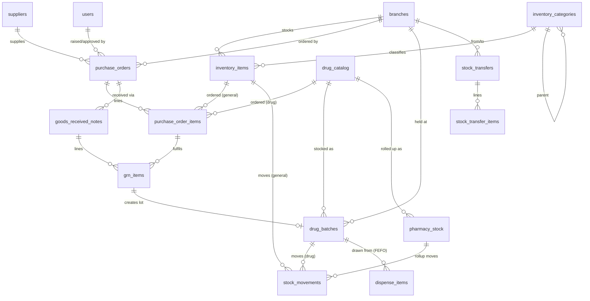
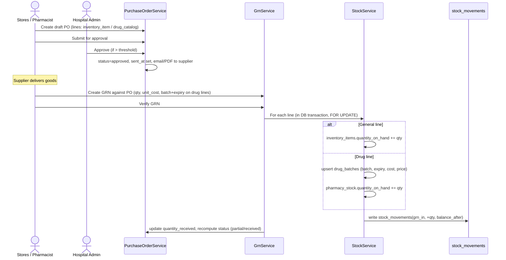
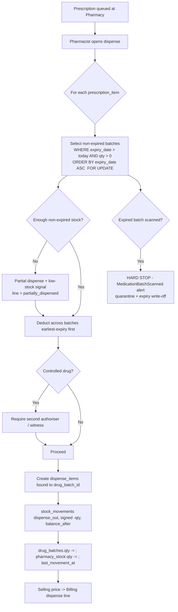
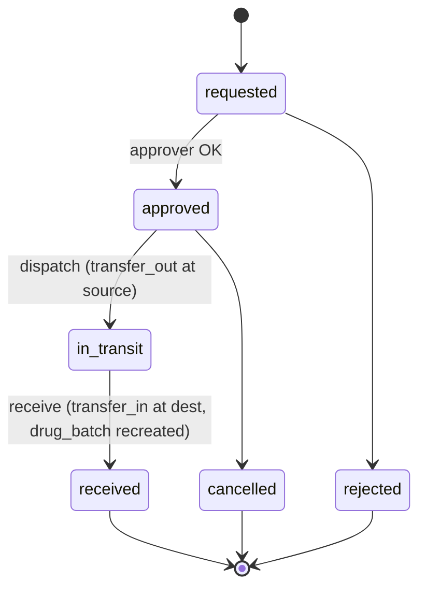

# 19 — Inventory Management Design

> **Scope:** Exhaustive design for Afya HMS inventory across **two distinct systems** —
> **Pharmacy inventory** (drugs, with batch + expiry + controlled-drugs control) and
> **Hospital (general) inventory** (non-drug consumables, equipment, PPE, oxygen, office).
> **Authority:** `00-foundation.md` wins on all cross-cutting decisions. Data models here are
> consistent with `10-database-erd.md` and `11-database-schema.md`; alert behaviour with
> `18-clinical-alerts-design.md`; API conventions with `12-api-specification.md`; RBAC with
> `08-rbac-matrix.md`.
>
> **Module:** `Inventory` (general supply chain) + `Pharmacy` (drug stock). **Status:** MVP baseline.

---

## Table of Contents

1. [Why Two Separate Inventories](#1-why-two-separate-inventories)
2. [Shared Principles & Conventions](#2-shared-principles--conventions)
3. [Hospital (General) Inventory](#3-hospital-general-inventory)
4. [Pharmacy Inventory](#4-pharmacy-inventory)
5. [Reorder & Alerts Logic](#5-reorder--alerts-logic)
6. [Inter-Branch Stock Transfers](#6-inter-branch-stock-transfers)
7. [Data Models](#7-data-models)
8. [Workflows & Diagrams](#8-workflows--diagrams)
9. [Reports](#9-reports)
10. [API Endpoints](#10-api-endpoints)
11. [Roles & Permissions](#11-roles--permissions)
12. [Configuration Keys](#12-configuration-keys)

---

## 1. Why Two Separate Inventories

Afya HMS deliberately runs **two inventory subsystems** with separate data structures, workflows,
screens, and reports. They share the procurement spine (suppliers → PO → GRN → stock_movements ledger)
but diverge everywhere a drug differs from a box of gloves.

### 1.1 Fundamentally different items

| Dimension | Pharmacy (drugs) | Hospital general (supplies/equipment) |
|---|---|---|
| Identity | Generic + brand + form + strength (`drug_catalog`) | SKU + name + category (`inventory_items`) |
| Tracked unit | **Batch/lot** with manufacture & **expiry** date | Plain item quantity (mostly no expiry) |
| Stock granularity | Per **batch** per branch (`drug_batches`), rolled up to `pharmacy_stock` | Per item per branch (`inventory_items.quantity_on_hand`) |
| Consumption rule | **FEFO** (First-Expiry-First-Out) at dispensing | FIFO/manual issue; no clinical expiry rule |
| Legal control | **Controlled / scheduled drugs** require a register + dual sign-off + audit | None |
| Clinical safety | Expired stock is a **hard stop** on dispense (clinical alert) | Expired stock is rare (sutures/reagents); soft warning only |
| Pricing | `cost_price` + `selling_price` per batch (billable to patient) | `unit_cost` only (internal consumable, usually not patient-billed line) |
| Demand source | **Prescriptions / dispenses** | Departmental requisitions, ward stock, theatre, housekeeping |
| Regulator | Pharmacy & Poisons Board, MOH | Internal stores / procurement |
| Owner role | **Pharmacist** | **Hospital Admin / Stores / Inventory officer** |

### 1.2 Why not one unified table

- **Expiry & batch tracking** is mandatory for drugs and pointless overhead for office paper. A single
  table would force nullable batch/expiry columns on everything and weaken FEFO query plans.
- **Controlled-drugs law** (Pharmacy & Poisons Board) demands a tamper-evident register, balances after
  every movement, and dual authorisation. Mixing it into general stores dilutes the audit boundary.
- **Different reorder economics:** drugs reorder against forecast dispensing and expiry shrinkage; general
  supplies reorder against burn-rate min/max. Different thresholds, different alert severities.
- **Clinical coupling:** pharmacy stock is wired into prescribing/dispensing and Clinical Alerts
  (`expiring_medication`, dispense hard-stop). General stock is not clinical and must not raise clinical alerts.
- **Separation of duties:** the pharmacist owns drug stock; stores/admin owns supplies. RBAC is cleaner
  with two permission namespaces (`pharmacy.*` vs `inventory.*`).

### 1.3 What they share

A common **procurement spine** and a single **immutable ledger**:
`suppliers` → `purchase_orders` (+items) → `goods_received_notes` (+items) → **`stock_movements`** (polymorphic).
PO/GRN lines carry *either* `inventory_item_id` (general) *or* `drug_catalog_id` (pharmacy), so one PO can
order both, and the GRN routes each line to the correct stock structure on receipt.

---

## 2. Shared Principles & Conventions

Per Foundation:

- **Branch scoping:** every operational table carries `branch_id`; `BranchScope` global scope auto-filters
  by the user's active branch. `drug_catalog`, `suppliers` (shared rows), and global `inventory_categories`
  are reference data and may omit / null `branch_id`. Stock (`drug_batches`, `pharmacy_stock`,
  `inventory_items.quantity_on_hand`) is **always per-branch** — there is no global stock pool.
- **PO numbering:** `PO-{BRANCH}-YYYY-0001` via `SequenceService` (scope `po:{BRANCH}:{YYYY}`), e.g.
  `PO-NRB-2026-0044`. GRN numbering: `GRN-{BRANCH}-YYYY-0001`. Stock-take: `STK-{BRANCH}-YYMMDD-0001`.
- **Money:** `DECIMAL(12,2)`, `KES`, never floats. **Quantities:** `DECIMAL(12,2)` (supports part-units, ml).
- **Stock movements are append-only** (no soft delete) — corrections are *new* compensating movements.
- **Transactions:** any operation touching stock runs in a DB transaction with `SELECT … FOR UPDATE`
  on the affected stock row(s), so concurrent dispense/receive/transfer cannot oversell or race the balance.
- **Single source of truth for "what happened":** `stock_movements`. `inventory_items.quantity_on_hand`,
  `drug_batches.quantity_on_hand`, and `pharmacy_stock.quantity_on_hand` are **derived caches** kept in step
  inside the same transaction; a nightly job reconciles cache vs ledger and flags drift.

---

## 3. Hospital (General) Inventory

Covers non-drug stockable goods: **PPE** (masks, gowns, face shields), **gloves**, **syringes & needles**,
**oxygen** (cylinders/concentrator consumables), **cleaning/housekeeping**, **office/stationery**,
**linen**, **lab/radiology consumables that are not reagents-with-expiry**, and **minor equipment**.

### 3.1 Item catalog (`inventory_items`)

Per-branch catalog of stockable goods. Key fields (full DDL in §7): `branch_id`, `category_id`, `sku`
(unique per branch), `name`, `unit`, `quantity_on_hand`, `reorder_level`, `reorder_quantity`,
`unit_cost`, `is_active`. SKU convention: `{CAT}-{NNNN}` (e.g. `PPE-0012`, `SYR-0003`).

### 3.2 Categories (`inventory_categories`)

Hierarchical (`parent_id`), branch-aware (`branch_id` NULL = global category usable by all branches).
Seed taxonomy:

```
PPE
  ├── Masks / Respirators
  ├── Gloves (exam, surgical)
  └── Gowns & Aprons
Consumables
  ├── Syringes & Needles
  ├── IV / Cannula / Giving sets
  └── Dressings & Sutures (non-expiry)
Medical Gases
  └── Oxygen (cylinders, regulators)
Housekeeping / Cleaning
Office / Stationery
Linen
Equipment (minor / trackable)
```

### 3.3 Units of measure (UoM)

`unit` is a controlled vocabulary (config-seeded, not free text in UI): `piece`, `box`, `pack`, `pair`,
`roll`, `bottle`, `litre`, `ml`, `cylinder`, `set`, `ream`. **Pack/issue ratios** (e.g. 1 box = 100 gloves)
are modelled by ordering in the *stock unit* and storing a `pack_size` hint on the catalog item; receipts
and issues are always recorded in the **stock unit** to keep the ledger unambiguous.

### 3.4 Reorder levels — min/max

Each item carries `reorder_level` (min) and `reorder_quantity` (suggested top-up to reach max). When
`quantity_on_hand <= reorder_level` a **low-stock** alert/widget fires (§5) and the item appears on the
auto-generated **reorder suggestion** list, which the stores officer turns into a draft PO.

### 3.5 Suppliers (`suppliers`)

Shared vendor master (`branch_id` NULL = used by all branches; a non-null row is a branch-private vendor).
Fields: `name`, `code`, `contact_person`, `phone`, `email`, `address`, `kra_pin` (Kenya tax PIN),
`payment_terms`, `is_active`. Suppliers are shared between **both** inventory systems.

### 3.6 Purchase orders — lifecycle

PO header (`purchase_orders`) + lines (`purchase_order_items`). A line references **either**
`inventory_item_id` (general) **or** `drug_catalog_id` (pharmacy) — one PO may mix both.

```
draft → submitted → approved → (sent to supplier) → partially_received → received
                         └────────────→ cancelled (any pre-received state)
```

| Status | Meaning | Who | Notes |
|---|---|---|---|
| `draft` | Being built; editable | Stores/Pharmacist | No stock effect. |
| `submitted` | Routed for approval | Stores/Pharmacist | Locks lines from edit except by approver. |
| `approved` | Authorised to purchase | Hospital Admin (approver) | Above a config money threshold, approval is mandatory. |
| *sent* | Emitted to supplier (PDF/email) | System | Tracked via `sent_at`; not a separate enum value but a flag/event after `approved`. |
| `partially_received` | Some lines/quantities received via GRN | Stores | Auto-set when GRN < ordered. |
| `received` | Fully fulfilled | Stores | Auto-set when all lines fully received. |
| `cancelled` | Abandoned | Admin | Only before any GRN exists. |

> The schema enum is `('draft','submitted','approved','partially_received','received','cancelled')`.
> "Sent" is represented by an `approved` PO with a populated `sent_at`/`PurchaseOrderSent` event to keep
> the enum minimal; UI shows it as a distinct step.

PO totals (`subtotal`, `tax_amount` (16% VAT default, configurable), `total_amount`) are recomputed on
every line change inside a transaction.

### 3.7 Goods Received Notes (GRN)

`goods_received_notes` (+`grn_items`) record the **physical receipt** against a PO (or a direct/ad-hoc
receipt with `purchase_order_id` NULL). GRN is the **only** trigger that increases general/pharmacy stock.

- Receiver checks delivered qty vs ordered, records `delivery_note_ref`, `invoice_ref`, batch/expiry on
  drug lines, and per-line `quantity_received` + `unit_cost`.
- On `verified`, the service:
  - **General line** → increments `inventory_items.quantity_on_hand`, writes `stock_movements (grn_in)`.
  - **Drug line** → creates/updates a `drug_batches` row (batch+expiry+cost+selling price), bumps
    `pharmacy_stock.quantity_on_hand`, writes `stock_movements (grn_in)`, links `drug_batches.grn_item_id`.
  - Updates `purchase_order_items.quantity_received` and recomputes PO status.
- GRN status: `draft → received → verified` (or `rejected`). Stock effect happens on **verified**.
- Over-receipt beyond ordered qty is allowed only with `inventory.grn.over-receive` permission + reason.

### 3.8 Stock movements (`stock_movements`)

The immutable ledger for **both** systems (polymorphic `stockable_type`/`stockable_id` →
`InventoryItem`, `DrugBatch`, or `PharmacyStock`). `movement_type`:
`grn_in`, `dispense_out`, `adjustment`, `transfer_in`, `transfer_out`, `return`, `wastage`, `expiry`.
`quantity` is **signed** (+in / −out); `balance_after` snapshots the resulting on-hand for audit;
`reference_type`/`reference_id` point to the cause (`GrnItem`, `DispenseItem`, `StockTransfer`,
`StockAdjustment`). Every write records `performed_by` and `moved_at`.

### 3.9 Stock-take / reconciliation

Periodic physical count to true-up the system:

1. Open a **stock-take session** (`STK-{BRANCH}-YYMMDD-0001`) scoped to a category/location; system snapshots
   expected on-hand per item.
2. Counters enter **counted quantity** (offline-capable via PWA, background-synced).
3. System computes **variance** (counted − expected) per line.
4. Supervisor reviews; on approval each non-zero variance posts a `stock_movements (adjustment)` with reason
   `stock_take:{session}` so the ledger and cache converge. Counts within a config tolerance auto-pass;
   variances above tolerance require a written reason and supervisor sign-off.

### 3.10 Valuation

- Method: **Weighted Average Cost (WAC)** for general items (recomputed on each `grn_in`), and
  **actual batch cost** for drugs (each `drug_batches.cost_price` is the true cost of that lot — drugs are
  valued lot-by-lot, which also supports expiry write-off accounting).
- **Stock value** report = Σ(`quantity_on_hand` × cost). Movements drive a periodic COGS figure for Billing/Reporting.
- Expiry/wastage movements feed a **shrinkage / write-off** value report.

---

## 4. Pharmacy Inventory

Covers drugs only. Built on `drug_catalog` (global formulary) → `drug_batches` (per-branch lots) →
`pharmacy_stock` (per-branch rollup), consumed by `dispenses`/`dispense_items` under **FEFO**.

### 4.1 Drug catalog (`drug_catalog`) — global reference

No `branch_id` (shared formulary, Foundation §4). Fields: `code` (formulary SKU, unique),
`generic_name`, `brand_name`, `form` (tablet/syrup/injection/cream…), `strength` (`500mg`), `unit`
(tablet/ml/vial), `atc_code`, **`is_controlled`** (scheduled-drug flag), `is_active`. Fulltext index on
generic+brand for prescriber search. Adding to the catalog is an admin/pharmacist governance action; branches
*stock* from it but cannot fork it.

### 4.2 Batch tracking (`drug_batches`)

Per-branch physical lots: `batch_number`, `expiry_date`, `quantity_received`, `quantity_on_hand`,
`cost_price`, `selling_price`, `supplier_id`, `grn_item_id` (provenance), `received_at`. Unique on
`(branch_id, drug_catalog_id, batch_number)`. This is the unit FEFO draws from and expiry alerts watch
(index on `expiry_date`). Manufacture date is captured on the GRN line; expiry is the dispensing-critical date.

### 4.3 `pharmacy_stock` rollup

Denormalised per-`(branch_id, drug_catalog_id)` aggregate: `quantity_on_hand` (Σ of that drug's batches),
`reorder_level`, `reorder_quantity`, `last_movement_at`. Exists for fast reorder queries and dashboards
without summing batches at read time. Kept in step inside the dispense/GRN/transfer transaction.

### 4.4 Expiry tracking & FEFO dispensing

- **FEFO** = consume the batch with the **earliest non-expired** `expiry_date` first. The dispense service
  selects candidate batches `WHERE quantity_on_hand > 0 AND expiry_date > today` **ORDER BY expiry_date ASC**,
  locks them `FOR UPDATE`, and deducts across batches until the prescribed quantity is met.
- **Expired batches are excluded** from FEFO selection and are a **hard stop** if scanned/selected
  (Clinical Alerts `MedicationBatchScanned` → block). Expired stock with on-hand > 0 must be quarantined and
  written off via a `stock_movements (expiry)` movement.
- If available non-expired stock < required, dispense is **partial** and the prescription line goes
  `partially_dispensed`; the shortfall raises a low-stock signal.

### 4.5 Controlled-drugs register & audit

For any `drug_catalog.is_controlled = 1`:

- **Every** movement (in/out/adjust/wastage/expiry/transfer) is written to a dedicated
  **controlled-drugs register view** built from `stock_movements` filtered to controlled drugs, showing a
  running **balance after each entry** (already captured in `stock_movements.balance_after`).
- **Dual authorisation:** dispensing and any adjustment/wastage of a controlled drug require a **second
  authoriser** (pharmacist/witness); both user ids are recorded (`performed_by` + a `witnessed_by` reference
  carried in the movement `reason`/metadata and in the dispense record).
- **Immutable audit:** controlled-drug movements are append-only (ledger never soft-deletes) and additionally
  written to the global immutable `audit_logs` (PHI/security stream, Foundation §11).
- **Register report** is printable/exportable per branch per period for Pharmacy & Poisons Board inspection.

### 4.6 Reorder & stock alerts

`pharmacy_stock.quantity_on_hand <= reorder_level` → **low-stock** alert + reorder suggestion. Out-of-stock
(`= 0`) for an actively-prescribed drug escalates severity. Expiry windows feed the clinical alert engine (§5).

### 4.7 Link to dispensing

Pharmacy stock is the consumption sink of the prescribing pipeline:
`prescription` → `prescription_items` → **`dispenses`/`dispense_items`** (each item bound to the exact
`drug_batch_id` it drew from, for traceability/recall) → `stock_movements (dispense_out)` →
`drug_batches.quantity_on_hand` and `pharmacy_stock.quantity_on_hand` decremented. Selling price for the
patient invoice comes from the consumed batch's `selling_price` (Billing reads it via the dispense line).

---

## 5. Reorder & Alerts Logic

### 5.1 Thresholds live in config (admin-editable)

Per Clinical Alerts §3.5, thresholds are admin-configurable and versioned — **not** hard-coded. Item-level
overrides (`reorder_level`/`reorder_quantity` on the stock row) take precedence over global defaults.

| Signal | Source | Rule | Severity |
|---|---|---|---|
| **General low stock** | `inventory_items` | `quantity_on_hand <= reorder_level` | warning |
| **General out of stock** | `inventory_items` | `quantity_on_hand = 0` | critical |
| **Pharmacy low stock** | `pharmacy_stock` | `quantity_on_hand <= reorder_level` | warning |
| **Pharmacy out of stock** | `pharmacy_stock` | `= 0` (drug currently prescribed) | critical |
| **Expiring medication** | `drug_batches` | `expiry_date <= today + expiry_warn_days` (default 90) & `qty>0` | warning |
| **Critically expiring** | `drug_batches` | `expiry_date <= today + expiry_critical_days` (default 30) | critical |
| **Expired with stock** | `drug_batches` | `expiry_date < today` & `qty>0` | critical + **dispense block** |

### 5.2 Evaluation

- **Real-time:** stock-decrementing operations (dispense/issue) check the post-movement on-hand against
  reorder level inside the same transaction and emit a `LowStockDetected` event when crossed.
- **Scheduled:** nightly `EvaluateExpiringStockJob` (per branch) flags expiring/expired batches and feeds the
  Clinical Alerts engine (`expiring_medication`), and `EvaluateReorderJob` rebuilds reorder suggestion lists.
- **Tie to Clinical Alerts (doc 18):** expiry alerts are owned by the **ClinicalAlerts** module, which *reads*
  `drug_batches`; Inventory does not own clinical alerts. The dispense hard-stop on expired batches is enforced
  at `MedicationBatchScanned`. General-supply alerts stay in the Inventory/Stores dashboard and never enter the
  clinical alert stream.

### 5.3 Delivery

Low-stock & expiry alerts surface as: (a) dashboard widgets (Pharmacist / Stores), (b) database
notifications to the owning role, (c) queued (non-interactive) digests per Clinical Alerts routing.
Reorder suggestions are one-click convertible to a **draft PO**.

---

## 6. Inter-Branch Stock Transfers

Move stock between branches without buying from a supplier. Modelled as a paired movement plus a transfer
document (`stock_transfers` + `stock_transfer_items`, §7) so it is fully auditable.

- **Lifecycle:** `requested → approved → in_transit → received` (or `cancelled` / `rejected`).
- A transfer line references `inventory_item_id` *or* `drug_catalog_id` (+ specific `drug_batch_id` for drugs,
  to preserve batch/expiry identity across branches).
- **On dispatch** (source branch): `stock_movements (transfer_out)` deducts source stock; status `in_transit`.
- **On receipt** (destination branch): `stock_movements (transfer_in)` increments destination stock;
  for drugs a **destination `drug_batches` row** is created/updated carrying the *same* `batch_number`,
  `expiry_date`, and `cost_price` so FEFO and expiry rules continue to apply.
- Both legs are branch-scoped; only users with `inventory.transfer.*` (and `branch.view-all` or access to both
  branches) can raise/approve. Quantities are reconciled — discrepancy on receipt posts an `adjustment`.

---

## 7. Data Models

> All tables match `11-database-schema.md`. Common columns omitted for brevity:
> `created_at`, `updated_at`, and (except ledger/append-only tables) `deleted_at`. Money/qty = `DECIMAL(12,2)`.

### 7.1 Entity map



### 7.2 General inventory tables (existing, doc 11)

| Table | Purpose | Key columns |
|---|---|---|
| `inventory_categories` | Hierarchical taxonomy; `branch_id` NULL = global | `parent_id`, `name`, `code`, `is_active` |
| `inventory_items` | Per-branch catalog of non-drug goods | `branch_id`, `category_id`, `sku`(uq/branch), `name`, `unit`, `quantity_on_hand`, `reorder_level`, `reorder_quantity`, `unit_cost`, `is_active` |
| `suppliers` | Shared vendor master (`branch_id` NULL = shared) | `name`, `code`, `contact_person`, `phone`, `email`, `kra_pin`, `payment_terms` |
| `purchase_orders` | PO header `PO-{BRANCH}-YYYY-0001` | `po_number`(uq), `branch_id`, `supplier_id`, `status` enum, `order_date`, `expected_date`, `subtotal`, `tax_amount`, `total_amount`, `created_by`, `approved_by` |
| `purchase_order_items` | PO lines (general or drug) | `purchase_order_id`, `branch_id`, `inventory_item_id?`, `drug_catalog_id?`, `description`, `quantity_ordered`, `quantity_received`, `unit_cost`, `line_total` |
| `goods_received_notes` | Receipt header | `grn_number`(uq), `branch_id`, `purchase_order_id?`, `supplier_id`, `delivery_note_ref`, `invoice_ref`, `status` enum, `received_at`, `total_amount`, `received_by` |
| `grn_items` | Receipt lines (carry batch/expiry for drugs) | `grn_id`, `branch_id`, `purchase_order_item_id?`, `inventory_item_id?`, `drug_catalog_id?`, `batch_number?`, `expiry_date?`, `quantity_received`, `unit_cost`, `line_total` |
| `stock_movements` | **Immutable** ledger (both systems) | `branch_id`, `stockable_type/_id` (morph), `movement_type` enum, `quantity`(signed), `balance_after`, `reference_type/_id`, `reason`, `performed_by`, `moved_at` |

### 7.3 Pharmacy tables (existing, doc 11)

| Table | Purpose | Key columns |
|---|---|---|
| `drug_catalog` | **Global** formulary master (no `branch_id`) | `code`(uq), `generic_name`, `brand_name`, `form`, `strength`, `unit`, `atc_code`, `is_controlled`, `is_active` |
| `drug_batches` | Per-branch lots | `branch_id`, `drug_catalog_id`, `batch_number`, `expiry_date`, `quantity_received`, `quantity_on_hand`, `cost_price`, `selling_price`, `supplier_id?`, `grn_item_id?`, `received_at`; uq `(branch_id, drug_catalog_id, batch_number)` |
| `pharmacy_stock` | Per-branch rollup for reorder | `branch_id`, `drug_catalog_id`, `quantity_on_hand`, `reorder_level`, `reorder_quantity`, `last_movement_at`; uq `(branch_id, drug_catalog_id)` |
| `dispenses` / `dispense_items` | Consumption; item bound to `drug_batch_id` | per doc 11 §10 (links prescription → batch) |

### 7.4 New tables for transfers & stock-take

These extend doc 11 to fully support §3.9 and §6. Consistent with its conventions (branch-scoped, soft-delete
except the movement ledger which is append-only).

```sql
CREATE TABLE stock_transfers (
    id                  BIGINT UNSIGNED NOT NULL AUTO_INCREMENT,
    transfer_number     VARCHAR(28)     NOT NULL,          -- TRF-{BRANCH}-YYYY-0001
    from_branch_id      BIGINT UNSIGNED NOT NULL,
    to_branch_id        BIGINT UNSIGNED NOT NULL,
    domain              ENUM('general','pharmacy') NOT NULL,
    status              ENUM('requested','approved','in_transit','received','rejected','cancelled') NOT NULL DEFAULT 'requested',
    notes               VARCHAR(512)    NULL,
    requested_by        BIGINT UNSIGNED NULL,
    approved_by         BIGINT UNSIGNED NULL,
    received_by         BIGINT UNSIGNED NULL,
    dispatched_at       TIMESTAMP       NULL,
    received_at         TIMESTAMP       NULL,
    created_at TIMESTAMP NULL, updated_at TIMESTAMP NULL, deleted_at TIMESTAMP NULL,
    PRIMARY KEY (id),
    UNIQUE KEY uq_trf_number (transfer_number),
    KEY idx_trf_from (from_branch_id, status),
    KEY idx_trf_to (to_branch_id, status),
    CONSTRAINT fk_trf_from FOREIGN KEY (from_branch_id) REFERENCES branches (id) ON DELETE RESTRICT ON UPDATE CASCADE,
    CONSTRAINT fk_trf_to   FOREIGN KEY (to_branch_id)   REFERENCES branches (id) ON DELETE RESTRICT ON UPDATE CASCADE
) ENGINE=InnoDB DEFAULT CHARSET=utf8mb4 COLLATE=utf8mb4_unicode_ci;

CREATE TABLE stock_transfer_items (
    id                  BIGINT UNSIGNED NOT NULL AUTO_INCREMENT,
    stock_transfer_id   BIGINT UNSIGNED NOT NULL,
    inventory_item_id   BIGINT UNSIGNED NULL,              -- general
    drug_catalog_id     BIGINT UNSIGNED NULL,              -- pharmacy
    drug_batch_id       BIGINT UNSIGNED NULL,              -- source lot (drugs)
    batch_number        VARCHAR(80)     NULL,
    expiry_date         DATE            NULL,
    quantity            DECIMAL(12,2)   NOT NULL DEFAULT 0,
    quantity_received   DECIMAL(12,2)   NOT NULL DEFAULT 0,
    unit_cost           DECIMAL(12,2)   NOT NULL DEFAULT 0.00,
    created_at TIMESTAMP NULL, updated_at TIMESTAMP NULL,
    PRIMARY KEY (id),
    KEY idx_trfitem_trf (stock_transfer_id),
    CONSTRAINT fk_trfitem_trf FOREIGN KEY (stock_transfer_id) REFERENCES stock_transfers (id) ON DELETE CASCADE ON UPDATE CASCADE
) ENGINE=InnoDB DEFAULT CHARSET=utf8mb4 COLLATE=utf8mb4_unicode_ci;

CREATE TABLE stock_takes (
    id                  BIGINT UNSIGNED NOT NULL AUTO_INCREMENT,
    stock_take_number   VARCHAR(28)     NOT NULL,          -- STK-{BRANCH}-YYMMDD-0001
    branch_id           BIGINT UNSIGNED NOT NULL,
    domain              ENUM('general','pharmacy') NOT NULL,
    category_id         BIGINT UNSIGNED NULL,              -- optional scope
    status              ENUM('open','counting','review','closed','cancelled') NOT NULL DEFAULT 'open',
    counted_by          BIGINT UNSIGNED NULL,
    approved_by         BIGINT UNSIGNED NULL,
    closed_at           TIMESTAMP       NULL,
    created_at TIMESTAMP NULL, updated_at TIMESTAMP NULL, deleted_at TIMESTAMP NULL,
    PRIMARY KEY (id),
    UNIQUE KEY uq_stk_number (stock_take_number),
    KEY idx_stk_branch (branch_id, status),
    CONSTRAINT fk_stk_branch FOREIGN KEY (branch_id) REFERENCES branches (id) ON DELETE RESTRICT ON UPDATE CASCADE
) ENGINE=InnoDB DEFAULT CHARSET=utf8mb4 COLLATE=utf8mb4_unicode_ci;

CREATE TABLE stock_take_items (
    id                  BIGINT UNSIGNED NOT NULL AUTO_INCREMENT,
    stock_take_id       BIGINT UNSIGNED NOT NULL,
    inventory_item_id   BIGINT UNSIGNED NULL,
    drug_batch_id       BIGINT UNSIGNED NULL,
    expected_quantity   DECIMAL(12,2)   NOT NULL DEFAULT 0,
    counted_quantity    DECIMAL(12,2)   NULL,
    variance            DECIMAL(12,2)   NULL,              -- counted - expected
    reason              VARCHAR(255)    NULL,
    created_at TIMESTAMP NULL, updated_at TIMESTAMP NULL,
    PRIMARY KEY (id),
    KEY idx_stkitem_take (stock_take_id),
    CONSTRAINT fk_stkitem_take FOREIGN KEY (stock_take_id) REFERENCES stock_takes (id) ON DELETE CASCADE ON UPDATE CASCADE
) ENGINE=InnoDB DEFAULT CHARSET=utf8mb4 COLLATE=utf8mb4_unicode_ci;
```

---

## 8. Workflows & Diagrams

### 8.1 Procurement: PO → GRN → stock



### 8.2 Dispensing: deduction via FEFO



### 8.3 Inter-branch transfer



---

## 9. Reports

### 9.1 Hospital (general) inventory reports

| Report | Contents |
|---|---|
| **Stock on hand / valuation** | Item, category, qty, unit cost (WAC), total value; per branch. |
| **Low-stock / reorder** | Items at/below reorder level with suggested order qty. |
| **Stock movement ledger** | Filterable in/out/adjust/transfer per item/date. |
| **Purchase orders** | PO register by status/supplier/period; outstanding (un-received) value. |
| **GRN / receipts** | Received goods vs ordered, discrepancies, by supplier. |
| **Supplier performance** | Lead time (order→receive), fill rate, price variance. |
| **Stock-take variance** | Counted vs expected, shrinkage value, sign-offs. |
| **Consumption / burn rate** | Issue volume per item/department for forecasting. |

### 9.2 Pharmacy inventory reports

| Report | Contents |
|---|---|
| **Drug stock on hand** | Per drug, batches, qty, value (batch cost); per branch. |
| **Expiry report** | Batches by days-to-expiry buckets (expired / ≤30 / ≤90); write-off value. |
| **Reorder report** | Drugs at/below reorder level. |
| **Dispensing / consumption** | Quantities dispensed per drug/period; fast/slow movers. |
| **Controlled-drugs register** | Append-only ledger per controlled drug with running balance, authoriser + witness, for PPB inspection. |
| **Wastage / write-off** | Expiry/wastage movements with reason and value. |
| **Batch traceability / recall** | Given a batch, all dispense_items (patients) it reached. |

All reports are **branch-scoped** by default; `branch.view-all` roles can run cross-branch/consolidated.

---

## 10. API Endpoints

> Base `…/api/v1`. `X-Branch-Id` required (operational). Conventions per doc 12.
> Two namespaces keep the systems distinct: `/inventory/*` (general) and `/pharmacy/*` (drugs).
> Shared procurement under `/inventory/*` since POs/GRNs can carry both line types.

### 10.1 General inventory

```
GET    /inventory/categories
POST   /inventory/categories
GET    /inventory/items
POST   /inventory/items
GET    /inventory/items/{id}
PATCH  /inventory/items/{id}
GET    /inventory/items/{id}/movements
POST   /inventory/items/{id}/adjust            # manual adjustment (+reason)
GET    /inventory/low-stock                     # reorder suggestions
GET    /inventory/valuation
```

### 10.2 Suppliers & procurement (shared)

```
GET    /inventory/suppliers
POST   /inventory/suppliers
PATCH  /inventory/suppliers/{id}

GET    /inventory/purchase-orders               # filter: status, supplier, domain
POST   /inventory/purchase-orders               # create draft (+lines)
GET    /inventory/purchase-orders/{id}
PATCH  /inventory/purchase-orders/{id}          # edit draft lines
POST   /inventory/purchase-orders/{id}/submit
POST   /inventory/purchase-orders/{id}/approve  # perm: inventory.po.approve
POST   /inventory/purchase-orders/{id}/send     # email/PDF to supplier
POST   /inventory/purchase-orders/{id}/cancel
GET    /inventory/purchase-orders/{id}/pdf

GET    /inventory/grns
POST   /inventory/grns                          # create receipt against PO (or ad-hoc)
GET    /inventory/grns/{id}
POST   /inventory/grns/{id}/verify              # triggers stock_in + ledger
POST   /inventory/grns/{id}/reject
```

### 10.3 Stock movements, transfers, stock-take (shared)

```
GET    /inventory/stock-movements               # ledger, filterable
POST   /inventory/transfers                      # request inter-branch transfer
GET    /inventory/transfers/{id}
POST   /inventory/transfers/{id}/approve
POST   /inventory/transfers/{id}/dispatch        # transfer_out
POST   /inventory/transfers/{id}/receive         # transfer_in
POST   /inventory/stock-takes                     # open session
GET    /inventory/stock-takes/{id}
PATCH  /inventory/stock-takes/{id}/counts         # submit counted qtys
POST   /inventory/stock-takes/{id}/close          # post adjustments
```

### 10.4 Pharmacy inventory

```
GET    /pharmacy/drugs                            # search drug_catalog (global)
POST   /pharmacy/drugs                            # admin/pharmacist add to formulary
GET    /pharmacy/stock                            # pharmacy_stock per branch
GET    /pharmacy/stock/{drugId}/batches           # drug_batches for a drug
POST   /pharmacy/batches/{id}/adjust              # adjustment / wastage (+reason, witness if controlled)
GET    /pharmacy/expiring                          # expiry buckets
GET    /pharmacy/low-stock                          # reorder list
GET    /pharmacy/controlled-register               # controlled-drugs register
POST   /pharmacy/dispenses                          # dispense (FEFO deduction)  [Pharmacy module]
GET    /pharmacy/batches/{id}/traceability          # recall: who received this batch
```

### 10.5 Reports

```
GET    /reporting/inventory/stock-valuation
GET    /reporting/inventory/movements
GET    /reporting/inventory/supplier-performance
GET    /reporting/pharmacy/expiry
GET    /reporting/pharmacy/consumption
GET    /reporting/pharmacy/controlled-register
```

---

## 11. Roles & Permissions

Permissions follow `{module}.{action}` (Foundation §5, doc 08). Two namespaces:
`inventory.*` (general) and `pharmacy.*` (drugs); procurement under `inventory.*`.

| Permission | hospital-admin | pharmacist | nurse | cashier | receptionist |
|---|:--:|:--:|:--:|:--:|:--:|
| `inventory.view` | ✔ | ✔ | ✔ (read) | ✔ | – |
| `inventory.items.manage` | ✔ | – | – | – | – |
| `inventory.adjust` | ✔ | – | – | – | – |
| `inventory.po.create` | ✔ | ✔ (drugs) | – | – | – |
| `inventory.po.approve` | ✔ | – | – | – | – |
| `inventory.grn.receive` | ✔ | ✔ (drugs) | – | – | – |
| `inventory.grn.over-receive` | ✔ | – | – | – | – |
| `inventory.transfer.request` | ✔ | ✔ | – | – | – |
| `inventory.transfer.approve` | ✔ | – | – | – | – |
| `inventory.stock-take.manage` | ✔ | ✔ (drugs) | – | – | – |
| `inventory.reports.view` | ✔ | ✔ | – | ✔ | – |
| `pharmacy.view-stock` | ✔ | ✔ | ✔ (read) | – | – |
| `pharmacy.manage-stock` | ✔ | ✔ | – | – | – |
| `pharmacy.dispense` | – | ✔ | – | – | – |
| `pharmacy.controlled-authorise` | ✔ | ✔ | – | – | – |
| `pharmacy.controlled-witness` | ✔ | ✔ | ✔ | – | – |

Notes: drug-line POs/GRNs are typically raised by the **pharmacist**; general supplies by **stores/admin**.
Controlled-drug movements require both an **authoriser** and a distinct **witness** (dual sign-off).
`branch.view-all` (admin/executive) unlocks cross-branch read & consolidated reports. MFA is required for
`hospital-admin` and `pharmacist` (Foundation §5).

---

## 12. Configuration Keys

Admin-editable, versioned (per Clinical Alerts §3.5), stored in `settings` (`config/inventory.php` defaults):

```php
'inventory' => [
    'po_approval_threshold_kes' => 50000,   // POs above this require approve step
    'default_vat_rate'          => 0.16,    // Kenya VAT
    'valuation_method'          => 'wac',   // weighted average cost (general)
    'stock_take_tolerance_pct'  => 1.0,     // auto-pass variance band
    'low_stock_digest_cron'     => 'daily',
],
'pharmacy' => [
    'expiry_warn_days'      => 90,          // -> warning alert
    'expiry_critical_days'  => 30,          // -> critical alert
    'block_expired_dispense'=> true,        // hard stop
    'fefo_enforced'         => true,        // earliest-expiry-first
    'controlled_dual_auth'  => true,        // require witness on controlled movements
],
```

> Item-level `reorder_level` / `reorder_quantity` on `inventory_items` and `pharmacy_stock` override
> any global default. Expiry thresholds are consumed by the **ClinicalAlerts** engine, which owns the
> `expiring_medication` alert; Inventory only supplies the `drug_batches` data it reads.

---

*End of 19 — Inventory Management Design.*
