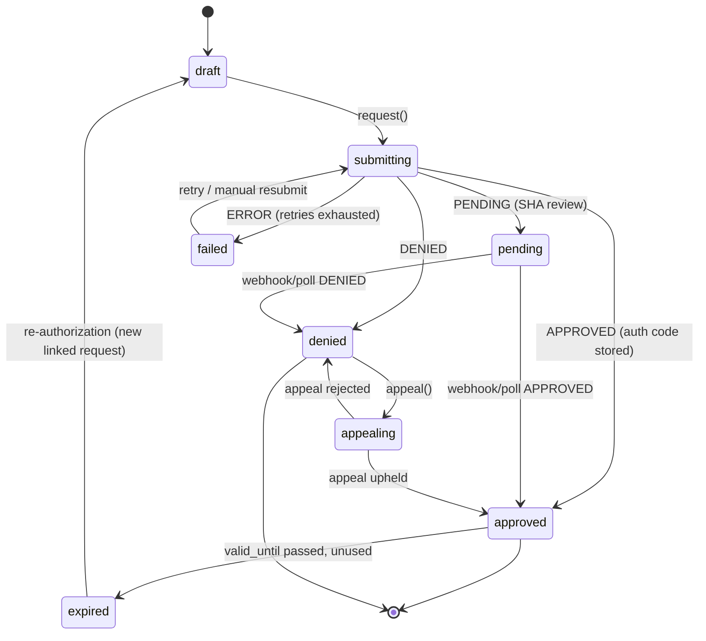
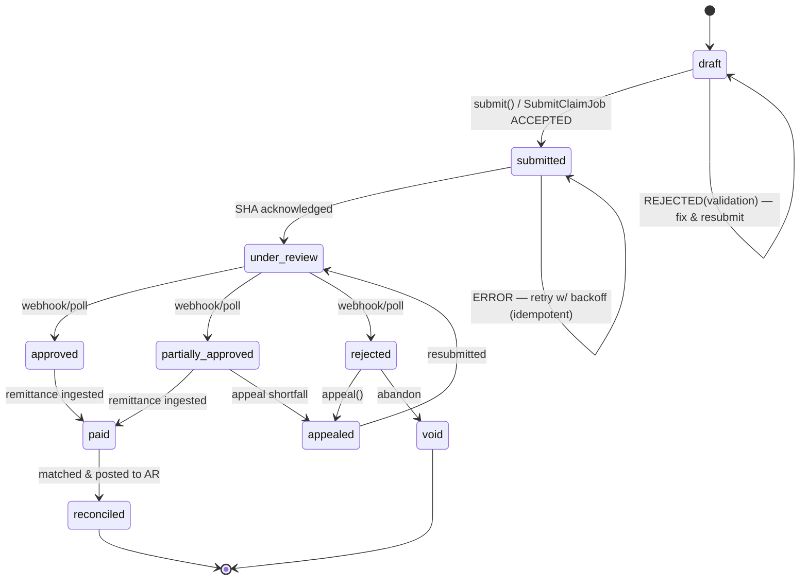
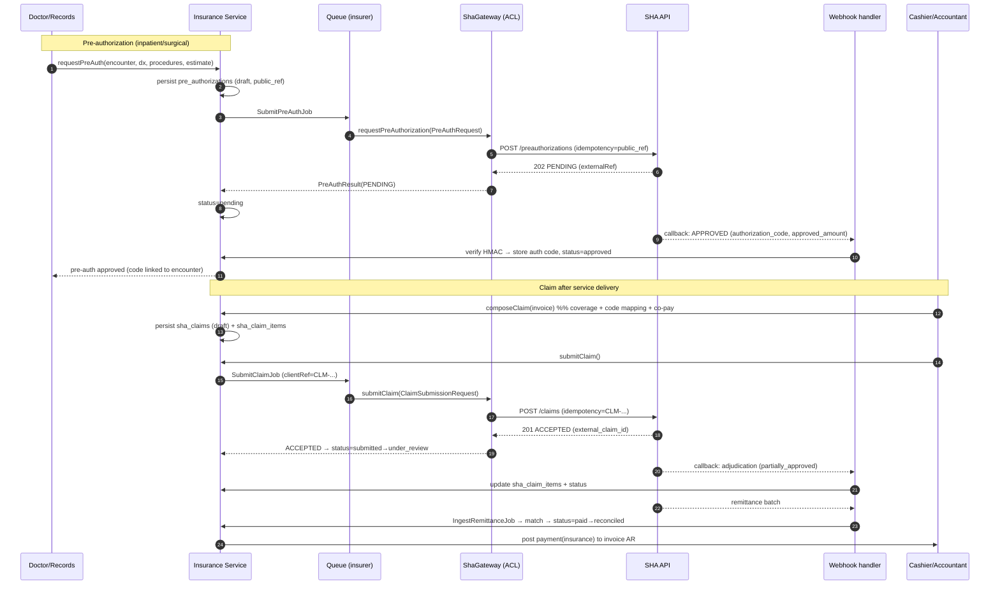
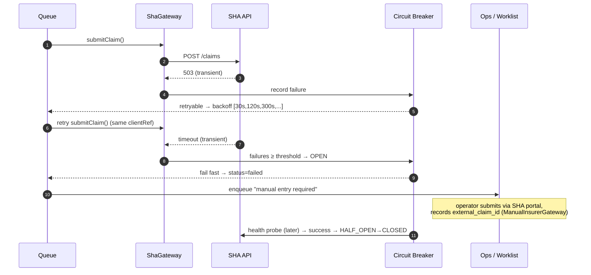

# 20 — SHA Integration Design (Insurer Gateway & Claims)

> **Authority:** This document derives from `00-foundation.md` (§9 Payments, §3 identifiers, §4 tenancy,
> §11 security/compliance) and must stay consistent with `10-data-model.md`, `11-database-schema.md` (§9
> Billing/Payments/Insurance), `13-backend-architecture.md` and `12-api-specification.md`.
> If anything here contradicts `00-foundation.md`, the foundation wins.
>
> **Module:** `Insurance` (bounded context). **Scope:** SHA (Social Health Authority, Kenya) claims,
> pre-authorization, eligibility, claim tracking, reconciliation and remittance — behind a vendor-neutral
> `InsurerGateway` abstraction that admits future insurers (AAR, Jubilee, Britam, Madison, corporate schemes).
>
> **Document version:** 1.0 · **Status:** MVP integration baseline
> **Design stance:** *Defensive.* SHA's digital APIs (the SHA/SHIF platform that replaced NHIF in Oct 2024)
> are **evolving and partially documented**. Every external touchpoint is wrapped in an **anti-corruption
> layer (ACL)** so that upstream contract churn never leaks into Afya HMS's domain model.

---

## 1. Context

### 1.1 SHA in Kenya

The **Social Health Authority (SHA)** is the Kenyan statutory body established under the **Social Health
Insurance Act, 2023**, operational from **1 October 2024**, that replaced the National Hospital Insurance
Fund (NHIF). It administers three funds:

- **PHC** — Primary Health Care Fund (financed by the exchequer).
- **SHIF** — Social Health Insurance Fund (contributory; covers outpatient/inpatient benefit packages).
- **ECCIF** — Emergency, Chronic & Critical Illness Fund.

For a private multi-branch hospital, SHA integration means, per patient encounter:

1. **Member identification & eligibility** — confirm the patient is a registered, active SHA member and that
   the requested service is within an active **benefit package** (and remaining benefit limits).
2. **Pre-authorization** — for inpatient, surgical, maternity, high-cost and certain outpatient services,
   obtain an **authorization/approval code** *before* delivering the service.
3. **Claim submission** — after service delivery, submit a structured claim (diagnoses in **ICD-10**,
   procedures, itemised costs against **SHA tariff/benefit codes**).
4. **Adjudication tracking** — track the claim through SHA review to approval / partial approval / rejection.
5. **Remittance & reconciliation** — match SHA payments (batched remittance advice) back to claims and
   settle the hospital's accounts receivable.

SHA exposes these via an evolving HTTPS/JSON API portal (with sandbox and production environments) plus, in
some flows, asynchronous callbacks. Where an API surface is not yet available or is unstable, the system must
**degrade gracefully to manual entry** (operators key in authorization codes / claim outcomes from the SHA
web portal).

### 1.2 Why an abstraction layer for multiple insurers

Although SHA is the dominant statutory payer, the hospital also bills **private and corporate insurers**.
These payers share the same *conceptual* lifecycle (eligibility → pre-auth → claim → adjudication →
remittance) but differ wildly in transport, payload, codes and semantics. We therefore define a single
domain-facing port — **`InsurerGateway`** — with one concrete adapter per payer. This yields:

- **Single domain workflow.** Billing/EMR code speaks one vocabulary (`Claim`, `PreAuthorization`,
  `EligibilityResult`); it never imports SHA-specific types.
- **Anti-corruption.** Each adapter translates between SHA's volatile wire format and our stable DTOs. A
  breaking SHA change is contained inside `ShaGateway` + its DTO mappers.
- **Pluggability.** Adding "Insurer X" = new config block + new adapter class bound in a service provider.
  No change to services, controllers, schema or queue jobs.
- **Testability.** A `FakeInsurerGateway` drives feature tests and the sandbox without hitting any network.
- **Consistency with the foundation.** Mirrors the existing `PaymentGateway`/`MpesaDarajaGateway`,
  `StorageManager`, and `NotificationChannelManager` patterns (`00-foundation.md` §7–§9).

---

## 2. The `InsurerGateway` abstraction

### 2.1 Layering (anti-corruption layer)

```
EMR / Billing Service Layer  (domain language only)
        │  DTOs (spatie/laravel-data): EligibilityRequest, PreAuthRequest, ClaimData, ...
        ▼
InsurerGateway  (interface / port)               ← domain owns this contract
        ▼
InsurerGatewayManager  (resolves adapter by scheme/insurer code, per branch)
        ▼
┌───────────────────────────────────────────────────────────┐
│  ShaGateway (adapter)        PrivateInsurerGateway (future) │
│   ├─ ShaHttpClient            ManualInsurerGateway (fallback)│
│   ├─ ShaRequestMapper  ◄── ANTI-CORRUPTION LAYER ──►        │
│   ├─ ShaResponseMapper        (maps wire ⇄ domain DTOs)     │
│   └─ ShaErrorTranslator                                     │
└───────────────────────────────────────────────────────────┘
        ▼
External SHA API (HTTPS/JSON, sandbox|production) + webhooks
```

The **mappers (`ShaRequestMapper` / `ShaResponseMapper`) are the ACL.** Domain DTOs never contain a raw SHA
field. Unknown/extra SHA fields are captured into a `raw` JSON bag (stored for audit) but never interpreted
by domain logic.

### 2.2 The interface

```php
namespace App\Modules\Insurance\Contracts;

use App\Modules\Insurance\Data\{
    EligibilityRequest, EligibilityResult,
    PreAuthRequest, PreAuthResult,
    ClaimSubmissionRequest, ClaimSubmissionResult,
    ClaimStatusResult, ReconciliationRequest, ReconciliationResult
};

interface InsurerGateway
{
    /** Stable machine code, e.g. 'sha', 'aar', 'jubilee'. Used by the manager to resolve config. */
    public function insurerCode(): string;

    /** Member active? Service covered? Remaining benefit limit? (read-only, may be cached briefly) */
    public function checkEligibility(EligibilityRequest $request): EligibilityResult;

    /** Request prior approval for a planned service/admission. Returns auth code or denial. */
    public function requestPreAuthorization(PreAuthRequest $request): PreAuthResult;

    /** Submit a finalized claim (idempotent by client_claim_ref). */
    public function submitClaim(ClaimSubmissionRequest $request): ClaimSubmissionResult;

    /** Poll the current adjudication status of a previously submitted claim. */
    public function getClaimStatus(string $externalClaimId): ClaimStatusResult;

    /** Pull remittance/adjudication batches for a date window to reconcile payments. */
    public function fetchReconciliation(ReconciliationRequest $request): ReconciliationResult;

    /** Capabilities flags so callers can branch (e.g. supportsAsyncPreAuth, supportsWebhooks). */
    public function capabilities(): InsurerCapabilities;
}
```

> **Design notes**
> - Every method takes/returns **immutable typed DTOs** (`spatie/laravel-data`), never Eloquent models and
>   never arrays of SHA JSON.
> - Methods are **synchronous from the caller's view but always invoked from queued jobs** (see §8.5). The
>   gateway itself never enqueues; orchestration lives in the service layer.
> - **Idempotency** is a first-class input: submission/pre-auth requests carry a `clientRef` the adapter
>   forwards to SHA's idempotency key (or simulates locally when SHA lacks one).
> - `capabilities()` lets the workflow tolerate insurers that, e.g., have no eligibility API (return
>   `UNKNOWN` and proceed) or no webhook support (fall back to polling).

### 2.3 Core DTOs (domain-facing, vendor-neutral)

```php
// Requests --------------------------------------------------------------
final class EligibilityRequest extends Data {
    public string $memberNumber;          // SHA number / member id
    public string $nationalId;            // for identity match
    public string $branchCode;            // 'NRB'
    public ?string $serviceCode;          // optional benefit/service being checked
    public ?CarbonImmutable $serviceDate;
}

final class PreAuthRequest extends Data {
    public string  $clientRef;            // idempotency key (our pre_auth public ref)
    public string  $memberNumber;
    public string  $branchCode;
    public string  $claimType;            // outpatient|inpatient|emergency|maternity|surgical
    /** @var DiagnosisLine[] */ public array $diagnoses;     // ICD-10
    /** @var ProcedureLine[] */ public array $procedures;    // requested procedures/services
    public Money   $estimatedAmount;
    public ?string $clinicalJustification;
    public ?int    $expectedLengthOfStay; // inpatient
}

final class ClaimSubmissionRequest extends Data {
    public string  $clientRef;            // = sha_claims.claim_number (CLM-...)
    public string  $memberNumber;
    public string  $branchCode;
    public ?string $preAuthCode;          // links to granted authorization
    public string  $claimType;
    /** @var DiagnosisLine[] */  public array $diagnoses;
    /** @var ClaimItemLine[] */  public array $items;        // mapped invoice items
    public Money   $claimedAmount;
    public array   $attachments = [];      // document public_ids (signed-URL fetch by SHA if supported)
}

// Results ---------------------------------------------------------------
final class EligibilityResult extends Data {
    public EligibilityStatus $status;     // ACTIVE|INACTIVE|NOT_FOUND|UNKNOWN
    public ?Money  $remainingLimit;
    public ?string $schemeName;
    public array   $coveredServices = [];
    public ?string $message;
    public array   $raw = [];             // captured SHA payload for audit (not interpreted)
}

final class PreAuthResult extends Data {
    public PreAuthOutcome $outcome;       // APPROVED|DENIED|PENDING|ERROR
    public ?string $authorizationCode;
    public ?Money  $approvedAmount;
    public ?CarbonImmutable $validUntil;
    public ?string $denialReason;
    public ?string $externalRef;
    public array   $raw = [];
}

final class ClaimSubmissionResult extends Data {
    public ClaimSubmissionOutcome $outcome; // ACCEPTED|REJECTED|DUPLICATE|ERROR
    public ?string $externalClaimId;        // SHA's claim handle for later status polls
    public array   $errors = [];            // validation errors echoed by SHA
    public array   $raw = [];
}
```

All money is `Money` (cast to `DECIMAL(12,2)` KES — never float, per `00-foundation.md` §3).

### 2.4 `ShaGateway` implementation

```php
final class ShaGateway implements InsurerGateway
{
    public function __construct(
        private ShaHttpClient    $http,        // configured Laravel HTTP client (base URL, auth, retries)
        private ShaRequestMapper $toWire,      // domain DTO  → SHA payload   (ACL)
        private ShaResponseMapper $fromWire,   // SHA payload → domain DTO    (ACL)
        private ShaErrorTranslator $errors,    // SHA error   → domain outcome/exception
        private ShaConfig $config,             // resolved from config/sha.php for the active branch
    ) {}

    public function insurerCode(): string { return 'sha'; }

    public function submitClaim(ClaimSubmissionRequest $r): ClaimSubmissionResult {
        $payload = $this->toWire->claim($r);
        $resp = $this->http
            ->withIdempotencyKey($r->clientRef)
            ->post($this->config->endpoint('claims.submit'), $payload);

        return $this->errors->guard($resp, fn () => $this->fromWire->claimSubmission($resp->json()));
    }
    // ...checkEligibility / requestPreAuthorization / getClaimStatus / fetchReconciliation analogous
}
```

- `ShaHttpClient` is a thin wrapper over Laravel's `Http::` macro bound with **base URL, OAuth2 bearer token
  (auto-refreshed), timeouts, TLS verification, retry/backoff policy** — all from `config/sha.php`. **No URL,
  key, or secret is ever hardcoded.**
- `ShaErrorTranslator` converts SHA HTTP/business errors into either a typed domain outcome (e.g.
  `DUPLICATE`, `REJECTED`) or a throwable that the queue treats as **retryable vs. terminal** (§8.6).

### 2.5 The manager (resolution & binding)

```php
final class InsurerGatewayManager
{
    /** Resolve the adapter for a scheme on a given branch, honouring config + feature flags. */
    public function for(string $insurerCode, int $branchId): InsurerGateway
    {
        $cfg = $this->configRepo->resolve($insurerCode, $branchId);   // insurer_configs + config/sha.php
        if (! $cfg->isApiEnabled()) {
            return $this->container->make(ManualInsurerGateway::class, ['config' => $cfg]); // fallback
        }
        return match ($insurerCode) {
            'sha'   => $this->container->make(ShaGateway::class, ['config' => $cfg]),
            default => throw new UnsupportedInsurerException($insurerCode),
        };
    }
}
```

Bound in `InsuranceServiceProvider`. The service layer calls `manager->for('sha', $branchId)` — it never
news-up an adapter.

### 2.6 How to add a future insurer

1. Add an `insurer_configs` row (and `config/insurers/{code}.php` block) with endpoints, auth, codes.
2. Implement `class AarGateway implements InsurerGateway` with its own `*Mapper` ACL classes.
3. Register it in `InsurerGatewayManager::for()` (one `match` arm) — or, cleaner, in a config-driven
   `'drivers' => ['aar' => AarGateway::class]` map so even this becomes data, not code.
4. Provide a `FakeAarGateway` + contract tests asserting it satisfies the same `InsurerGateway` test suite.
5. Map its benefit/tariff codes in `insurer_service_mappings` (see §5.3). **Nothing else changes.**

A shared **`InsurerGatewayContractTest`** (Pest) runs against *every* adapter to guarantee behavioural parity
(e.g. idempotent re-submit returns `DUPLICATE`, never a second claim).

---

## 3. Pre-authorization workflow

Pre-auth is required for inpatient, surgical, maternity, high-cost outpatient, and any benefit SHA flags as
gated. It is **requested before service delivery** and its outcome (auth code + approved amount + validity)
is stored and **linked to the encounter and/or admission** so downstream claiming can reference it.

### 3.1 Flow

1. **Trigger.** A doctor/records officer initiates pre-auth from the encounter or, for inpatient, at
   admission. `PreAuthorizationService::request()` builds a `PreAuthRequest` (member no., claim type, ICD-10
   diagnoses, requested procedures, estimated cost, clinical justification, expected LoS).
2. **Persist `draft`.** A `pre_authorizations` row is created `status = draft` with a generated public ref
   used as `clientRef` (idempotency).
3. **Dispatch.** `SubmitPreAuthJob` (queue `insurer`) calls `gateway->requestPreAuthorization()`.
4. **Outcome:**
   - `APPROVED` → store `authorization_code`, `approved_amount`, `valid_until`; set `status = approved`.
   - `DENIED` → store `denial_reason`; `status = denied`. Cashier informed; patient may pay cash or appeal.
   - `PENDING` → SHA queued the request for human review; `status = pending`. Resolved later by **webhook**
     (`pre-auth callback`) or by a **polling job** (`PollPreAuthJob`, backoff). Manual entry permitted.
   - `ERROR` → retryable; job retried with backoff (§8.6). After max attempts → `status = failed`, flagged
     for manual entry.
5. **Linkage.** On approval the auth code is attached to the encounter/admission; when the claim is composed
   (§5) the code flows into `sha_claims.preauth_number` and the submission payload.
6. **Expiry & utilisation.** If `valid_until` passes unused, or service changes materially beyond approved
   scope/amount, a **re-authorization** is required (new row, links to the prior via `parent_preauth_id`).

### 3.2 Roles & guards

- `doctor`, `records-officer` may **request**; `cashier`/`hospital-admin` may **view/override**.
- Permissions: `insurance.preauth.request`, `insurance.preauth.view`, `insurance.preauth.manual_enter`,
  `insurance.preauth.override` (per `08-rbac-matrix.md`).
- Every transition writes to `pre_auth_status_history` + `audit_logs` (§10).

### 3.3 Pre-authorization state machine



---

## 4. Claim lifecycle state machine

### 4.1 Canonical statuses

`sha_claims.status` (per `11-database-schema.md` §9) is the authoritative enum:
`draft → submitted → under_review → approved | partially_approved | rejected → paid → reconciled`,
plus side states `appealed`, `void`. (The physical enum in doc 11 lists
`draft, submitted, pre_auth, approved, partially_approved, rejected, paid, appealed`; this document refines
the operational sub-states `under_review` and `reconciled` — see §7 schema, which extends the enum
**additively** and is the change of record for doc 11.)

| Status | Meaning | Who acts | Next |
|---|---|---|---|
| `draft` | Composed from invoice, not yet sent | Cashier/records | submit |
| `submitted` | Sent to SHA, accepted into queue | System (job) | under_review |
| `under_review` | SHA adjudicating | SHA | approved / partially_approved / rejected |
| `approved` | Full claimed amount approved | SHA | paid |
| `partially_approved` | Some lines/amounts approved | SHA | paid (+ appeal on shortfall) |
| `rejected` | Nothing approved | SHA | appealed / void |
| `paid` | SHA remitted funds | SHA → us | reconciled |
| `reconciled` | Remittance matched to claim & posted to AR | Cashier/accountant | terminal |
| `appealed` | Resubmitted after partial/reject | Cashier/records | under_review |
| `void` | Cancelled/abandoned | Hospital admin | terminal |

### 4.2 Transitions, actors, retries

- **draft → submitted:** `cashier`/`records-officer` triggers `ClaimService::submit()`; `SubmitClaimJob` runs.
  On `ACCEPTED` store `external_claim_id`, `submitted_at`. On `DUPLICATE` reconcile to the existing external
  id (idempotent). On `REJECTED` (validation) → back to `draft` with errors surfaced. On `ERROR` retry/backoff.
- **submitted → under_review:** automatic on SHA acknowledgement (sync flag or webhook).
- **under_review → approved/partially_approved/rejected:** driven by **webhook** (`claim adjudication
  callback`) or `PollClaimStatusJob` (exponential backoff, capped daily cadence). Per-line outcomes update
  `sha_claim_items`.
- **approved/partially_approved → paid:** set when a remittance line referencing the claim is ingested (§9).
- **paid → reconciled:** cashier/accountant confirms the matched amount and posts to the invoice/AR; writes
  a `payment` (method `insurance`) against the SHA-payer invoice and updates `invoices.amount_paid/balance`.
- **rejected/partially_approved → appealed → under_review:** appeal carries corrected coding/attachments;
  same submission machinery, `appeal_of_claim_id` set.
- **Retries:** transport/5xx/timeout are retryable (backoff, idempotent by `clientRef`). Business rejections
  are **terminal** (no auto-retry) and routed to a human work queue.

Transitions are enforced by a `ClaimStateMachine` guard (allowed-transition matrix); illegal transitions
throw and are logged. Every transition appends to `sha_claim_status_history`.

### 4.3 State diagram



---

## 5. Claim composition

### 5.1 Source → claim mapping

A claim is assembled from a **SHA-payer invoice** plus the encounter's clinical record:

| Claim element | Source | Mapping rule |
|---|---|---|
| Header (member, claim type) | `patient_insurance` (scheme `sha`) + `encounters` | `sha_member_number` from member record; `claim_type` from encounter type |
| Pre-auth code | `pre_authorizations` (approved) | copied into `preauth_number` + payload |
| Diagnoses | `diagnoses` (ICD-10) for the encounter | `icd10_code` + description; primary first |
| Claim items | `invoice_items` (where covered) | one `sha_claim_items` per covered invoice line |
| SHA codes | `insurer_service_mappings` | internal service/SKU/CPT → SHA tariff/benefit code |
| Amounts | invoice line totals | `claimed_amount` per line; header = Σ covered lines |

`ClaimComposerService::compose(Invoice $invoice): ClaimData`:

1. Loads the SHA-payer invoice + its `invoice_items` and the encounter `diagnoses`.
2. For each item, looks up **coverage** (§5.2). Non-covered items are excluded from the claim and remain the
   **patient share**.
3. Maps each covered item's `billable_type`/internal code to a **SHA tariff/benefit code** via
   `insurer_service_mappings`. Unmapped covered items raise a **composition warning** (block submit until
   resolved or manually overridden).
4. Computes co-pay / patient-share (§5.4) and the net claimed amount.
5. Persists `sha_claims` (`draft`) + `sha_claim_items`, then returns a `ClaimData` DTO for submission.

### 5.2 Coverage rules

Coverage is **data-driven**, not hardcoded, evaluated per item:

- **Scheme/benefit eligibility** — item's service category must be in the patient's active SHA benefit
  package (from eligibility result / `insurer_configs` benefit map).
- **Benefit limits** — remaining limit on `patient_insurance.coverage_limit` and SHA's reported remaining
  limit cap the claimable amount; overflow becomes patient share.
- **Pre-auth gating** — items in a pre-auth-required category are only claimable if an **approved** auth code
  covers them; otherwise excluded or blocked.
- **Exclusions** — categories SHA never covers (configurable exclusion list) are flagged patient-pay.
- **Tariff ceiling** — claimed line amount is `min(hospital_price, sha_tariff_ceiling)` where a ceiling is
  defined; difference is either written off or patient share per scheme policy.

A `CoverageRuleEvaluator` returns, per line: `{covered: bool, claimable: Money, patientShare: Money, reason}`.

### 5.3 `insurer_service_mappings` (code mapping)

Maps hospital internal codes (drug SKU, lab/radiology service, procedure/CPT, generic service) to each
insurer's benefit/tariff code, with optional per-insurer tariff ceiling. This is the **ACL for codes** and
is global-ish reference data but **scoped by `insurer_code`** (not branch).

### 5.4 Co-pay / patient-share calculation

For a SHA invoice with lines `L`:

```
claimable(line)      = min(line_total, coverage_remaining, tariff_ceiling)   if covered else 0
patient_share(line)  = line_total − claimable(line)
copay                = scheme_copay (fixed per visit or % per benefit, from insurer_configs)  // if any
claim_total          = Σ claimable(line) − copay
patient_total        = Σ patient_share(line) + copay
```

- `claim_total` → `sha_claims.claimed_amount` and the SHA-payer portion of the invoice.
- `patient_total` → a **patient-share line** the cashier collects via cash/M-Pesa (`payments`), independent
  of the SHA claim's fate.
- All arithmetic in integer minor units internally, persisted `DECIMAL(12,2)` KES. Rounding: round each
  line to 2dp, sum; never sum-then-round.

---

## 6. Claim tracking dashboard & statuses

A **Claims dashboard** (React feature `features/insurance/claims`, TanStack Query) gives the
cashier/accountant/admin live visibility:

- **Filters:** branch (honours `BranchScope`; `branch.view-all` sees all), status, date range, claim type,
  payer, ageing bucket.
- **KPIs:** total submitted, under review, approved value, rejected value, paid vs. outstanding (AR),
  average adjudication turnaround, rejection rate, % requiring appeal.
- **Ageing report:** claims by days-in-status (e.g. >30/60/90 days under review) to chase SHA.
- **Per-claim drawer:** timeline from `sha_claim_status_history`, line-level outcomes from
  `sha_claim_items`, attached documents, raw SHA responses (admin only), and actions (submit, poll now,
  appeal, void, mark reconciled).
- **Worklists:** "Needs manual entry", "Rejected — action required", "Partially approved — appeal?",
  "Awaiting remittance".

Status colour mapping is centralised (no inline styles per `00-foundation.md` §10); statuses surface from
the backend enum so UI never invents states.

---

## 7. Data models

> Consistent with `11-database-schema.md` §9 conventions (BIGINT PK, `branch_id` tenancy, soft deletes,
> `DECIMAL(12,2)` KES, UTC timestamps, FK policy). The two existing tables `sha_claims` / `sha_claim_items`
> are reproduced (with **additive** enum extensions noted) and three new tables are introduced:
> `pre_authorizations`, `insurer_configs`, `insurer_service_mappings`, plus history/remittance tables.

### 7.1 `insurer_configs`

Config-driven insurer registry. **Secrets are NOT stored here** — only non-secret operational config and
references to secret *keys* resolved from `config/sha.php` / env / a secrets manager. Branch-agnostic master
with optional per-branch override row (nullable `branch_id`).

```sql
CREATE TABLE insurer_configs (
    id                  BIGINT UNSIGNED NOT NULL AUTO_INCREMENT,
    branch_id           BIGINT UNSIGNED NULL,                -- NULL = global default; row = per-branch override
    insurer_code        VARCHAR(40)     NOT NULL,            -- 'sha','aar','jubilee'
    insurer_name        VARCHAR(150)    NOT NULL,
    driver              VARCHAR(60)     NOT NULL DEFAULT 'sha', -- maps to a InsurerGateway adapter
    environment         ENUM('sandbox','production') NOT NULL DEFAULT 'sandbox',
    is_api_enabled      TINYINT(1)      NOT NULL DEFAULT 0,   -- 0 => ManualInsurerGateway fallback
    base_url            VARCHAR(255)    NULL,                 -- non-secret; or NULL => from config/sha.php
    credentials_ref     VARCHAR(120)    NULL,                -- KEY NAME into config/secrets, never the secret
    webhook_secret_ref  VARCHAR(120)    NULL,                -- key name for HMAC verification secret
    supports_eligibility TINYINT(1)     NOT NULL DEFAULT 1,
    supports_preauth    TINYINT(1)      NOT NULL DEFAULT 1,
    supports_webhooks   TINYINT(1)      NOT NULL DEFAULT 0,
    copay_type          ENUM('none','fixed','percent') NOT NULL DEFAULT 'none',
    copay_value         DECIMAL(12,2)   NOT NULL DEFAULT 0.00,
    benefit_map         JSON            NULL,                -- covered categories, exclusions, ceilings
    retry_max_attempts  SMALLINT UNSIGNED NOT NULL DEFAULT 5,
    retry_backoff_secs  SMALLINT UNSIGNED NOT NULL DEFAULT 30,
    is_active           TINYINT(1)      NOT NULL DEFAULT 1,
    created_at          TIMESTAMP       NULL,
    updated_at          TIMESTAMP       NULL,
    deleted_at          TIMESTAMP       NULL,
    PRIMARY KEY (id),
    UNIQUE KEY uq_insurercfg_branch_code (branch_id, insurer_code, environment),
    KEY idx_insurercfg_code (insurer_code),
    KEY idx_insurercfg_active (is_active),
    CONSTRAINT fk_insurercfg_branch FOREIGN KEY (branch_id)
        REFERENCES branches (id) ON DELETE CASCADE ON UPDATE CASCADE
) ENGINE=InnoDB DEFAULT CHARSET=utf8mb4 COLLATE=utf8mb4_unicode_ci;
```

### 7.2 `pre_authorizations`

```sql
CREATE TABLE pre_authorizations (
    id                  BIGINT UNSIGNED NOT NULL AUTO_INCREMENT,
    public_ref          CHAR(36)        NOT NULL,            -- clientRef / idempotency key
    branch_id           BIGINT UNSIGNED NOT NULL,
    patient_id          BIGINT UNSIGNED NOT NULL,
    encounter_id        BIGINT UNSIGNED NULL,
    admission_id        BIGINT UNSIGNED NULL,                -- inpatient linkage
    patient_insurance_id BIGINT UNSIGNED NULL,
    insurer_code        VARCHAR(40)     NOT NULL DEFAULT 'sha',
    sha_member_number   VARCHAR(80)     NULL,
    claim_type          ENUM('outpatient','inpatient','emergency','maternity','surgical') NOT NULL DEFAULT 'inpatient',
    status              ENUM('draft','submitting','pending','approved','denied','failed','appealing','expired') NOT NULL DEFAULT 'draft',
    authorization_code  VARCHAR(80)     NULL,                -- stored on approval
    estimated_amount    DECIMAL(12,2)   NOT NULL DEFAULT 0.00,
    approved_amount     DECIMAL(12,2)   NOT NULL DEFAULT 0.00,
    clinical_justification TEXT         NULL,
    expected_los_days   SMALLINT UNSIGNED NULL,
    diagnoses_snapshot  JSON            NULL,                -- ICD-10 at request time
    procedures_snapshot JSON            NULL,
    denial_reason       VARCHAR(512)    NULL,
    external_ref        VARCHAR(80)     NULL,                -- SHA-side handle
    valid_from          DATE            NULL,
    valid_until         DATE            NULL,
    parent_preauth_id   BIGINT UNSIGNED NULL,                -- re-auth / appeal chain
    raw_response        JSON            NULL,                -- ACL: captured SHA payload (audit)
    requested_by        BIGINT UNSIGNED NULL,
    requested_at        TIMESTAMP       NULL,
    responded_at        TIMESTAMP       NULL,
    created_at          TIMESTAMP       NULL,
    updated_at          TIMESTAMP       NULL,
    deleted_at          TIMESTAMP       NULL,
    PRIMARY KEY (id),
    UNIQUE KEY uq_preauth_ref (public_ref),
    UNIQUE KEY uq_preauth_authcode (authorization_code),
    KEY idx_preauth_branch_status (branch_id, status),
    KEY idx_preauth_patient (patient_id),
    KEY idx_preauth_encounter (encounter_id),
    KEY idx_preauth_admission (admission_id),
    KEY idx_preauth_member (sha_member_number),
    CONSTRAINT fk_preauth_branch FOREIGN KEY (branch_id)
        REFERENCES branches (id) ON DELETE RESTRICT ON UPDATE CASCADE,
    CONSTRAINT fk_preauth_patient FOREIGN KEY (patient_id)
        REFERENCES patients (id) ON DELETE RESTRICT ON UPDATE CASCADE,
    CONSTRAINT fk_preauth_encounter FOREIGN KEY (encounter_id)
        REFERENCES encounters (id) ON DELETE SET NULL ON UPDATE CASCADE,
    CONSTRAINT fk_preauth_admission FOREIGN KEY (admission_id)
        REFERENCES admissions (id) ON DELETE SET NULL ON UPDATE CASCADE,
    CONSTRAINT fk_preauth_insurance FOREIGN KEY (patient_insurance_id)
        REFERENCES patient_insurance (id) ON DELETE SET NULL ON UPDATE CASCADE,
    CONSTRAINT fk_preauth_parent FOREIGN KEY (parent_preauth_id)
        REFERENCES pre_authorizations (id) ON DELETE SET NULL ON UPDATE CASCADE,
    CONSTRAINT fk_preauth_requester FOREIGN KEY (requested_by)
        REFERENCES users (id) ON DELETE SET NULL ON UPDATE CASCADE
) ENGINE=InnoDB DEFAULT CHARSET=utf8mb4 COLLATE=utf8mb4_unicode_ci;
```

### 7.3 `sha_claims` (reproduced; enum extended additively + new linkage columns)

Identical to `11-database-schema.md` §9 with: status enum extended to include `under_review`, `reconciled`,
`void`; new nullable columns `preauth_id`, `external_claim_id`, `appeal_of_claim_id`, `reconciled_amount`,
`reconciled_at`, `raw_response`. These are additive (existing columns unchanged) — doc 11 §9 to be updated to
match.

```sql
ALTER TABLE sha_claims
    MODIFY status ENUM('draft','submitted','under_review','pre_auth','approved','partially_approved',
                       'rejected','paid','reconciled','appealed','void') NOT NULL DEFAULT 'draft',
    ADD COLUMN preauth_id          BIGINT UNSIGNED NULL AFTER patient_insurance_id,
    ADD COLUMN external_claim_id   VARCHAR(80)     NULL AFTER preauth_number,
    ADD COLUMN appeal_of_claim_id  BIGINT UNSIGNED NULL AFTER external_claim_id,
    ADD COLUMN reconciled_amount   DECIMAL(12,2)   NOT NULL DEFAULT 0.00 AFTER paid_amount,
    ADD COLUMN reconciled_at       TIMESTAMP       NULL AFTER paid_at,
    ADD COLUMN raw_response        JSON            NULL AFTER rejection_reason,
    ADD KEY idx_shaclaim_external (external_claim_id),
    ADD CONSTRAINT fk_shaclaim_preauth FOREIGN KEY (preauth_id)
        REFERENCES pre_authorizations (id) ON DELETE SET NULL ON UPDATE CASCADE,
    ADD CONSTRAINT fk_shaclaim_appeal FOREIGN KEY (appeal_of_claim_id)
        REFERENCES sha_claims (id) ON DELETE SET NULL ON UPDATE CASCADE;
```

### 7.4 `sha_claim_items` (as doc 11 §9 — unchanged; ICD/diagnosis context added)

`sha_claim_items` is reused verbatim from `11-database-schema.md` §9. Diagnosis (ICD-10) context for a claim
comes from the encounter's `diagnoses` rows (snapshotted into the submission payload and into
`sha_claims.raw_response`); a denormalized `primary_icd10` column may be added to `sha_claims` for reporting.

### 7.5 `sha_claim_status_history`

Immutable transition log (also feeds the dashboard timeline).

```sql
CREATE TABLE sha_claim_status_history (
    id                  BIGINT UNSIGNED NOT NULL AUTO_INCREMENT,
    sha_claim_id        BIGINT UNSIGNED NOT NULL,
    branch_id           BIGINT UNSIGNED NOT NULL,
    from_status         VARCHAR(30)     NULL,
    to_status           VARCHAR(30)     NOT NULL,
    actor_type          ENUM('user','system','webhook','poll') NOT NULL DEFAULT 'system',
    actor_user_id       BIGINT UNSIGNED NULL,
    note                VARCHAR(512)    NULL,
    raw_response        JSON            NULL,
    created_at          TIMESTAMP       NULL,
    PRIMARY KEY (id),
    KEY idx_shahist_claim (sha_claim_id, created_at),
    KEY idx_shahist_branch (branch_id),
    CONSTRAINT fk_shahist_claim FOREIGN KEY (sha_claim_id)
        REFERENCES sha_claims (id) ON DELETE CASCADE ON UPDATE CASCADE,
    CONSTRAINT fk_shahist_branch FOREIGN KEY (branch_id)
        REFERENCES branches (id) ON DELETE RESTRICT ON UPDATE CASCADE,
    CONSTRAINT fk_shahist_actor FOREIGN KEY (actor_user_id)
        REFERENCES users (id) ON DELETE SET NULL ON UPDATE CASCADE
) ENGINE=InnoDB DEFAULT CHARSET=utf8mb4 COLLATE=utf8mb4_unicode_ci;
```

### 7.6 `insurer_service_mappings`

```sql
CREATE TABLE insurer_service_mappings (
    id                  BIGINT UNSIGNED NOT NULL AUTO_INCREMENT,
    insurer_code        VARCHAR(40)     NOT NULL,            -- 'sha'
    internal_type       VARCHAR(60)     NOT NULL,            -- 'drug','lab','radiology','procedure','service'
    internal_code       VARCHAR(60)     NOT NULL,            -- SKU / service code / CPT
    insurer_code_value  VARCHAR(60)     NOT NULL,            -- SHA tariff/benefit code
    description         VARCHAR(255)    NULL,
    tariff_ceiling      DECIMAL(12,2)   NULL,                -- max claimable per unit
    requires_preauth    TINYINT(1)      NOT NULL DEFAULT 0,
    is_excluded         TINYINT(1)      NOT NULL DEFAULT 0,  -- never covered
    is_active           TINYINT(1)      NOT NULL DEFAULT 1,
    created_at          TIMESTAMP       NULL,
    updated_at          TIMESTAMP       NULL,
    PRIMARY KEY (id),
    UNIQUE KEY uq_insmap (insurer_code, internal_type, internal_code),
    KEY idx_insmap_insurer (insurer_code),
    KEY idx_insmap_value (insurer_code_value)
) ENGINE=InnoDB DEFAULT CHARSET=utf8mb4 COLLATE=utf8mb4_unicode_ci;
```

### 7.7 `sha_remittances` & `sha_remittance_lines`

Remittance advice batches ingested from SHA (§9), and their per-claim lines matched to claims.

```sql
CREATE TABLE sha_remittances (
    id                  BIGINT UNSIGNED NOT NULL AUTO_INCREMENT,
    branch_id           BIGINT UNSIGNED NOT NULL,
    insurer_code        VARCHAR(40)     NOT NULL DEFAULT 'sha',
    external_batch_id   VARCHAR(80)     NOT NULL,            -- SHA remittance/advice id (idempotency)
    statement_date      DATE            NULL,
    total_amount        DECIMAL(12,2)   NOT NULL DEFAULT 0.00,
    matched_amount      DECIMAL(12,2)   NOT NULL DEFAULT 0.00,
    status              ENUM('imported','partially_matched','reconciled','disputed') NOT NULL DEFAULT 'imported',
    raw_payload         JSON            NULL,
    imported_by         BIGINT UNSIGNED NULL,
    imported_at         TIMESTAMP       NULL,
    created_at          TIMESTAMP       NULL,
    updated_at          TIMESTAMP       NULL,
    PRIMARY KEY (id),
    UNIQUE KEY uq_remit_batch (insurer_code, external_batch_id),
    KEY idx_remit_branch_status (branch_id, status),
    CONSTRAINT fk_remit_branch FOREIGN KEY (branch_id)
        REFERENCES branches (id) ON DELETE RESTRICT ON UPDATE CASCADE,
    CONSTRAINT fk_remit_importer FOREIGN KEY (imported_by)
        REFERENCES users (id) ON DELETE SET NULL ON UPDATE CASCADE
) ENGINE=InnoDB DEFAULT CHARSET=utf8mb4 COLLATE=utf8mb4_unicode_ci;

CREATE TABLE sha_remittance_lines (
    id                  BIGINT UNSIGNED NOT NULL AUTO_INCREMENT,
    sha_remittance_id   BIGINT UNSIGNED NOT NULL,
    branch_id           BIGINT UNSIGNED NOT NULL,
    sha_claim_id        BIGINT UNSIGNED NULL,                -- matched claim (NULL until matched)
    external_claim_id   VARCHAR(80)     NULL,
    claim_number        VARCHAR(30)     NULL,
    paid_amount         DECIMAL(12,2)   NOT NULL DEFAULT 0.00,
    adjustment_amount   DECIMAL(12,2)   NOT NULL DEFAULT 0.00,
    reason_code         VARCHAR(60)     NULL,                -- SHA denial/adjustment code
    match_status        ENUM('unmatched','auto_matched','manually_matched','disputed') NOT NULL DEFAULT 'unmatched',
    created_at          TIMESTAMP       NULL,
    updated_at          TIMESTAMP       NULL,
    PRIMARY KEY (id),
    KEY idx_remitline_remit (sha_remittance_id),
    KEY idx_remitline_claim (sha_claim_id),
    KEY idx_remitline_branch (branch_id),
    KEY idx_remitline_external (external_claim_id),
    CONSTRAINT fk_remitline_remit FOREIGN KEY (sha_remittance_id)
        REFERENCES sha_remittances (id) ON DELETE CASCADE ON UPDATE CASCADE,
    CONSTRAINT fk_remitline_claim FOREIGN KEY (sha_claim_id)
        REFERENCES sha_claims (id) ON DELETE SET NULL ON UPDATE CASCADE,
    CONSTRAINT fk_remitline_branch FOREIGN KEY (branch_id)
        REFERENCES branches (id) ON DELETE RESTRICT ON UPDATE CASCADE
) ENGINE=InnoDB DEFAULT CHARSET=utf8mb4 COLLATE=utf8mb4_unicode_ci;
```

---

## 8. Integration mechanics

### 8.1 Config-driven endpoints & credentials (`config/sha.php`)

**Never hardcode** URLs, keys, or secrets. All live in `config/sha.php`, fed by `.env` (and, in prod, a
secrets manager). `insurer_configs` holds non-secret operational toggles + *references* (key names) to
secrets, resolved at runtime.

```php
// config/sha.php
return [
    'environment' => env('SHA_ENV', 'sandbox'),            // sandbox | production
    'environments' => [
        'sandbox' => [
            'base_url'      => env('SHA_SANDBOX_BASE_URL'),
            'client_id'     => env('SHA_SANDBOX_CLIENT_ID'),
            'client_secret' => env('SHA_SANDBOX_CLIENT_SECRET'),
            'token_url'     => env('SHA_SANDBOX_TOKEN_URL'),
        ],
        'production' => [
            'base_url'      => env('SHA_PROD_BASE_URL'),
            'client_id'     => env('SHA_PROD_CLIENT_ID'),
            'client_secret' => env('SHA_PROD_CLIENT_SECRET'),
            'token_url'     => env('SHA_PROD_TOKEN_URL'),
        ],
    ],
    'endpoints' => [                                        // relative paths, never absolute hardcoded URLs
        'eligibility'    => '/v1/eligibility/verify',
        'preauth.create' => '/v1/preauthorizations',
        'preauth.status' => '/v1/preauthorizations/{ref}',
        'claims.submit'  => '/v1/claims',
        'claims.status'  => '/v1/claims/{id}',
        'reconciliation' => '/v1/remittances',
    ],
    'http' => [
        'timeout'        => env('SHA_HTTP_TIMEOUT', 30),
        'connect_timeout'=> env('SHA_HTTP_CONNECT_TIMEOUT', 10),
        'retry_times'    => env('SHA_HTTP_RETRY', 3),
        'retry_backoff'  => env('SHA_HTTP_BACKOFF_MS', 500), // base for exponential backoff
        'verify_tls'     => env('SHA_VERIFY_TLS', true),
    ],
    'webhook' => [
        'signing_secret' => env('SHA_WEBHOOK_SECRET'),       // HMAC verification
        'tolerance_secs' => 300,
    ],
    'queue'   => env('SHA_QUEUE', 'insurer'),
];
```

Resolution order: `insurer_configs` (per-branch override → global) **then** `config/sha.php` defaults.
`config:cache`-safe (no closures). Secrets only ever in env/secret store, **never** in DB or VCS.

### 8.2 Authentication

- **OAuth2 client-credentials** (or SHA-specified scheme): `ShaTokenManager` fetches a bearer token from
  `token_url`, caches it in Redis with TTL = `expires_in − skew`, refreshes proactively, and serialises
  refresh with a lock to avoid stampedes. Token never logged.
- All requests over **TLS** with verification on (`verify_tls`). mTLS supported if SHA mandates client certs
  (cert paths from config/secret store).

### 8.3 Request/response DTOs & the ACL

- Inbound to gateway: domain DTOs (§2.3). Outbound to SHA: built by `ShaRequestMapper` (snake_case/SHA
  schema). Inbound from SHA: parsed by `ShaResponseMapper` into domain DTOs; **unknown fields preserved in
  `raw`** and persisted to `*.raw_response` for audit/forensics.
- DTOs are validated (shape + business invariants) before dispatch; a malformed SHA response is treated as a
  retryable transport error, not silently coerced.

### 8.4 Error handling

`ShaErrorTranslator` classifies every outcome:

| Class | Examples | Treatment |
|---|---|---|
| **Transient** | timeout, 429, 5xx, token expiry, DNS | Retryable — backoff + retry (§8.6) |
| **Business-terminal** | invalid member, benefit exhausted, duplicate, validation reject | No retry; map to domain outcome; surface to operator |
| **Auth** | 401 invalid creds | Refresh token once; else alert ops, halt that insurer |
| **Contract drift** | unexpected schema/enum | Capture `raw`, mark `failed`, alert; route to manual entry |

All failures emit structured logs (no PHI/secrets) + metrics; repeated terminal failures open a **circuit
breaker** per insurer (fail fast → manual mode) until a health probe recovers.

### 8.5 Queues, retries with backoff

- Dedicated **`insurer`** Redis queue (per `00-foundation.md` §1). Jobs: `SubmitPreAuthJob`, `PollPreAuthJob`,
  `SubmitClaimJob`, `PollClaimStatusJob`, `IngestRemittanceJob`, `MatchRemittanceJob`.
- All external calls are **queued** — never inline in a web request — to keep API latency off the request
  path and to centralise retry/backoff.
- **Backoff:** exponential with jitter (`backoff()` returns e.g. `[30, 120, 300, 900, 3600]`s),
  `tries`/`maxExceptions` from `insurer_configs.retry_*`. `retryUntil()` caps total window (e.g. 24h for
  submit). On exhaustion → `failed_jobs` + status `failed` + ops alert + manual-entry worklist.

### 8.6 Idempotency

- Every mutating call carries a **client idempotency key**: pre-auth = `pre_authorizations.public_ref`;
  claim = `sha_claims.claim_number` (`CLM-...`). Forwarded as an idempotency header to SHA when supported.
- A `DUPLICATE` response is reconciled to the existing external id — **never** creates a second SHA record.
- Job-level guard: a unique constraint / advisory lock prevents two workers submitting the same claim
  concurrently. Local `external_claim_id` presence short-circuits re-submission.

### 8.7 Webhook / callback handling

- Signed webhook routes (mirroring the M-Pesa pattern, `00-foundation.md` §9): e.g.
  `POST /api/webhooks/sha/preauth`, `POST /api/webhooks/sha/claim`, `POST /api/webhooks/sha/remittance`.
- **Verification:** HMAC signature over the raw body with `SHA_WEBHOOK_SECRET` + timestamp tolerance; reject
  unsigned/stale/replayed (nonce cache). IP allow-list if SHA publishes ranges.
- Handler is **thin**: verify → persist raw event (`webhook_events`) → dispatch a queued processor →
  return `200` fast. Processing is idempotent by event id. If webhooks are unavailable for a flow, **polling
  jobs** are the source of truth (`capabilities()` decides).

### 8.8 Sandbox vs production

- Selected by `SHA_ENV` / `insurer_configs.environment`; **no code branches** on environment beyond config.
- Sandbox uses test member numbers and never posts real `payments`/AR (guarded by `environment` flag —
  reconciliation in sandbox is dry-run).
- Promotion to production is a config/secret change only. A `FakeInsurerGateway` (in-memory) backs automated
  tests and offline local dev.

---

## 9. Reconciliation & remittance handling

1. **Ingest.** `IngestRemittanceJob` calls `gateway->fetchReconciliation()` (or a webhook delivers a batch),
   persisting `sha_remittances` + `sha_remittance_lines` (idempotent by `external_batch_id`).
2. **Match.** `MatchRemittanceService` matches each line to a `sha_claim` by `external_claim_id` →
   `claim_number` → fuzzy (member + amount + date). Auto-matches set `match_status = auto_matched`;
   ambiguous → `unmatched` for cashier review.
3. **Post.** On a confident match: set claim `reconciled_amount`/`reconciled_at`, transition `paid →
   reconciled`, create a `payments` row (method `insurance`) against the SHA-payer invoice, update
   `invoices.amount_paid`/`balance`. Short-paid lines (`adjustment_amount`, `reason_code`) surface a
   **variance** the cashier can accept (write-off) or **dispute/appeal**.
4. **Variances & disputes.** Under-payments/denied lines feed the appeals worklist; line `reason_code`
   maps to a human-readable reason. Unmatched remittance lines and unremitted approved claims are reported in
   an **AR ageing / reconciliation report** per branch.
5. **Controls.** Reconciliation posting requires `insurance.reconcile` permission; all postings are
   double-entry consistent with Billing and audited. Sandbox reconciliation is dry-run (no AR impact).

---

## 10. Audit & compliance

- **Every** eligibility check, pre-auth, submission, status change, webhook, and reconciliation posting
  writes an immutable `audit_logs` entry (`event_type` like `insurance.claim.submit`,
  `insurance.preauth.approve`, `insurance.reconcile.post`) with actor, branch, IP, before/after — per
  `00-foundation.md` §11 and `11-database-schema.md` §audit. Model changes also captured by Spatie Activity
  Log.
- **PHI handling:** claim payloads contain diagnoses and member identifiers — treated as PHI. Outbound only
  over TLS; **secrets and PHI never logged**; raw SHA payloads stored in `raw_response`/`raw_payload` are
  access-controlled (admin only) and covered by the **10-year medical-record retention** + soft-delete
  policy (clinical/claim data is never hard-deleted).
- **Kenya Data Protection Act 2019** + MOH/SHA requirements: data minimisation (send only required fields),
  consent for sharing with SHA recorded at registration, encrypted-at-rest sensitive columns (member numbers
  via encrypted casts), signed-URL document access only.
- **Tenancy:** all insurance tables carry `branch_id` and obey `BranchScope`; cross-branch claim visibility
  requires `branch.view-all`. Claim numbers are per-branch per-year (`CLM-{BRANCH}-YYYY-00001`).
- **State-machine integrity:** illegal transitions rejected and logged; `sha_claim_status_history` and
  `pre_auth_status_history` are append-only audit trails.

---

## 11. Failure / fallback (manual claim & pre-auth entry)

When SHA APIs are down, unstable, not yet available for a flow, or the circuit breaker is open:

- `insurer_configs.is_api_enabled = 0` (or per-flow capability false) routes the workflow to
  **`ManualInsurerGateway`**: operators enter outcomes captured from the SHA **web portal**.
  - **Manual pre-auth:** cashier/records keys the `authorization_code`, `approved_amount`, `valid_until`;
    `pre_authorizations` set `status = approved`, `actor_type = user`. Same downstream linkage as API path.
  - **Manual submission:** claim composed and exported as a **SHA-format pack** (PDF/CSV per SHA spec); the
    portal reference is recorded back as `external_claim_id`; status advanced manually.
  - **Manual adjudication/remittance:** operators import/key the remittance advice; `MatchRemittanceService`
    runs the same matching/posting path.
- Permissions gate manual actions (`insurance.*.manual_enter`); every manual entry is audited and visibly
  flagged (`actor_type = user`) so reporting distinguishes API vs manual.
- **Automatic recovery:** when APIs return healthy (health probe / breaker closes), queued items resume; the
  system reconciles any manually-entered records by `external_claim_id` to avoid duplicates.
- Degradation never blocks **clinical care or cash collection**: the patient-share portion is collected
  regardless of SHA claim state, and care proceeds; the claim simply follows asynchronously.

---

## 12. Diagrams

### 12.1 Pre-authorization & claim — sequence (happy path, async)



### 12.2 Retry / fallback — sequence



### 12.3 Combined claim state machine

(See §4.3 for the authoritative claim state diagram and §3.3 for the pre-authorization state diagram.)

---

## 13. Cross-references & consistency

- **Identifiers:** `CLM-{BRANCH}-YYYY-00001` via `SequenceService` (`00-foundation.md` §3, §6).
- **Schema:** extends `11-database-schema.md` §9; `sha_claims`/`sha_claim_items` reused (status enum extended
  additively); new tables `insurer_configs`, `pre_authorizations`, `insurer_service_mappings`,
  `sha_claim_status_history`, `sha_remittances`, `sha_remittance_lines`.
- **Patterns:** `InsurerGateway` mirrors `PaymentGateway`/`MpesaDarajaGateway`, `StorageManager`,
  `NotificationChannelManager` (`00-foundation.md` §7–§9). Repository + Service + DTO + FormRequest layering
  (`00-foundation.md` §2).
- **Tenancy/RBAC/Audit:** `BranchScope`, Spatie permissions `insurance.*`, immutable `audit_logs`
  (`00-foundation.md` §4, §5, §11).
- **API/Frontend:** endpoints per `12-api-specification.md`; Claims dashboard per `14-frontend-architecture.md`
  conventions (TanStack Query, Zustand, no inline styles, i18n en/sw).
```
