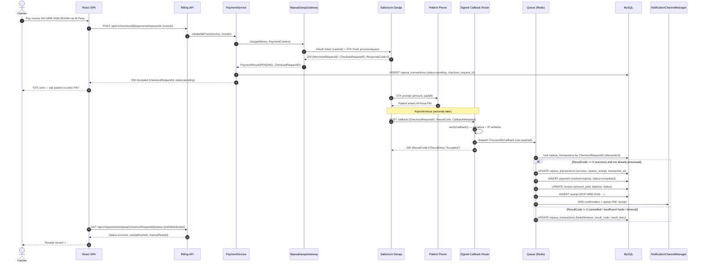
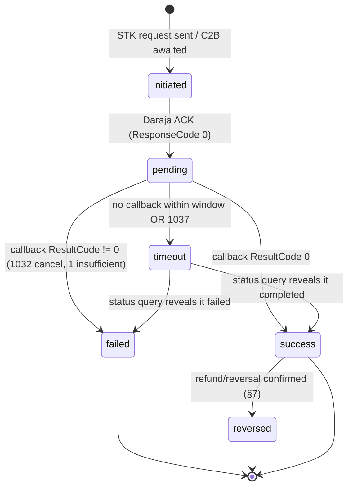
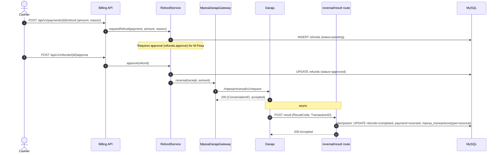

# 21 — M-Pesa Integration Design (Safaricom Daraja)

> **Scope:** End-to-end design for accepting payments in Afya HMS via cash and Safaricom M-Pesa
> (Daraja API) — STK Push, Paybill (C2B), and Till (Buy Goods, C2B). Covers the `PaymentGateway`
> abstraction, Daraja request/response flows, callbacks & idempotency, data models, reconciliation,
> refunds/reversals, per-branch config, error handling, security, receipts, and sandbox testing.
>
> **Authority:** Subordinate to `00-foundation.md`. Money is `DECIMAL(12,2)` KES; tables carry
> `branch_id`; identifiers follow Foundation §3. Data models here are **consistent with
> `10-database-erd.md` and `11-database-schema.md`** (tables `payments`, `mpesa_transactions`,
> `receipts`, `refunds`). The `PaymentGateway` interface matches `13-backend-architecture.md §7.4`.
>
> **Module:** `Billing` (with the `Payments` provider abstraction in `app/Contracts/Payments` and
> `app/Services/Payments`). **Document version:** 1.0 · **Status:** MVP design baseline.

---

## 1. Payment methods & the `PaymentGateway` abstraction

### 1.1 Supported methods

| Method | Daraja product | Direction | Use case in Afya HMS |
|---|---|---|---|
| **Cash** | — | — | Cashier desk; immediate, no external call. |
| **M-Pesa STK Push** | M-Pesa Express (Lipa na M-Pesa Online) | C2B (push) | Cashier/patient initiates; PIN prompt sent to patient's phone at point of care. The default M-Pesa flow. |
| **M-Pesa Paybill** | C2B (Pay Bill, `BusinessShortCode`) | C2B (pull) | Patient pays the branch Paybill with the **invoice number** as the account reference (e.g. self-service, remote top-ups). |
| **M-Pesa Till** | C2B (Buy Goods / Till number) | C2B (pull) | Patient pays the branch Till; no per-transaction account reference (matched via amount + phone + time window, then manually). |
| **Card / Bank** | — | — | Recorded manually (out of scope here; same `payments` table). |

> **Why two C2B variants matter.** STK Push is initiated **by us** and is self-identifying
> (`CheckoutRequestID` + `AccountReference` = invoice). Paybill/Till are initiated **by the payer**;
> Paybill carries an account reference (the invoice number) so it auto-matches, while Till has no
> account field and frequently needs reconciliation/manual matching. The design supports all three.

### 1.2 The interface (matches `13-backend-architecture.md §7.4`)

The Billing service depends only on the **interface**, never a concrete gateway. Bound in
`PaymentServiceProvider`; selected per transaction (cashier desk → `CashGateway`; mobile money →
`MpesaDarajaGateway`).

```php
<?php

namespace App\Contracts\Payments;

use App\Domain\ValueObjects\Money;

interface PaymentGateway
{
    /**
     * Initiate a charge. For cash this completes synchronously; for M-Pesa STK Push
     * it returns an ACCEPTED/pending result carrying the CheckoutRequestID — the
     * money is confirmed later, asynchronously, via verifyCallback().
     */
    public function charge(Money $amount, PaymentContext $context): PaymentResult;

    /** Validate an inbound provider callback/webhook payload (signature/shape/whitelist). */
    public function verifyCallback(array $payload): bool;
}
```

Supporting value objects / DTOs (`spatie/laravel-data`, Foundation §2):

```php
final class PaymentContext extends Data
{
    public function __construct(
        public readonly int $branchId,
        public readonly int $invoiceId,
        public readonly int $patientId,
        public readonly string $invoiceNumber,   // AccountReference
        public readonly ?string $msisdn,         // E.164/2547… for STK Push
        public readonly ?int $initiatedBy,       // user id (cashier) or null (patient self-service)
        public readonly PaymentChannel $channel, // CASH | MPESA_STK | MPESA_PAYBILL | MPESA_TILL
    ) {}
}

final class PaymentResult extends Data
{
    public function __construct(
        public readonly PaymentStatus $status,        // COMPLETED | PENDING | FAILED
        public readonly ?string $checkoutRequestId,   // STK Push correlation id
        public readonly ?string $merchantRequestId,
        public readonly ?string $mpesaReceipt,        // present only once confirmed
        public readonly Money $amount,
        public readonly ?string $message,
        public readonly array $raw = [],              // provider raw response (for audit)
    ) {}
}
```

### 1.3 Implementations

```php
final class CashGateway implements PaymentGateway
{
    public function charge(Money $amount, PaymentContext $ctx): PaymentResult
    {
        // No external call. Caller (PaymentService) writes the payment + receipt in a DB tx.
        return new PaymentResult(PaymentStatus::COMPLETED, null, null, null, $amount, 'Cash received');
    }

    public function verifyCallback(array $payload): bool
    {
        return false; // Cash has no callbacks.
    }
}
```

`MpesaDarajaGateway` reads **all** credentials from `config('mpesa')` resolved **per branch**
(§8). It delegates HTTP to a thin `DarajaClient` (OAuth, STK Push, C2B register, status query,
reversal). It is **stateless** w.r.t. money: it never writes `payments`; it returns a
`PaymentResult` and the orchestrating `PaymentService`/listeners persist state. This keeps the
gateway substitutable (Foundation SOLID / LSP) and the money-writing logic in one place.

```php
final class MpesaDarajaGateway implements PaymentGateway
{
    public function __construct(
        private readonly DarajaClient $client,
        private readonly BranchMpesaConfigResolver $config, // §8
    ) {}

    public function charge(Money $amount, PaymentContext $ctx): PaymentResult
    {
        $cfg = $this->config->forBranch($ctx->branchId);

        $resp = $this->client->stkPush(
            shortcode:   $cfg->businessShortCode,
            passkey:     $cfg->passkey,
            amount:      (int) $amount->toInteger(), // STK Push amount is a whole number (KES)
            msisdn:      MsisdnNormalizer::toMpesa($ctx->msisdn), // 2547XXXXXXXX
            accountRef:  $ctx->invoiceNumber,        // INV-NRB-2026-001934
            description: 'Afya HMS payment '.$ctx->invoiceNumber,
            callbackUrl: $cfg->stkCallbackUrl,
        );

        return new PaymentResult(
            status:            PaymentStatus::PENDING,
            checkoutRequestId: $resp['CheckoutRequestID'] ?? null,
            merchantRequestId: $resp['MerchantRequestID'] ?? null,
            mpesaReceipt:      null,
            amount:            $amount,
            message:           $resp['CustomerMessage'] ?? null,
            raw:               $resp,
        );
    }

    public function verifyCallback(array $payload): bool
    {
        return app(CallbackValidator::class)->validate($payload); // §4 / §10
    }
}
```

> **Amount rule.** STK Push requires an **integer** amount in KES. Afya HMS stores money as
> `DECIMAL(12,2)`. Because M-Pesa cannot transact fractional shillings, invoices settled by STK Push
> must be billed in whole KES; the `Money` VO rejects a non-integer STK amount (throws
> `MpesaFractionalAmountException`) rather than silently rounding. Paybill/Till amounts arrive
> exactly as the payer entered and are stored as received.

---

## 2. Daraja API specifics

Base URLs (selected by `config('mpesa.env')`):

| Environment | Base URL |
|---|---|
| Sandbox | `https://sandbox.safaricom.co.ke` |
| Production | `https://api.safaricom.co.ke` |

All Daraja HTTP goes through `DarajaClient`, which uses Laravel's `Http` client with timeouts,
retries, and logging (§9). Endpoints used:

| Concern | Endpoint | Method |
|---|---|---|
| OAuth token | `/oauth/v1/generate?grant_type=client_credentials` | GET |
| STK Push | `/mpesa/stkpush/v1/processrequest` | POST |
| STK query | `/mpesa/stkpushquery/v1/query` | POST |
| C2B register URLs | `/mpesa/c2b/v1/registerurl` | POST |
| C2B simulate (sandbox only) | `/mpesa/c2b/v1/simulate` | POST |
| Transaction status | `/mpesa/transactionstatus/v1/query` | POST |
| Reversal (refunds) | `/mpesa/reversal/v1/request` | POST |

### 2.1 OAuth token generation & caching

Token is `client_credentials`, Basic-auth with consumer key:secret, valid ~3600s. **Cache it in
Redis per branch** keyed by shortcode, expiring slightly **before** Daraja's expiry to avoid using a
just-expired token. Never request a token per call.

```php
final class DarajaAuth
{
    public function __construct(private readonly BranchMpesaConfigResolver $config) {}

    public function token(int $branchId): string
    {
        $cfg = $this->config->forBranch($branchId);
        $cacheKey = "mpesa:token:{$cfg->businessShortCode}";

        return Cache::remember($cacheKey, now()->addMinutes(55), function () use ($cfg) {
            $resp = Http::withBasicAuth($cfg->consumerKey, $cfg->consumerSecret)
                ->timeout(15)
                ->retry(2, 200)
                ->get($cfg->baseUrl.'/oauth/v1/generate', ['grant_type' => 'client_credentials'])
                ->throw()
                ->json();

            // Honour Daraja's expires_in but expire 5 min early.
            $ttl = max(60, (int) ($resp['expires_in'] ?? 3600) - 300);
            Cache::put("mpesa:token:{$cfg->businessShortCode}", $resp['access_token'], $ttl);

            return $resp['access_token'];
        });
    }
}
```

> **Concurrency:** wrap token refresh in `Cache::lock("mpesa:token-lock:{$shortcode}", 10)` so a
> burst of payments doesn't hammer the OAuth endpoint (thundering herd). On a 401 from any Daraja
> call, the client forgets the cached token once and retries (token may have been revoked early).

### 2.2 STK Push (Lipa na M-Pesa Online) request

The password is `base64(Shortcode + Passkey + Timestamp)` where `Timestamp = yyyyMMddHHmmss`
(Africa/Nairobi). `TransactionType` is `CustomerPayBillOnline` (Paybill shortcode) or
`CustomerBuyGoodsOnline` (Till shortcode).

```php
public function stkPush(
    string $shortcode, string $passkey, int $amount, string $msisdn,
    string $accountRef, string $description, string $callbackUrl,
): array {
    $timestamp = now('Africa/Nairobi')->format('YmdHis');
    $password  = base64_encode($shortcode.$passkey.$timestamp);

    return Http::withToken($this->auth->token($this->branchId))
        ->timeout(20)
        ->post($this->baseUrl.'/mpesa/stkpush/v1/processrequest', [
            'BusinessShortCode' => $shortcode,
            'Password'          => $password,
            'Timestamp'         => $timestamp,
            'TransactionType'   => $this->stkTransactionType,   // CustomerPayBillOnline | CustomerBuyGoodsOnline
            'Amount'            => $amount,
            'PartyA'            => $msisdn,                      // payer 2547…
            'PartyB'            => $shortcode,                   // Paybill/Till (or store number for Till)
            'PhoneNumber'       => $msisdn,
            'CallBackURL'       => $callbackUrl,                 // HTTPS, signed route (§4)
            'AccountReference'  => Str::limit($accountRef, 12, ''), // Daraja max 12 chars
            'TransactionDesc'   => Str::limit($description, 13, ''),
        ])
        ->throw()
        ->json();
}
```

A successful synchronous response carries `MerchantRequestID`, `CheckoutRequestID`,
`ResponseCode = "0"`, and a `CustomerMessage`. **This is only the acceptance of the request** — the
money is confirmed later by the async callback (§3, §4).

### 2.3 C2B (Paybill / Till) — register URLs + validation/confirmation

For Paybill/Till the **payer** initiates. Daraja calls our **Validation URL** (optional; can accept
or reject) then our **Confirmation URL** (final). We register both once per shortcode (idempotent;
re-run on deploy). `ResponseType` is `Completed` (auto-complete if validation times out) or
`Cancelled` (reject on validation timeout).

```php
public function registerC2bUrls(string $shortcode, string $validationUrl, string $confirmationUrl): array
{
    return Http::withToken($this->auth->token($this->branchId))
        ->post($this->baseUrl.'/mpesa/c2b/v1/registerurl', [
            'ShortCode'       => $shortcode,
            'ResponseType'    => 'Completed', // accept payment even if our validation is unreachable
            'ConfirmationURL' => $confirmationUrl,
            'ValidationURL'   => $validationUrl,
        ])->throw()->json();
}
```

- **Validation** (only fired if "External Validation" is enabled on the shortcode): we check the
  `BillRefNumber` (invoice number) exists, is open, and amount is sane; respond
  `{"ResultCode":0,"ResultDesc":"Accepted"}` or a non-zero code to reject.
- **Confirmation**: the authoritative C2B event. Payload carries `TransID` (the M-Pesa receipt),
  `TransAmount`, `BillRefNumber`, `MSISDN`, `BusinessShortCode`, `TransTime`. Handled idempotently
  (§4) and matched to the invoice by `BillRefNumber`; Till payments (no `BillRefNumber`) drop into
  the **unmatched** queue (§6).

`registerurl` is invoked from an artisan command `php artisan mpesa:register-urls {branch?}` and on
deploy; registering with the same URL twice is harmless.

### 2.4 Transaction status query

Used to resolve **pending/timed-out** STK and C2B transactions where no callback was received (§6).
Requires the `Initiator` name + `SecurityCredential` (the initiator password encrypted with
Safaricom's public cert, §8/§10).

```php
public function transactionStatus(string $shortcode, string $transactionId): array
{
    return Http::withToken($this->auth->token($this->branchId))
        ->post($this->baseUrl.'/mpesa/transactionstatus/v1/query', [
            'Initiator'          => $this->initiatorName,
            'SecurityCredential' => $this->securityCredential, // pre-encrypted, from config
            'CommandID'          => 'TransactionStatusQuery',
            'TransactionID'      => $transactionId,     // mpesa_receipt
            'PartyA'             => $shortcode,
            'IdentifierType'     => '4',                // shortcode
            'ResultURL'          => $this->statusResultUrl,
            'QueueTimeOutURL'    => $this->statusTimeoutUrl,
            'Remarks'            => 'Status check',
            'Occasion'          => '',
        ])->throw()->json();
}
```

### 2.5 Reversal API (refunds)

Reverses a C2B/STK receipt back to the customer (§7). Async: result delivered to `ResultURL`.

```php
public function reversal(string $shortcode, string $mpesaReceipt, int $amount, string $remarks): array
{
    return Http::withToken($this->auth->token($this->branchId))
        ->post($this->baseUrl.'/mpesa/reversal/v1/request', [
            'Initiator'              => $this->initiatorName,
            'SecurityCredential'     => $this->securityCredential,
            'CommandID'              => 'TransactionReversal',
            'TransactionID'          => $mpesaReceipt,
            'Amount'                 => $amount,
            'ReceiverParty'          => $shortcode,
            'RecieverIdentifierType' => '11',           // Daraja's (sic) spelling; 11 = shortcode
            'ResultURL'              => $this->reversalResultUrl,
            'QueueTimeOutURL'        => $this->reversalTimeoutUrl,
            'Remarks'                => Str::limit($remarks, 100),
            'Occasion'               => '',
        ])->throw()->json();
}
```

---

## 3. Full STK Push sequence (initiate → receipt)

**Happy path:** cashier opens the invoice → enters/confirms the patient's MSISDN → `PaymentService`
calls `MpesaDarajaGateway::charge()` → Daraja returns a `CheckoutRequestID` → an `mpesa_transactions`
row is written `status = pending` (UI shows "Awaiting PIN…") → patient enters M-Pesa PIN → Daraja
POSTs the async callback to our signed route → `ProcessStkCallback` job runs **idempotently** →
`payment` + `receipt` written, invoice balance updated → SMS + PDF receipt dispatched.



**Client awaits confirmation** via either short polling of the status endpoint or — preferred — a
**Laravel Broadcasting** event (`PaymentConfirmed`) on a private branch/invoice channel (Foundation
§13 already uses Redis + WebSockets), so the desk updates the instant the callback lands.

---

## 4. Callback / webhook handling

### 4.1 Routes (signed + whitelisted)

Callbacks are **server-to-server** from Safaricom — no Sanctum auth. They are protected by a
combination of:

1. A **signed/secret path segment** per branch (unguessable token in the URL, stored in config),
   so the public callback URL is e.g.
   `https://api.afya.example/webhooks/mpesa/stk/{branchToken}` — the token maps to a branch.
2. **IP allow-listing** of Safaricom's published callback ranges via middleware.
3. **Payload validation** (`verifyCallback`) — shape + expected shortcode.

```php
// routes/webhooks.php — NOT in the api middleware group; no Sanctum.
Route::prefix('webhooks/mpesa')
    ->middleware(['mpesa.ip-whitelist', 'mpesa.resolve-branch'])
    ->group(function () {
        Route::post('stk/{branchToken}',  [MpesaCallbackController::class, 'stk'])->name('mpesa.stk');
        Route::post('c2b/validate/{branchToken}', [MpesaCallbackController::class, 'c2bValidate']);
        Route::post('c2b/confirm/{branchToken}',  [MpesaCallbackController::class, 'c2bConfirm']);
        Route::post('status/result/{branchToken}',   [MpesaCallbackController::class, 'statusResult']);
        Route::post('reversal/result/{branchToken}', [MpesaCallbackController::class, 'reversalResult']);
    });
```

> CSRF is not applicable (stateless, no session cookie). The routes live **outside** the `web` and
> `api` groups. The `branchToken` is the only thing in the URL that identifies the branch, so it is
> treated as a secret (§10) and is rotatable.

### 4.2 Controller: accept fast, process async

The controller's job is to **validate, persist the raw payload, ACK 200 immediately, and queue the
real work.** Daraja retries on non-200, so we must respond fast and never let business logic throw
into the HTTP response.

```php
public function stk(Request $request, int $branchId): JsonResponse
{
    $payload = $request->all();

    if (! $this->gateway->verifyCallback($payload)) {
        Log::channel('mpesa')->warning('Rejected STK callback', ['branch' => $branchId]);
        return response()->json(['ResultCode' => 1, 'ResultDesc' => 'Rejected']);
    }

    // Persist raw immediately for audit/replay, then process out of band.
    ProcessStkCallback::dispatch($branchId, $payload)->onQueue('payments');

    // Always ACK so Daraja stops retrying; idempotency makes retries safe anyway.
    return response()->json(['ResultCode' => 0, 'ResultDesc' => 'Accepted']);
}
```

### 4.3 Idempotency & duplicate protection

Two independent idempotency keys, both **`UNIQUE`** in the DB (per `11-database-schema.md`):
`mpesa_transactions.checkout_request_id` and `mpesa_transactions.mpesa_receipt`. Duplicate
processing is prevented at three layers:

1. **DB unique constraints** — the ultimate guard; a duplicate `mpesa_receipt` insert fails.
2. **Row lock + status check** — the job locks the transaction row (`lockForUpdate`) and **no-ops if
   already `success`**.
3. **Redis dedup lock** — `Cache::lock("mpesa:cb:{$checkoutRequestId}")` to avoid concurrent workers
   racing on the same callback.

```php
class ProcessStkCallback implements ShouldQueue
{
    public int $tries = 5;
    public array $backoff = [10, 30, 60, 120, 300]; // exponential-ish

    public function __construct(public int $branchId, public array $payload) {}

    public function handle(PaymentService $payments): void
    {
        $stk   = $this->payload['Body']['stkCallback'] ?? [];
        $crid  = $stk['CheckoutRequestID'] ?? null;
        $code  = (int) ($stk['ResultCode'] ?? -1);

        if (! $crid) {
            Log::channel('mpesa')->error('Callback without CheckoutRequestID', $this->payload);
            return; // nothing to correlate; do not retry forever
        }

        Cache::lock("mpesa:cb:{$crid}", 30)->block(10, function () use ($crid, $code, $stk, $payments) {
            DB::transaction(function () use ($crid, $code, $stk, $payments) {
                /** @var MpesaTransaction $txn */
                $txn = MpesaTransaction::where('checkout_request_id', $crid)->lockForUpdate()->first();

                if (! $txn) {                       // STK we never initiated → unmatched (§6)
                    $payments->recordUnmatchedStk($this->branchId, $crid, $this->payload);
                    return;
                }
                if (in_array($txn->status, ['success', 'reversed'], true)) {
                    return;                          // already processed — idempotent no-op
                }

                $txn->raw_callback = $this->payload; // always store the latest raw payload

                if ($code !== 0) {
                    $txn->fill([
                        'status'      => $code === 1037 || $code === 1032 ? 'timeout' : 'failed',
                        'result_code' => $code,
                        'result_desc' => $stk['ResultDesc'] ?? null,
                    ])->save();
                    return;                          // 1032 = user cancelled, 1037 = timeout, 1 = insufficient
                }

                $meta    = $this->metadata($stk['CallbackMetadata']['Item'] ?? []);
                $receipt = $meta['MpesaReceiptNumber'] ?? null;

                // Second idempotency key — receipt must be globally unique.
                if ($receipt && MpesaTransaction::where('mpesa_receipt', $receipt)
                        ->where('id', '!=', $txn->id)->exists()) {
                    Log::channel('mpesa')->warning('Duplicate receipt across txns', compact('receipt'));
                    return;
                }

                $txn->fill([
                    'status'        => 'success',
                    'mpesa_receipt' => $receipt,
                    'phone_number'  => (string) ($meta['PhoneNumber'] ?? $txn->phone_number),
                    'amount'        => $meta['Amount'] ?? $txn->amount,
                    'transacted_at' => $this->parseTransTime($meta['TransactionDate'] ?? null),
                    'result_code'   => 0,
                ])->save();

                // Confirm money: writes payment + receipt + invoice update (§5/§6), then notifies.
                $payments->confirmMpesaPayment($txn);
            });
        });
    }
}
```

### 4.4 Matching to invoice & partial payments

- **STK Push / Paybill:** matched deterministically — STK by `CheckoutRequestID` → the
  `mpesa_transactions.invoice_id` we set at initiation; Paybill by `BillRefNumber == invoice_number`.
- **Partial payments:** a payment may be **less than** the invoice balance. `confirmMpesaPayment`
  applies `amount` against the invoice: `amount_paid += amount`, `balance = total_amount -
  amount_paid`, and sets invoice `status`:
  - `balance <= 0` → `paid`
  - `0 < amount_paid < total_amount` → `partially_paid`
  An **over-payment** (amount > balance) is allowed; the excess is recorded and flagged for a credit
  note/refund decision (does not silently vanish). Multiple `payments` rows per invoice are normal.
- **Till (no account ref):** cannot auto-match → recorded as an **unmatched payment** (§6) for the
  cashier to attach to an invoice manually.

```php
public function confirmMpesaPayment(MpesaTransaction $txn): Payment
{
    return DB::transaction(function () use ($txn) {
        $invoice = Invoice::lockForUpdate()->find($txn->invoice_id);

        $payment = Payment::create([
            'branch_id'            => $txn->branch_id,
            'invoice_id'           => $invoice->id,
            'patient_id'           => $invoice->patient_id,
            'method'               => 'mpesa',
            'amount'               => $txn->amount,
            'status'               => 'completed',
            'reference'            => $txn->mpesa_receipt,
            'mpesa_transaction_id' => $txn->id,
            'received_by'          => $txn->initiated_by,   // null for self-service
            'paid_at'              => $txn->transacted_at,
        ]);

        $txn->update(['payment_id' => $payment->id]);

        $invoice->amount_paid = bcadd($invoice->amount_paid, $txn->amount, 2);
        $invoice->balance     = bcsub($invoice->total_amount, $invoice->amount_paid, 2);
        $invoice->status      = $invoice->balance <= 0 ? 'paid'
                              : ($invoice->amount_paid > 0 ? 'partially_paid' : $invoice->status);
        $invoice->save();

        $receipt = $this->receipts->issue($payment); // RCP-{BRANCH}-YYYY-… via SequenceService

        event(new PaymentConfirmed($payment, $receipt)); // broadcast + SMS + PDF listeners
        return $payment;
    });
}
```

---

## 5. Data models

These are the **canonical tables from `11-database-schema.md §9`**, reproduced here for the
integration's working set. **No schema drift** — this design adds only the documented columns.

### 5.1 `payments` (money received against an invoice)

`method ENUM('cash','mpesa','card','bank','insurance','waiver')`,
`status ENUM('pending','completed','failed','reversed')`, `amount DECIMAL(12,2)`,
`reference` (the M-Pesa receipt), `mpesa_transaction_id` FK → `mpesa_transactions`,
`received_by` FK → users, `paid_at`, `branch_id`, `invoice_id`, `patient_id`, soft-deletes.

### 5.2 `mpesa_transactions` (request + callback fields, idempotency keys)

```sql
-- (from 11-database-schema.md §9 — authoritative)
transaction_type    ENUM('stk_push','paybill','till','c2b','b2c','reversal')
checkout_request_id VARCHAR(80)   -- UNIQUE  (STK idempotency key, request side)
merchant_request_id VARCHAR(80)
mpesa_receipt       VARCHAR(40)   -- UNIQUE  (settlement idempotency key, callback side)
phone_number        VARCHAR(20)
amount              DECIMAL(12,2)
account_reference   VARCHAR(80)   -- invoice_number for Paybill/STK
result_code         INT
result_desc         VARCHAR(255)
status              ENUM('initiated','pending','success','failed','timeout','reversed')
raw_callback        JSON          -- full payload for audit/replay
transacted_at       TIMESTAMP
-- + branch_id, invoice_id (nullable), payment_id (nullable, set on confirm)
```

> **Design note — `initiated_by`.** The orchestration above references `txn->initiated_by` (the
> cashier user, null for patient self-service). The base schema does not list this column; this
> design **adds `initiated_by BIGINT UNSIGNED NULL` FK → users** to `mpesa_transactions` (a
> backward-compatible additive migration), so a confirmed payment's `received_by` can be traced to
> the cashier who initiated the STK push. If schema freeze forbids the column, `received_by` is
> instead taken from the request-time `payments` row created at initiation; the `initiated_by` route
> is preferred and recommended for adoption into doc 11.

### 5.3 `receipts` (`RCP-{BRANCH}-YYYY-000001`)

One per confirmed `payment`; `receipt_number` UNIQUE, generated by `SequenceService`
(`SELECT … FOR UPDATE`, Foundation §6) with scope `receipt:{BRANCH}:{YEAR}`. Carries `amount`,
`payment_id`, `invoice_id`, `patient_id`, `issued_by`, `issued_at`.

### 5.4 `refunds`

`method ENUM('cash','mpesa','card','bank')`,
`status ENUM('pending','approved','completed','rejected')`, `amount DECIMAL(12,2)`, `reason`,
`approved_by`, `processed_by`, `refunded_at`. An M-Pesa refund links back to the original
`payment_id`; the reversal result (§7) updates `status` → `completed` and the original `payment` →
`reversed` (and a `mpesa_transactions` row with `transaction_type='reversal'`).

### 5.5 Relationship summary

```
invoices 1─* payments 1─0..1 receipts
payments 0..1─1 mpesa_transactions   (mpesa_transaction_id)
payments 1─* refunds                 (a payment can be partially refunded)
mpesa_transactions  *─1 invoices     (nullable; unmatched until linked)
```

---

## 6. Reconciliation & pending-state machine

### 6.1 State machine (`mpesa_transactions.status`)



### 6.2 Pending / timeout resolution

A scheduled job (`ReconcilePendingMpesa`, every 2 min) sweeps `mpesa_transactions` in `pending`
older than the STK timeout window (~120 s) and **actively queries** Daraja
(`stkpushquery`/`transactionstatus`) instead of waiting forever for a lost callback. STK prompts
also auto-expire at Daraja after ~60–90 s.

```php
public function handle(DarajaClient $client): void
{
    MpesaTransaction::where('status', 'pending')
        ->where('transaction_type', 'stk_push')
        ->where('updated_at', '<', now()->subSeconds(120))
        ->chunkById(100, function ($txns) use ($client) {
            foreach ($txns as $txn) {
                $res  = $client->forBranch($txn->branch_id)->stkQuery($txn->checkout_request_id);
                $code = (int) ($res['ResultCode'] ?? -1);
                if ($code === 0)      { app(PaymentService::class)->confirmFromQuery($txn, $res); }
                elseif ($code === 1032 || $code === 1037) { $txn->update(['status' => 'timeout', 'result_code' => $code]); }
                elseif ($code > 0)    { $txn->update(['status' => 'failed',  'result_code' => $code]); }
                // code still 'processing' (500.001.1001) → leave pending, retry next sweep
            }
        });
}
```

### 6.3 Auto vs manual reconciliation

- **Auto:** STK (by `CheckoutRequestID`) and Paybill (by `BillRefNumber`) self-match and post on
  callback. A **daily reconciliation report** (per branch) compares `mpesa_transactions(success)`
  against `payments(method=mpesa)` and against the Safaricom statement (if the **org statement
  pull** is enabled) to catch any drift.
- **Unmatched payments queue:** Till payments and any C2B confirmation whose `BillRefNumber` doesn't
  resolve to an open invoice are stored with `invoice_id = NULL`, `status = success` and surfaced in
  a cashier "Unmatched M-Pesa" worklist. The cashier matches one to an invoice → triggers
  `confirmMpesaPayment` retroactively (same idempotent path). Over/under payments are reconciled
  here too.
- **Manual:** cashier-with-permission (`payments.reconcile`) can attach, split, or refund an
  unmatched payment; every action is audited (Spatie Activity Log + `audit_logs`, Foundation §11).

---

## 7. Refunds / reversals workflow



Rules:

- M-Pesa refunds use the **Reversal API** against the original `mpesa_receipt`; cash refunds are
  recorded directly (`method=cash`, no external call).
- Refunds are **approval-gated** (`refunds.approve`, typically `cashier`/`hospital-admin`) and never
  exceed the original payment amount (partial refunds allowed; sum of refunds ≤ payment amount,
  enforced in `RefundService`).
- On the reversal **result callback** (idempotent, same patterns as §4): `refunds.status=completed`,
  original `payments.status=reversed`, a `mpesa_transactions` row `transaction_type='reversal'`
  written, the invoice's `amount_paid`/`balance` recomputed and `status` adjusted
  (`paid`→`partially_paid`/`refunded`). A refund receipt/credit note is issued.

---

## 8. Config-driven credentials per branch (`config/mpesa.php`)

**Nothing is hardcoded.** Each branch has its own shortcode, passkey, consumer key/secret, callback
tokens, and initiator credentials. Secrets live in `.env` / the secrets manager; `config/mpesa.php`
only references them. Sandbox vs production is a single switch.

```php
// config/mpesa.php
return [
    'env'      => env('MPESA_ENV', 'sandbox'), // sandbox | production
    'base_url' => env('MPESA_ENV', 'sandbox') === 'production'
        ? 'https://api.safaricom.co.ke'
        : 'https://sandbox.safaricom.co.ke',

    'timeout'        => env('MPESA_HTTP_TIMEOUT', 20),
    'token_ttl'      => env('MPESA_TOKEN_TTL', 3300),     // seconds, < Daraja 3600
    'stk_timeout_s'  => env('MPESA_STK_TIMEOUT', 120),

    // Per-branch credentials. Key = branch code (Foundation §4 branches.code).
    'branches' => [
        'NRB' => [
            'consumer_key'        => env('MPESA_NRB_CONSUMER_KEY'),
            'consumer_secret'     => env('MPESA_NRB_CONSUMER_SECRET'),
            'business_shortcode'  => env('MPESA_NRB_SHORTCODE'),       // Paybill or Till head office no.
            'passkey'             => env('MPESA_NRB_PASSKEY'),
            'stk_transaction_type'=> env('MPESA_NRB_STK_TYPE', 'CustomerPayBillOnline'),
            'initiator_name'      => env('MPESA_NRB_INITIATOR'),
            'security_credential' => env('MPESA_NRB_SECURITY_CRED'),   // pre-encrypted (cert)
            'callback_token'      => env('MPESA_NRB_CB_TOKEN'),        // secret URL segment
        ],
        'MSA' => [ /* …Mombasa branch… */ ],
    ],

    // Callback URLs are derived from APP_URL + the branch callback_token (see route names).
    'callbacks' => [
        'stk'             => '/webhooks/mpesa/stk/%s',
        'c2b_validate'    => '/webhooks/mpesa/c2b/validate/%s',
        'c2b_confirm'     => '/webhooks/mpesa/c2b/confirm/%s',
        'status_result'   => '/webhooks/mpesa/status/result/%s',
        'reversal_result' => '/webhooks/mpesa/reversal/result/%s',
    ],
];
```

```php
// BranchMpesaConfigResolver — single source of resolved, validated per-branch config.
final class BranchMpesaConfigResolver
{
    public function forBranch(int $branchId): BranchMpesaConfig
    {
        $code = Branch::findOrFail($branchId)->code; // e.g. NRB
        $c = config("mpesa.branches.{$code}")
            ?? throw new MissingMpesaConfigException("No M-Pesa config for branch {$code}");

        foreach (['consumer_key','consumer_secret','business_shortcode','passkey','callback_token'] as $req) {
            if (blank($c[$req] ?? null)) {
                throw new MissingMpesaConfigException("M-Pesa {$req} missing for branch {$code}");
            }
        }
        return BranchMpesaConfig::from($c + [
            'base_url'        => config('mpesa.base_url'),
            'stk_callback_url'=> rtrim(config('app.url'),'/').sprintf(config('mpesa.callbacks.stk'), $c['callback_token']),
        ]);
    }
}
```

- **`MPESA_ENV` is the only sandbox↔production switch.** Switching it changes the base URL and the
  credential set used (separate env values for sandbox vs prod credentials in deployment).
- The `security_credential` is the initiator password **encrypted with Safaricom's public
  certificate** (different cert for sandbox vs prod) — generated out-of-band and stored as a secret;
  never the plaintext.
- Config is cached (`php artisan config:cache`); secrets are only ever read from env at cache time on
  the server, never committed.

---

## 9. Error handling, retries, queues, rate limits

- **HTTP layer:** `Http::timeout(config('mpesa.timeout'))->retry(3, fn($a)=>$a*250)` with retry only
  on connection errors / 5xx / 429. 4xx (bad request, auth) are **not** retried — they're logged and
  surfaced. On 401 the cached token is flushed once and the call retried.
- **Queues (Foundation §1, Redis):** a dedicated `payments` queue. Jobs: `ProcessStkCallback`,
  `ProcessC2bConfirmation`, `ProcessReversalResult`, `ReconcilePendingMpesa`, `SendPaymentReceipt`.
  `tries=5` with exponential `backoff=[10,30,60,120,300]`; failures land in `failed_jobs` and alert
  ops. STK **initiation** itself is synchronous (the cashier waits for the `CheckoutRequestID`); the
  long-running confirmation is async.
- **Idempotent retries:** because every confirmation path is idempotent (§4.3), retrying a failed
  job can never double-post money.
- **Rate limits:** Daraja throttles OAuth and STK. We mitigate by (a) caching the token (§2.1), (b)
  a `RateLimiter` on the STK initiation endpoint per branch (`throttle:mpesa-stk` — e.g. N/min), and
  (c) a Redis lock to serialise token refresh. STK pushes to the **same MSISDN+invoice** within a
  short window are de-duplicated to avoid spamming a patient with PIN prompts.
- **Timeouts → pending, not lost:** a missing callback never strands a transaction (the reconciler,
  §6.2, queries status and resolves it).

---

## 10. Security

- **Credential storage:** consumer key/secret, passkey, initiator password, and `callback_token`
  are **secrets in env / a secrets manager**, never in VCS, never in client code. Sensitive
  config-resolved values are not logged. Where any of these are persisted (e.g. cached initiator
  credential), Laravel **encrypted casts** are used (Foundation §11).
- **Callback validation (`verifyCallback`):** (1) IP allow-list of Safaricom ranges (middleware);
  (2) secret `callback_token` path segment that resolves the branch (rotatable); (3) payload
  shape/shortcode check. Reject (non-zero `ResultCode`) anything failing validation; log it.
- **Transport:** all Daraja calls and all callback URLs are **HTTPS only**; Daraja refuses non-TLS
  callback URLs. HSTS + secure headers (Foundation §11) on the app.
- **No trust in callback amounts:** for STK the authoritative amount is what we requested; the
  callback amount is cross-checked and any mismatch flags the transaction for review rather than
  auto-posting a different figure.
- **`SecurityCredential`** is the initiator password encrypted with Safaricom's public cert — so
  even the API request never carries the plaintext password.
- **Audit:** every payment, refund, manual match, and callback decision writes to Spatie Activity
  Log and the immutable `audit_logs` (Foundation §11), with `branch_id` scoping.
- **Branch isolation:** the `branchToken` → branch mapping and `BranchScope` (Foundation §4) ensure
  a callback for branch A can never post against branch B's invoices.

---

## 11. Receipts (PDF + SMS via the notification abstraction)

On `PaymentConfirmed`, listeners run on the `payments` queue:

- **Receipt record:** `RCP-{BRANCH}-YYYY-000001` via `SequenceService` (idempotent — one receipt per
  payment; re-firing the event does not duplicate it because the `receipt` row already exists).
- **PDF:** rendered from a Blade template (the only Blade allowed, Foundation §1) by a
  `ReceiptPdfService` (e.g. `dompdf`/`snappy`), stored via `DocumentService`/`StorageManager` and
  served by **time-limited signed URL** (Foundation §7). Linked to the `documents` table polymorphic
  owner = receipt.
- **SMS confirmation:** sent through the **`NotificationChannelManager`** (SMS = Africa's Talking,
  Foundation §8) — code never calls the SMS SDK directly. Message: amount, M-Pesa receipt, invoice
  no., balance, receipt no. Localised `en`/`sw` (Foundation §10).

```php
class SendPaymentReceipt implements ShouldQueue
{
    public function handle(PaymentConfirmed $event, ReceiptPdfService $pdf): void
    {
        $url = $pdf->generateAndStore($event->receipt);             // signed-URL-backed document
        $event->payment->patient->notify(
            new PaymentReceivedNotification($event->payment, $event->receipt, $url) // routes to SMS + optional email
        );
    }
}
```

---

## 12. Testing with the Daraja sandbox

- **Sandbox credentials & test data:** `MPESA_ENV=sandbox`, sandbox consumer key/secret, the
  sandbox shortcode `174379` + the published test passkey, and sandbox test MSISDNs. STK Push in
  sandbox auto-confirms; **C2B `simulate`** is used to fire fake Paybill/Till payments at our
  confirmation URL.
- **Local callback tunnelling:** Daraja must reach our callback over HTTPS — in dev use a tunnel
  (e.g. ngrok/Cloudflare Tunnel) and point `APP_URL` at it so generated callback URLs are reachable.
- **Unit tests (Pest):** `DarajaClient` against **`Http::fake()`** — assert STK payload (password =
  `base64(shortcode.passkey.timestamp)`, integer amount, account ref ≤ 12 chars), token caching
  (one OAuth call across N charges), 401-retry-once, and backoff. No network in CI.
- **Feature tests:** POST canned Daraja callback fixtures (success `ResultCode 0`, cancel `1032`,
  insufficient `1`, timeout `1037`) at the signed routes and assert: payment/receipt created once,
  invoice balance + status correct, **duplicate callback is a no-op** (idempotency), unmatched Till
  lands in the worklist, partial payment sets `partially_paid`.
- **Reconciliation tests:** simulate a lost callback → assert `ReconcilePendingMpesa` queries status
  and resolves `pending`→`success`/`timeout`.
- **Refund/reversal tests:** approval gating, partial-refund cap, idempotent reversal-result
  handling, invoice/payment state transitions.
- **Security tests:** callback from a non-whitelisted IP rejected; wrong `callback_token` rejected;
  cross-branch posting blocked.
- **Contract guard:** a fixture-based test pins the exact Daraja request/response shapes so an
  upstream change is caught. Target ≥80% coverage (Foundation §14).

---

## 13. Component & file map (`16-folder-structure.md` aligned)

```
app/
├── Contracts/Payments/PaymentGateway.php
├── Services/Payments/
│   ├── CashGateway.php
│   ├── MpesaDarajaGateway.php
│   ├── DarajaClient.php                 # OAuth, stkPush, stkQuery, registerC2bUrls, transactionStatus, reversal
│   ├── DarajaAuth.php                    # token caching (Redis)
│   ├── BranchMpesaConfigResolver.php     # reads config/mpesa.php per branch
│   ├── CallbackValidator.php             # IP + token + shape
│   ├── PaymentService.php                # orchestration: confirm, partial, unmatched
│   ├── RefundService.php
│   └── ReceiptPdfService.php
├── Http/Controllers/Webhooks/MpesaCallbackController.php
├── Http/Middleware/{MpesaIpWhitelist.php, ResolveMpesaBranch.php}
├── Jobs/Payments/{ProcessStkCallback.php, ProcessC2bConfirmation.php, ProcessReversalResult.php,
│                  ReconcilePendingMpesa.php, SendPaymentReceipt.php}
├── Events/{PaymentConfirmed.php}
├── Listeners/{SendPaymentReceipt.php, BroadcastPaymentConfirmed.php}
├── Providers/PaymentServiceProvider.php  # binds PaymentGateway impls
config/mpesa.php
routes/webhooks.php
```

---

## 14. Traceability

| Requirement / source | Covered by |
|---|---|
| Foundation §9 — `PaymentGateway` / `MpesaDarajaGateway` / `CashGateway`, idempotent callbacks | §1, §4 |
| FR-BILL-006 (STK initiation), FR-BILL-007 (idempotent callback) | §3, §4 |
| SW-MPESA-1..3 (SRS §3.3.2) — interface, STK/Paybill/Till, signed idempotent callbacks | §1, §2, §4, §10 |
| `11-database-schema.md §9` — payments / mpesa_transactions / receipts / refunds | §5 |
| Risk R3 — callback double-processing | §4.3 (triple-layer idempotency) |
| Foundation §6/§7/§8 — sequences, storage signed URLs, notification abstraction | §11 |

---

*End of document 21 — M-Pesa Integration Design.*
