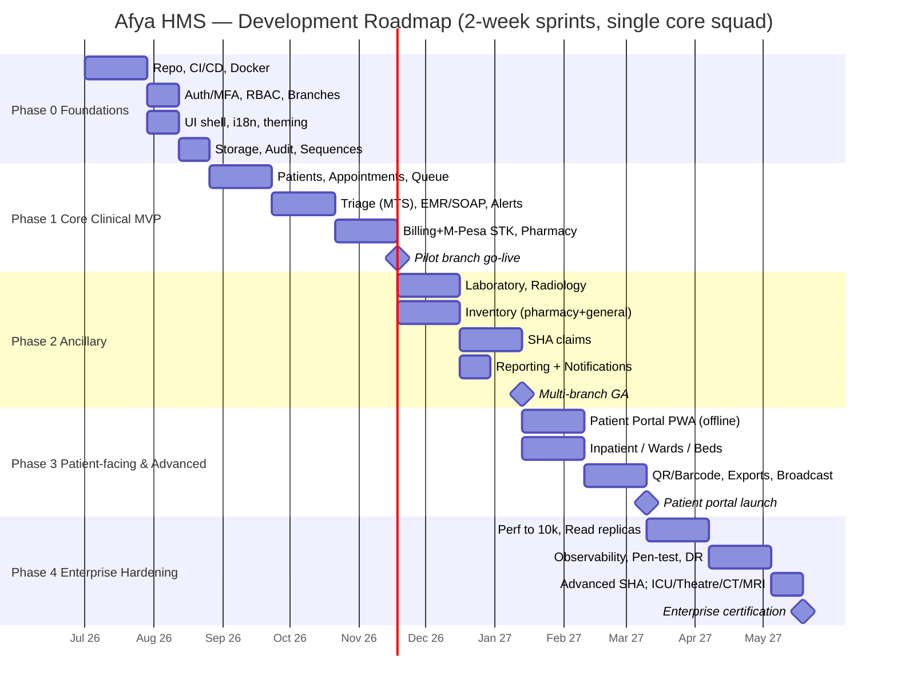

# 27 — Development Roadmap

> **Authority:** This roadmap derives from `00-foundation.md` and stays consistent with it. Where this document and the foundation disagree, the **foundation wins**. All module names, identifiers, roles, and architecture references map to the canonical decisions there.

**Product:** Afya HMS — production multi-branch Hospital Management System, Kenya
**Context:** 100–300 patients/day · 1,000 users now · architected for 10,000+
**Document version:** 1.0 · **Status:** Delivery plan baseline
**Owner:** Product Manager + Delivery Lead

---

## 1. Delivery Approach

### 1.1 Methodology — Agile / Scrum with a Kanban safety valve

- **Framework:** Scrum, **2-week sprints**. 26 sprints/year. Each sprint ships a potentially shippable increment behind feature flags.
- **Cadence per sprint:**
  - Day 1: Sprint Planning (capacity-based, story-point committed).
  - Daily: 15-min stand-up (async-friendly via written update + 1 live sync).
  - Mid-sprint: Backlog refinement / grooming (1.5h).
  - Last day: Sprint Review (demo to stakeholders) + Retrospective.
- **Kanban overlay** for Production Support, hotfixes, and SHA/Daraja API breakages — a separate swimlane with WIP limits so unplanned regulatory/integration work does not derail sprint commitments.
- **Definition of Ready (story can enter a sprint):** acceptance criteria written, designs/UX attached, dependencies resolved, test approach noted, RBAC permissions identified, i18n keys listed, branch-scope behavior specified.
- **Definition of Done (global — applies to every story, every phase):**
  1. Code merged to `main` via PR, **Conventional Commits**, ≥1 review approval.
  2. Backend layered architecture honored: Route → Controller → FormRequest → Service → Repository → Model; DTOs across boundaries; Resources shape JSON.
  3. RBAC permissions (`{module}.{action}`) defined and enforced; **BranchScope** applied; MFA respected for privileged roles.
  4. Tests written and green; coverage **≥80%** (Pest/PHPUnit backend, Vitest + RTL frontend, Playwright E2E for user journeys).
  5. i18n: no hardcoded strings; `en` + `sw` keys present.
  6. Audit: model changes logged (Spatie Activity Log); PHI/security events written to immutable `audit_logs`.
  7. CI green (lint, type-check, tests, build); Husky pre-commit passing.
  8. Docs updated (API contract, changelog); feature flag wired; observability (logs/metrics) added for new critical paths.
  9. Accessibility pass (keyboard nav, contrast) and dark/light theme verified.
  10. Security: no secrets in code, signed URLs for clinical files, rate limits on new public endpoints.

### 1.2 Engineering principles (non-negotiable, every phase)

- **Modular monolith** — one Laravel deployable; bounded modules per `00-foundation §1`. No microservices.
- **Contract-first** — OpenAPI spec for each endpoint before/with implementation; Zod schemas on the frontend mirror backend FormRequests.
- **Trunk-based-ish** — short-lived feature branches, feature flags for incomplete work, frequent integration.
- **Schema-ready, not feature-bloated** — tables/columns for future modules (ICU, Theatre, CT/MRI) may be migrated early but stay **dormant** until their activation phase.
- **Abstractions first** — `PaymentGateway`, `InsurerGateway`, `StorageManager`, `NotificationChannelManager` interfaces land before concrete providers, so volatile externals (SHA, Daraja) are swappable.

### 1.3 Recommended team composition

**Core build squad (Phases 0–2, ~7–9 people):**

| Role | Count | Responsibility |
|---|---|---|
| Delivery Lead / Scrum Master (also PM) | 1 | Backlog, ceremonies, stakeholder comms, risk register |
| Tech Lead / Architect | 1 | Architecture guardrails, code review, ADRs, CI/CD ownership |
| Backend Engineers (Laravel/PHP) | 2–3 | Modules, services, integrations (Daraja, SHA, AT) |
| Frontend Engineers (React/TS) | 2 | SPA/PWA, feature folders, design-system adherence |
| QA / SDET | 1 | Test strategy, Playwright E2E, regression, exploratory |
| DevOps / SRE (fractional → full from Phase 2) | 0.5–1 | Docker, CI/CD, observability, scaling, DR |
| UI/UX Designer (fractional) | 0.5 | Flows, design system, clinical usability, i18n review |

**Scale-up for Phases 3–4 (add):** +1 Backend (integrations/insurers), +1 Frontend (portal/PWA), full-time SRE, fractional Security Engineer (pen-test liaison), Clinical SME / Product Analyst (part-time, validates clinical workflows, triage, EMR, SHA coding).

**Standing advisory (part-time / on-call):** Clinical Champion (a doctor + a nurse + a pharmacist from the hospital), Data Protection / Compliance officer (Kenya DPA 2019), Finance/Billing SME.

---

## 2. Phased Plan

> Durations are **rough planning estimates** for the core squad above. Sprints are 2 weeks. Phases overlap modestly where dependencies allow (e.g., Phase 2 ancillary design can start late in Phase 1).

### Phase 0 — Foundations (Platform & Plumbing)

**Goal:** A secure, multi-branch, deployable skeleton that any feature team can build on. No clinical value yet, but every later phase is fast because this exists.

**Duration:** ~4 sprints (~8 weeks / 2 months).

**Epics / features (→ module map):**
- **Repo & tooling** — monorepo or paired repos (api + web), Pint/PSR-12, ESLint/Prettier strict, Husky, Conventional Commits, ADR log. (cross-cutting)
- **CI/CD** — GitHub Actions (or GitLab CI): lint → type-check → test → build → image push; environment promotion (dev → staging → prod) with manual gate. (cross-cutting)
- **Docker & Docker Compose** — PHP 8.3, MySQL 8, Redis, Node/Vite, Nginx; one-command local dev; parity with cloud. (cross-cutting)
- **Auth + MFA** — Sanctum SPA tokens, login history, device/IP tracking, password expiry, idle timeout, TOTP MFA for `hospital-admin`/`doctor`/`pharmacist`. (`Auth`)
- **RBAC** — Spatie Permission, 10 canonical roles, permission naming `{module}.{action}`, `<ProtectedRoute>` guards. (`Auth`, `Admin`)
- **Branches / Tenancy** — `branches` table, `branch_id` on operational tables, global `BranchScope`, `branch.view-all`, branch switcher + token claim. (`Tenancy`)
- **Base UI shell** — React 18 + TS strict + Vite SPA, app layout, nav, branch switcher, auth flows, TanStack Query + Zustand wiring, React Router code-splitting. (frontend cross-cutting)
- **i18n** — react-i18next, `en` + `sw`, per-feature namespaces, zero hardcoded strings policy + lint rule. (cross-cutting)
- **Theming** — Tailwind `class` dark/light, persisted; centralized SVG icon registry, `<Icon>` component, no emojis. (cross-cutting)
- **Storage abstraction** — `StorageManager` (`local`/`s3`/`r2`/`b2`), `DocumentService`, signed-URL serving. (`Documents`)
- **Audit baseline** — Spatie Activity Log + immutable `audit_logs` writer for PHI/security events. (`Audit`)
- **Sequence service** — `sequences` table + `SequenceService` with `FOR UPDATE` locking. (cross-cutting; unblocks all numbered entities)

**Dependencies:** None (this is the root). Sequence service + tenancy + auth must precede all Phase 1 work.

**Exit criteria / DoD:**
- New engineer can clone, `docker compose up`, log in with MFA, switch branch, see localized + themed shell — in < 30 min.
- CI blocks merges on lint/type/test failures; staging auto-deploys from `main`.
- A protected sample endpoint enforces RBAC + BranchScope and writes an audit entry; signed-URL file upload/download works through `StorageManager`.
- `SequenceService` proven concurrency-safe under load test (no duplicate `PAT-YYYY-NNNNNN`).

**KPIs:** Build green rate ≥ 95%; local-setup time < 30 min; 0 hardcoded strings (lint); auth/RBAC test coverage ≥ 90%.

---

### Phase 1 — Core Clinical MVP

**Goal:** A single branch can run an outpatient visit end-to-end: register → queue → triage → consult (EMR/SOAP) → prescribe/dispense → pay (cash + M-Pesa). This is the first production-usable release (pilot branch).

**Duration:** ~7 sprints (~14 weeks / ~3.5 months).

**Epics / features (→ module map):**
- **Patients** — registration (`PAT-YYYY-000001`), demographics, search, merge/dedupe, `public_id` UUID, DPA consent capture. (`Patients`)
- **Appointments** — booking, scheduling, FullCalendar UI, reschedule/cancel, per-branch provider slots. (`Appointments`)
- **Queue** — canonical pipeline `Reception → Triage → Doctor → Lab → Pharmacy → Billing`, daily-reset tickets (`TRI-014`), real-time via Redis + Broadcasting, priority + emergency bypass. (`Queue`)
- **Triage** — Manchester Triage System (Red/Orange/Yellow/Green/Blue), vitals capture, drives queue priority. (`Triage`)
- **EMR / SOAP** — encounter notes (Subjective/Objective/Assessment/Plan), ICD-10 coding, problem list, vitals history, ≥10-year retention rules (soft-delete, no hard-delete). (`EMR`)
- **Clinical Alerts (core)** — drug–allergy and basic drug–drug interaction checks, duplicate-therapy, critical-vitals flags surfaced at prescribing/triage. (`ClinicalAlerts`)
- **Basic Billing + M-Pesa STK** — invoices (`INV-{BRANCH}-YYYY-...`), receipts, `PaymentGateway` interface, `MpesaDarajaGateway` (STK Push) + `CashGateway`, idempotent signed webhooks. (`Billing`)
- **Pharmacy dispense** — prescriptions (`RX-{BRANCH}-YYYY-...`, QR), dispense workflow, stock decrement against a minimal drug catalog, dispense-time alert recheck. (`Pharmacy`)

**Dependencies:** All of Phase 0. Billing depends on Patients + a Daraja sandbox; Pharmacy dispense depends on EMR prescriptions + minimal inventory stock model.

**Exit criteria / DoD:**
- A real patient journey completes in the **pilot branch**: registered → triaged (MTS) → SOAP note saved with ICD-10 → prescription created → dispensed with stock decrement → invoice paid by **M-Pesa STK (sandbox→live)** and by cash, with receipt.
- Queue board updates in real time across stations; emergency bypass demonstrably reorders.
- Clinical alert fires on a known drug–allergy pair and blocks/ warns per policy.
- M-Pesa callbacks idempotent (replayed callback does not double-credit).
- Smoke + E2E suite covers the full happy path; pilot UAT sign-off by Clinical Champion.

**KPIs:** End-to-end visit completion in app for ≥ 90% of pilot visits; M-Pesa STK success rate ≥ 95% (excl. user cancels); median queue-status latency < 2s; 0 P1 clinical-safety defects open at release.

---

### Phase 2 — Ancillary Services & Operations

**Goal:** Complete the diagnostic and operational loop — lab, radiology, inventory, insurer claims (SHA), reporting, and outbound notifications — so a branch runs without paper for the common cases.

**Duration:** ~7 sprints (~14 weeks / ~3.5 months).

**Epics / features (→ module map):**
- **Laboratory** — test catalog, orders from EMR, sample IDs (`LAB-{BRANCH}-YYMMDD-0001`, barcoded), result entry, reference ranges, critical-result alerts back to ordering doctor. (`Laboratory`)
- **Radiology** — study orders (`RAD-{BRANCH}-YYMMDD-0001`), worklist, report capture, image/document attachment via `StorageManager` signed URLs. (`Radiology`)
- **Inventory (pharmacy + general)** — drug & consumable catalog, stock, batches/expiry, reorder levels, GRN + Purchase Orders (`PO-{BRANCH}-YYYY-...`), stock-take. (`Inventory`)
- **SHA claims** — `InsurerGateway` + `ShaGateway`: eligibility/pre-auth, claim build (`CLM-{BRANCH}-YYYY-...`), submission, status tracking, reconciliation. Built defensively against API volatility (versioned adapter, contract tests, manual-fallback export). (`Insurance`)
- **Reporting dashboards** — operational + clinical + financial dashboards (Recharts), branch-scoped, role-aware. (`Reporting`)
- **Notifications (SMS/email)** — `NotificationChannelManager`: AfricasTalking SMS + Mailgun/Resend email; appointment reminders, result-ready, payment confirmations. (`Communication`)

**Dependencies:** Phase 1 (EMR orders feed lab/radiology; billing feeds SHA claims; pharmacy dispense feeds inventory). Notification abstraction relies on Phase 0 config plumbing.

**Exit criteria / DoD:**
- Lab/radiology orders flow from EMR, results return to the chart, critical results alert the doctor; barcoded samples scan correctly.
- Inventory reflects dispensing and receiving (GRN/PO); expiry and reorder alerts fire.
- An SHA claim is built, submitted, and tracked end-to-end in **SHA sandbox**, with a manual export fallback proven.
- Dashboards render branch-scoped KPIs; SMS reminder + email result-ready delivered via providers (with retry/queue).
- Multi-branch rollout: at least 2 branches live with correct row-level isolation.

**KPIs:** Lab result turnaround tracked in-app; SHA claim first-pass acceptance rate (target ≥ 80% in sandbox parity); SMS/email delivery rate ≥ 97%; dashboard load < 2s; inventory stock-accuracy ≥ 98% at stock-take.

---

### Phase 3 — Patient-Facing & Advanced Clinical

**Goal:** Extend value to patients (portal/PWA, offline) and to inpatient operations (wards/beds), plus richer reporting and hospital-wide communication.

**Duration:** ~7 sprints (~14 weeks / ~3.5 months).

**Epics / features (→ module map):**
- **Patient Portal (PWA, offline)** — patient login (`patient` role), appointments, results, prescriptions, invoices/payments; Vite PWA service worker, offline shell + cached reads, background sync for queued writes. (`PatientPortal`)
- **QR / barcode** — generate + scan: prescription QR, lab/radiology barcodes, patient wristband/ID, queue tickets. (cross-cutting; `Pharmacy`, `Laboratory`, `Inpatient`)
- **Inpatient / wards / beds** — admissions (`ADM-{BRANCH}-YYYY-...`), ward/bed management, bed occupancy board, ward rounds, transfers, discharge, inpatient billing accrual. (`Inpatient`)
- **Advanced reporting / exports** — scheduled reports, CSV/PDF/Excel exports, MOH-style returns, custom date/branch filters, executive cross-branch view (`branch.view-all`). (`Reporting`)
- **Broadcast announcements** — hospital/branch-wide announcements to staff and (opt-in) patients; banners + push/SMS. (`Communication`)

**Dependencies:** Phases 1–2 (portal surfaces EMR/lab/billing data; inpatient billing extends Billing; QR builds on existing identifiers). PWA offline relies on Phase 0 shell.

**Exit criteria / DoD:**
- Patient completes a self-service journey on the PWA, including **offline** view of cached results and a write (e.g., appointment request) that syncs when back online.
- Bed board shows real-time occupancy; an admission → ward stay → discharge cycle bills correctly.
- QR/barcode scan resolves to the correct record at pharmacy, lab, and bedside.
- Scheduled exports generate and deliver; executive can view a correct cross-branch report.
- Accessibility + i18n verified on all patient-facing screens.

**KPIs:** Patient portal adoption ≥ 30% of eligible patients within 60 days; offline-sync success ≥ 99%; bed-board accuracy ≥ 99%; report export success ≥ 99%.

---

### Phase 4 — Enterprise Hardening & Scale

**Goal:** Take the proven system to 10,000+ users and full multi-branch scale with the reliability, security, and observability a production HMS demands — and light up the schema-ready high-acuity modules.

**Duration:** ~6 sprints (~12 weeks / ~3 months), then continuous.

**Epics / features (→ module map):**
- **Performance to 10k** — query/index tuning, N+1 elimination, caching strategy (Redis), pagination/cursoring, load + soak testing to 10k concurrent users, queue worker autoscaling. (cross-cutting)
- **Read replicas** — MySQL read replica routing for reporting/read-heavy paths; write/read split in repositories. (cross-cutting; `Reporting`)
- **Observability** — centralized logging, metrics (RED/USE), tracing, dashboards, alerting/on-call; SLOs + error budgets. (cross-cutting)
- **Pen-test & security hardening** — third-party penetration test, remediation, secrets rotation, dependency scanning, WAF, threat-model review vs DPA 2019/HIPAA principles. (`Audit`, `Auth`, cross-cutting)
- **DR drills** — backup/restore validation, RPO/RTO targets, failover runbooks, periodic game-days. (cross-cutting)
- **Advanced SHA / insurers** — additional insurer adapters via `InsurerGateway`, batch claims, automated reconciliation, denial management. (`Insurance`)
- **Schema-ready activation** — turn on dormant **ICU**, **Theatre**, **CT/MRI** modules (advanced radiology modalities) on top of inpatient + radiology foundations. (`Inpatient`, `Radiology`)

**Dependencies:** All prior phases live and stable. Activation modules depend on Inpatient (Phase 3) and Radiology (Phase 2).

**Exit criteria / DoD:**
- Load test sustains 10k concurrent users within SLOs; read replicas serve reporting without impacting OLTP.
- Observability stack alerts on a simulated incident; on-call runbook exercised.
- Pen-test critical/high findings remediated and re-tested to zero open critical.
- DR drill restores within RTO/RPO; documented and signed off.
- ICU/Theatre/CT/MRI modules pass clinical UAT and go live in at least one branch.

**KPIs:** p95 API latency < 300ms at target load; uptime ≥ 99.9%; 0 open critical security findings; RTO ≤ 4h / RPO ≤ 15min met in drill; SHA reconciliation automation ≥ 90% of claims.

---

## 3. Milestone Timeline (sprints / months)

> Indicative single-squad sequence. Months are cumulative; sprints are 2 weeks. Parallelization with a second squad can compress total elapsed time by ~25–30%.

| Phase | Milestone | Sprints | Approx. months (cumulative) | Headline exit |
|---|---|---|---|---|
| 0 | Foundations live (CI/CD, auth/MFA, RBAC, branches, shell, storage, audit) | 1–4 | M0–M2 | Deployable secure skeleton |
| 1 | Core Clinical MVP — pilot branch go-live | 5–11 | M2–M5.5 | End-to-end outpatient visit + M-Pesa |
| 2 | Ancillary & ops — multi-branch | 12–18 | M5.5–M9 | Lab/Radiology/Inventory/SHA/Reporting/Notifications |
| 3 | Patient-facing & advanced clinical | 19–25 | M9–M12.5 | Portal PWA, inpatient/wards, QR, exports |
| 4 | Enterprise hardening & scale | 26–31 | M12.5–M15.5 | 10k scale, observability, pen-test, DR, ICU/Theatre/CT/MRI |

**Key go-live gates:** Pilot go-live end of Phase 1 (M~5.5); general multi-branch availability end of Phase 2 (M~9); patient portal launch end of Phase 3 (M~12.5); enterprise certification end of Phase 4 (M~15.5).

---

## 4. Risk Register

Likelihood (L) and Impact (I): Low / Med / High.

| # | Risk | I | L | Mitigation |
|---|---|---|---|---|
| R1 | **SHA API volatility** — Kenya SHA endpoints, schemas, and rules change with little notice; sandbox ≠ prod | High | High | Versioned `ShaGateway` adapter behind `InsurerGateway`; contract tests + schema snapshots; feature-flag claim submission; **manual export fallback** so billing never blocks; monitor SHA announcements; keep a fast-patch Kanban lane. |
| R2 | **M-Pesa Daraja instability** — STK timeouts, callback delays, sandbox/prod drift, credential rotation | High | Med | Idempotent webhooks keyed on `CheckoutRequestID`/`mpesa_receipt`; reconciliation job vs Daraja statements; retries + circuit breaker; cash fallback always available; alerting on callback-latency SLO breach. |
| R3 | **Data migration** from legacy/paper — dirty data, duplicates, mapping gaps, retention rules | High | Med | Dedicated migration sub-project; staging dry-runs; dedupe/merge tooling; validation reports + reconciliation counts; ≥10-year retention preserved; cutover rollback plan; freeze window + parallel-run period. |
| R4 | **Adoption / training** — clinical staff resist new workflow, slowing care | High | High | Clinical Champions embedded from Phase 1; role-based training + sandbox; phased pilot before rollout; in-app guidance + `sw`/`en` UI; super-user network per branch; collect and act on UAT feedback; measure adoption KPIs. |
| R5 | **Regulatory / compliance** — Kenya DPA 2019, MOH requirements, PHI handling | High | Med | Compliance officer in advisory; encrypted casts + at-rest encryption; immutable audit of PHI access; consent capture; DPIA; signed URLs only; retention/soft-delete enforced; legal review before each public-facing launch. |
| R6 | **Scaling to 10k** — performance cliffs, N+1, DB contention | High | Med | Performance budgets from Phase 0; load tests each phase (not just Phase 4); read replicas; Redis caching; indexing review in DoD; queue autoscaling; observability to find hotspots early. |
| R7 | **Real-time queue/broadcast reliability** under load | Med | Med | Redis-backed broadcasting with reconnection/backoff; degrade gracefully to polling; soak-test the queue board; monitor WebSocket connection health. |
| R8 | **Clinical-safety defects** — wrong dose, missed allergy alert | High | Low | ClinicalAlerts core from Phase 1; mandatory review for clinical logic; clinician UAT sign-off gate; no auto-close of safety defects; post-incident reviews. |
| R9 | **Key-person / capacity risk** — small squad, integration knowledge silos | Med | Med | Pairing + ADRs + docs; cross-train on Daraja/SHA; bus-factor ≥ 2 on critical modules; fractional roles converted to full-time as load grows. |
| R10 | **Scope creep** — premature build of ICU/Theatre/CT/MRI before foundations stable | Med | Med | Schema-ready but feature-flagged dormant; activation gated to Phase 4; PM enforces DoR; backlog triage discipline. |
| R11 | **Third-party provider lock-in / outage** (storage, SMS, email) | Med | Low | All behind `StorageManager` / `NotificationChannelManager`; multi-provider config; health checks + failover provider where viable. |
| R12 | **Connectivity** in Kenyan branches — intermittent internet | Med | Med | PWA offline shell + background sync (Phase 3); resilient retries; local caching; graceful offline UX with clear sync status. |

---

## 5. Resourcing & Roles (by phase)

| Role | P0 | P1 | P2 | P3 | P4 |
|---|---|---|---|---|---|
| Delivery Lead / PM / Scrum Master | 1 | 1 | 1 | 1 | 1 |
| Tech Lead / Architect | 1 | 1 | 1 | 1 | 1 |
| Backend Engineers (Laravel) | 2 | 3 | 3 | 3 | 3 |
| Frontend Engineers (React/TS) | 2 | 2 | 2 | 3 | 2 |
| QA / SDET | 1 | 1 | 1 | 2 | 2 |
| DevOps / SRE | 0.5 | 0.5 | 1 | 1 | 1.5 |
| UI/UX Designer | 0.5 | 0.5 | 0.5 | 1 | 0.5 |
| Security Engineer (fractional) | – | – | 0.25 | 0.25 | 1 |
| Clinical SME / Analyst (part-time) | 0.25 | 0.5 | 0.5 | 0.5 | 0.5 |
| Compliance / DPA officer (advisory) | 0.1 | 0.25 | 0.25 | 0.25 | 0.25 |

**Responsibilities recap:**
- **Delivery Lead/PM** — backlog ownership, ceremonies, stakeholder & hospital-leadership comms, risk register, release decisions.
- **Tech Lead** — architecture guardrails, ADRs, code-review standards, CI/CD, integration designs (Daraja/SHA).
- **Backend** — modules, services/repositories, gateways, queues, migrations, contract tests.
- **Frontend** — SPA/PWA, feature folders, design-system + i18n + theming adherence, offline/PWA.
- **QA/SDET** — test strategy, E2E (Playwright), regression, performance test support, exploratory clinical testing.
- **SRE** — Docker, CI/CD, observability, scaling, DR, on-call.
- **UX** — clinical-workflow usability, accessibility, bilingual review.
- **Security/Compliance/Clinical SME** — pen-test liaison, DPIA, clinical validation, SHA coding correctness.

---

## 6. KPIs Summary (per phase)

| Phase | Delivery KPIs | Product / Outcome KPIs |
|---|---|---|
| 0 | CI green rate ≥ 95%; setup < 30 min; auth/RBAC coverage ≥ 90% | Secure skeleton accepted; 0 hardcoded strings |
| 1 | Velocity stable; ≥ 80% coverage; 0 open P1 safety defects | In-app visit completion ≥ 90%; M-Pesa STK success ≥ 95%; queue latency < 2s |
| 2 | Defect escape rate ↓; SHA contract tests green | SHA first-pass ≥ 80% (sandbox); SMS/email delivery ≥ 97%; inventory accuracy ≥ 98%; 2+ branches live |
| 3 | E2E coverage on patient journeys; release predictability | Portal adoption ≥ 30% in 60 days; offline-sync ≥ 99%; bed-board accuracy ≥ 99% |
| 4 | Change-failure rate < 15%; MTTR < 1h | p95 < 300ms @ 10k; uptime ≥ 99.9%; 0 critical security findings; RTO ≤ 4h / RPO ≤ 15min |

**Cross-cutting DORA-style metrics tracked from Phase 0:** deployment frequency, lead time for change, change-failure rate, MTTR.

---

## 7. Post-Launch Support & Maintenance Plan

**Support tiers (from Phase 1 pilot onward):**
- **L1** — branch super-users handle how-to and basic triage of issues; in-app help + bilingual guides.
- **L2** — application support team: configuration, data fixes, known-issue runbooks.
- **L3** — engineering on-call for defects, integration breakages (SHA/Daraja), and incidents.

**SLAs (suggested):**
- P1 (clinical safety / system down): respond ≤ 30 min, mitigate ≤ 4h.
- P2 (major feature degraded): respond ≤ 2h, fix ≤ 2 business days.
- P3 (minor): next sprint.

**Maintenance cadence:**
- **Hotfix lane** (Kanban) for P1/P2 and regulatory breakages — does not wait for sprint boundary.
- **Patch releases** as needed; **scheduled releases** every sprint behind flags.
- **Dependency & security upkeep** — automated scanning, monthly patch window, quarterly major-version reviews (Laravel/React).
- **Data & compliance** — daily backups (tested), retention enforcement, periodic access-audit reviews, annual pen-test, DR game-day each half-year.
- **Observability-driven** — SLOs with error budgets; alert → on-call → blameless post-incident review with action items fed to backlog.
- **Continuous improvement** — quarterly UX/clinical feedback cycles; adoption metrics reviewed monthly with hospital leadership.

**Knowledge & docs:** living runbooks, ADRs, API contracts, on-call playbooks for Daraja/SHA, change log per release.

---

## 8. Future Evolution Backlog (post-Phase 4)

Prioritized themes; each enters the normal Scrum intake (DoR/DoD) when scheduled. All build on the modular monolith and existing abstractions.

1. **Telemedicine** — video consults, e-prescribing, remote triage; integrates with Appointments, EMR, Billing, PatientPortal.
2. **HL7 / FHIR interoperability** — FHIR resources (Patient, Encounter, Observation, MedicationRequest, DiagnosticReport) for MOH/national exchange and lab/device integration; HL7 v2 for legacy analyzers.
3. **Native mobile apps** — patient app (iOS/Android) and clinician companion; reuse REST API; push notifications.
4. **AI triage & clinical decision support** — symptom-based triage assist, alert prioritization, coding suggestions (ICD-10/SHA), with clinician-in-the-loop and auditability. (Provider-agnostic; if/when LLM-backed, follow secure-integration patterns.)
5. **Advanced analytics & BI** — data warehouse / star schema off read replicas, self-service dashboards, predictive operations (no-show prediction, demand forecasting, inventory optimization).
6. **Device & IoT integration** — vitals monitors, lab analyzers (via FHIR/HL7), pharmacy automation.
7. **Additional insurers & national schemes** — more `InsurerGateway` adapters; automated denial management and reconciliation at scale.
8. **Patient engagement** — loyalty/wellness, recall/screening programs, satisfaction surveys, multilingual expansion beyond `en`/`sw`.

---

## 9. Mermaid Gantt Timeline

---

*End of 27 — Development Roadmap. Consistent with `00-foundation.md` v1.0.*
